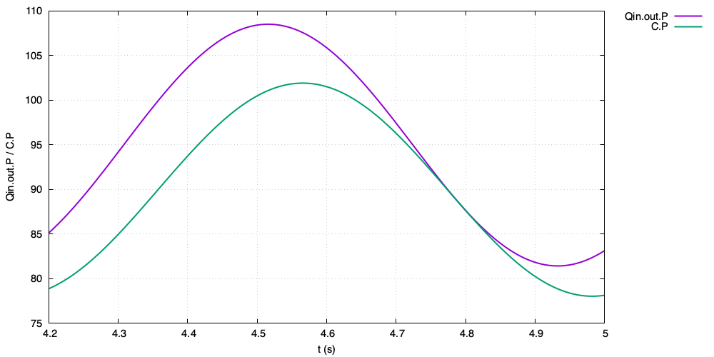
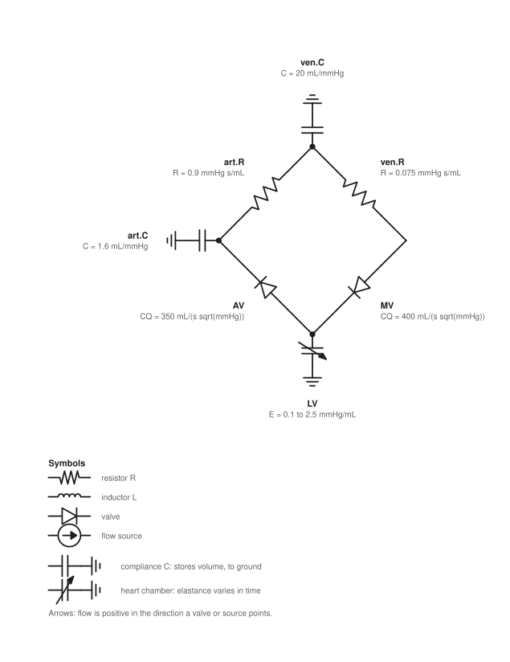
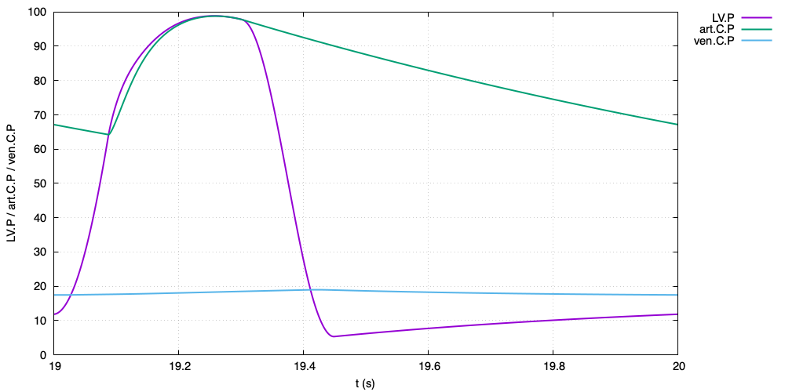
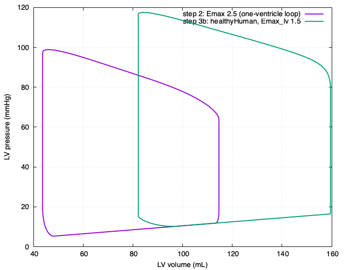
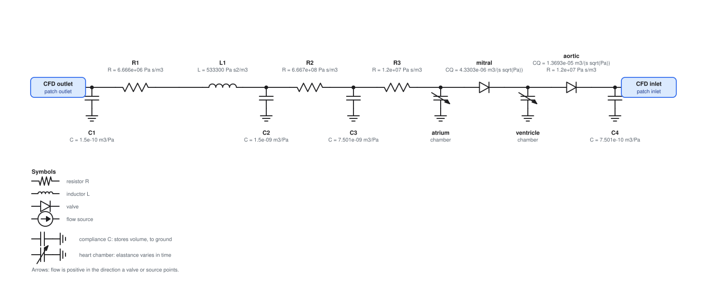

# What you will do

You will write a circulation model as a short text file, run it, look at the results, and
finally put it behind a 3D CFD domain. Nothing here needs C++: a circuit is a dictionary of
named parts and a list of how they are connected.

| step | you build | you learn |
|---|---|---|
| 1 | a three-element Windkessel | the file layout, components, connections, running, plotting |
| 2 | a closed loop with one beating ventricle | chambers, valves, blood volume, per-cycle metrics |
| 3 | your own reusable module; a whole preset heart with one number changed | modules, presets, parameters |
| 4 | the circuit behind a CFD pipe | coupling ports, schemes, running CFD |

The finished cases are in `tutorials/tutorial/` so you can compare with your own. The
whole tutorial takes about an hour, and the longest run is about a minute.

## Before you start

Build the code once (from the `src/circulationModels` directory) and load OpenFOAM v2412 in every
terminal you use:

```bash
source /path/to/OpenFOAM-v2412/etc/bashrc       # as you always do
(cd src/circulationModels && ./Allwmake)                    # the libraries
(cd applications/solvers/circulationFoam && ./Allwmake)   # circulationFoam
export PATH=$PATH:$PWD/src/circulationModels/tools                    # circulationPlot, used below
```

`circulationFoam` solves a circuit that has no mesh. `gnuplot` is only used by
`circulationPlot`; the results are plain text and any plotting tool will do.

# The idea in one minute

A circuit is made of **elements**. A two-terminal element has an `in` and an `out`
terminal, and flow is positive from `in` to `out`. Terminals that you connect share one
pressure, which is called a **node**.

* A **resistor** (`R`), a **valve**, an **inductor** (`L`) or a **flow source** connects two nodes.
* A **compliance** or a heart **chamber** is a node that *stores volume*. Its volume is
  what the solver integrates in time (an ODE state), and its pressure follows from the volume.
* A **ground** is a node held at a fixed pressure.

You never write the equations. From the connections the program finds the nodes, makes a
state for every compliance, chamber and inductor, balances the flows at nodes that store
nothing, and integrates the result with an OpenFOAM ODE solver.

A *connection* is a list of names. `(a b c)` joins `a.out` to `b.in` and `b.out` to `c.in`.
A name in the list that is also the first name closes a ring: `(a b c a)`.

# Step 1: a three-element Windkessel

A Windkessel is the simplest model of an artery: a flow comes in through a characteristic
resistance `Rch`, charges a compliance `C`, and drains through a peripheral resistance `R`.


## The case folder

A case is a folder with two files. Make one and copy a `controlDict`:

```bash
mkdir -p myWindkessel/system myWindkessel/constant
cp tutorials/tutorial/01_windkessel/system/controlDict myWindkessel/system/
```

`system/controlDict` says how long to run and how often to write a row of results:

```c++
application     circulationFoam;
startFrom       startTime;
startTime       0;
stopAt          endTime;
endTime         5;              // seconds
deltaT          0.001;          // how often a row of results is written
writeControl    runTime;
writeInterval   5;              // restart state at the end of the run
```

(`deltaT` is only the output interval. The ODE solver takes whatever internal steps its
tolerances need inside it.)

## The circuit

Put this in `myWindkessel/constant/circulationProperties`:

```c++
units       mmHg_mL;            // write pressures in mmHg, volumes in mL, time in s
Tcycle      0.8333;             // the heartbeat in seconds

components
{
    ground  { type ground; }                                  // a node held at 0 mmHg

    Qin                                                       // the flow source
    {
        type     flowSource;
        waveform { type sine; mean 100; amplitude 100; period 0.8333; phase 0; }   // mL/s
    }

    Rch     { type resistor;   R 0.05; }                      // mmHg s/mL
    C       { type compliance; C 1.1;  initialPressure 73; }  // mL/mmHg
    R       { type resistor;   R 0.9; }
}

connections
(
    (ground Qin Rch C R ground)
);

solver { type RKDP45; absTol 1e-12; relTol 1e-10; }

probes ( Qin.out );             // also report the pressure at the node between Qin and Rch
```

Read the `connections` line aloud: *ground, then the source, then Rch, then the compliance,
then R, then back to ground.* The flow leaves ground through `Qin`, passes `Rch`, charges
`C`, and returns through `R`.

* `units mmHg_mL` means every number you write is in mmHg, mL and seconds (a resistance in
  mmHg·s/mL, a compliance in mL/mmHg). Inside, everything is SI. The results come back in
  the same units you wrote. Leave `units` out (or write `units SI;`) to use Pa and m³.
* `initialPressure 73` is the pressure of the compliance at t = 0.
* `probes` adds the pressure of a node that stores nothing, which is not otherwise written.

## Check it before you run it

```bash
cd myWindkessel
circulationFoam -check
```

```
5 elements:
  ground      ground        fixed P,  node n0
  Qin         flowSource    flow source,  node n0 -> n1
  Rch         resistor      branch,  node n1 -> n2
  C           compliance    storage,  node n2
  R           resistor      branch,  node n2 -> n0
3 nodes (1 solved algebraically):
  n0  fixed pressure (ground):  'ground', 'Qin', 'R'
  n1  algebraic:  'Qin', 'Rch'
  n2  stores volume (C):  'Rch', 'C', 'R'
1 ODE states:
  y[0]  C  volume  80.3 mL  (initial)
Parameter check (human-scale ranges, SI):
  5 values checked, none outside the usual ranges
Result: 1 states, 3 nodes, 0 warning(s)
```

`-check` is the most useful command in this tutorial. It shows you what the program
understood: the nodes, which one stores volume (that is the state), which are solved
algebraically, and it warns about values that look like a unit mix-up. `circulationFoam -diagram`
draws the circuit as an electrical circuit diagram (the picture above; see "Drawing the circuit" below).

## Draw it

```bash
export PATH=$PATH:/path/to/solids4foam/src/circulationModels/tools     # once per terminal: puts circulationSchematic on the PATH
circulationFoam -diagram
open circuit.svg
```

`-diagram` draws the circuit as an electrical circuit diagram, using the electrical analogy of the
model: a resistor is a zigzag, an inductor a coil, a valve a diode (flow passes one way only), a flow
source a circle with an arrow, a **compliance a capacitor to ground**, a **heart chamber a capacitor with an
arrow through it** (its elastance varies in time), a fixed pressure a ground symbol, and, in step 4, a
CFD port a blue box. Every part carries its name and value in your units, and a legend is drawn below.
A closed loop is drawn as a ring, a chain left to right. The file is `circuit.svg` (open it in a
browser, or in Preview with `open`); `circuit.json` next to it is the netlist it was drawn from.

## Run it

```bash
circulationFoam
```

The results are in `postProcessing/circulation/0/circulation.dat`, plain text with a
column for time and one for each quantity of each element. The second line of the file
names the columns, the third gives their units:

```
# t Qin.Q Rch.Q C.P C.V R.Q Qin.out.P
# s mL/s mL/s mmHg mL mL/s mmHg
0 100 100 73 80.3 81.1111111111 78
...
5 100.150802422 100.150802422 78.1252245956 85.9377470552 86.8058051063 83.1327647168
```

Names follow `<element>.P` (pressure), `.V` (volume) and `.Q` (flow through the element,
from `in` to `out`). Plot the pressure inside the compliance and at the inlet over the last
beat:

```bash
circulationPlot -t 4.2:5 postProcessing/circulation/0/circulation.dat Qin.out.P C.P
```



`circulationPlot -o fig.png ...` writes a PNG instead of opening a window, and
`circulationPlot results.dat` on its own lists the column names. The inlet pressure sits
above the compliance pressure by exactly `Rch × Q`, because the node between the source
and `Rch` stores nothing.

**Try:** change `R` to `1.5` and rerun. The mean pressure rises (from about 90 to 146 mmHg
over these five seconds), because the same mean flow must pass a larger resistance.

# Step 2: a closed loop with a beating ventricle

Now the flow is not imposed; a heart makes it. The loop is a ventricle, an aortic valve, an
artery, a vein and a mitral valve, closed on itself:



Copy the folder set-up and write the circuit (the finished case is
`tutorials/tutorial/02_oneVentricleLoop`):

```bash
mkdir -p myLoop/system myLoop/constant
cp tutorials/tutorial/02_oneVentricleLoop/system/controlDict myLoop/system/   # endTime 20: 20 heartbeats
```

```c++
units       mmHg_mL;
Tcycle      1.0;                // 60 beats/min

components
{
    LV
    {
        type elastanceChamber;          // pressure = (V - V0) E(t) + P0, with E(t) rising and falling each beat
        V0 5;  P0 1;                    // unstressed volume (mL), offset pressure (mmHg)
        Emin 0.1;  Emax 2.5;            // relaxed and fully contracted stiffness (mmHg/mL)
        Tes 0.3;  Ted 0.45;             // contraction peak and end (s)
        initialVolume 130;              // mL at t = 0
    }

    AV      { type orificeValve; CQ 350; }     // Q = CQ sqrt(dP) forward, closed backwards
    MV      { type orificeValve; CQ 400; }

    art     { type CR; C 1.6; R 0.9;   initialPressure 100; }   // artery: compliance, then peripheral resistance
    ven     { type CR; C 20;  R 0.075; initialPressure 14;  }   // vein: compliance, then return resistance
}

connections ( (LV AV art ven MV LV) );        // a closed ring

solver { type RKDP45; absTol 1e-12; relTol 1e-9; }

metrics
{
    LV    { type chamber;  volume LV.V;     pressure LV.P; }
    aorta { type pressure; column art.C.P; }
}
```

New things here:

* **`elastanceChamber`** is a heart chamber whose stiffness rises and falls once a beat.
  `Tes` is when contraction peaks and `Ted` when it ends (seconds into the beat).
* **`orificeValve`** lets flow through in one direction only, `Q = CQ·√ΔP`.
* **`CR`** is a ready-made *compliance followed by a resistor*. It is not a new
  physical element, just two connected for you: its parts appear in the results as
  `art.C.P`, `art.C.V` and `art.R.Q`. (`CRL` adds an inductor for blood inertia.)
* **A ring.** Blood is conserved. There is no flow source: the loop settles to the beat that
  its total volume allows, here 130 + 160 + 280 = 570 mL.
* **`metrics`** asks for numbers per heartbeat, computed from output columns.

```bash
cd myLoop
circulationFoam -check        # 3 states, no warnings
circulationFoam               # a fraction of a second
```

## What came out

```bash
cat postProcessing/circulation/0/metrics.dat | tail -2
```

Each row is a completed heartbeat. After about ten beats every row is the same (the stroke
volume is 70.893 mL at beat 8 and 70.897 mL at beat 19): the loop has reached its limit cycle. In the last beat you should read

| ventricle | | artery | |
|---|---|---|---|
| end-diastolic volume | 114.6 mL | mean pressure | 81.9 mmHg |
| end-systolic volume | 43.7 mL | systolic | 98.8 mmHg |
| stroke volume | 70.9 mL | diastolic | 64.2 mmHg |
| ejection fraction | 0.619 | pulse pressure | 34.6 mmHg |
| cardiac output | 4254 mL/min | | |

```bash
circulationPlot -t 19:20 postProcessing/circulation/0/circulation.dat LV.P art.C.P ven.C.P
```



The ventricular pressure rises until it passes the aortic pressure (the aortic valve
opens, blood is ejected), peaks, and falls; the valve closes when the ventricular pressure
drops below the aorta's. The aorta then drains slowly through the peripheral resistance
(the straight decay), and the ventricle refills from the vein.

The pressure-volume loop of the last beat is written for you as `LV.pvLoop.dat` (volume,
pressure):

```bash
gnuplot -persist -e "set xlabel 'V (mL)'; set ylabel 'P (mmHg)'; plot 'postProcessing/circulation/0/LV.pvLoop.dat' w l"
```

## Two checks worth making on any circuit of your own

1. **Blood is conserved.** For a closed loop, the sum of the volumes (`LV.V + art.C.V + ven.C.V`)
   must not change. Here it stays 570.000000 mL, to 2·10⁻⁹ mL, for the whole run.
2. **It reaches a periodic beat.** If the metrics keep drifting from beat to beat, the
   loop has not settled: run longer, or check the total volume.

**Try:** change the artery's `initialPressure` or the vein's: the total volume sets the
filling pressure, hence the stroke volume (the Frank–Starling effect). In this model, 378 mL
total (artery at 80 mmHg, vein at 6 mmHg) gives a stroke volume of 46 mL and a mean arterial
pressure of 53 mmHg; the 570 mL above gives 71 mL and 82 mmHg.

# Step 3: your own building blocks

## 3a. A module

The artery and the vein belong together: they are "the body". A *module* is a
reusable sub-circuit that you define once with parameters. Add this to the circuit of step 2,
and replace `art` and `ven` by one `body` line (finished case: `tutorials/tutorial/03_modules`):

```c++
modules
{
    systemicBed
    {
        required    ( Cart Rper Cven Rven );              // must be given when the module is used
        defaults    { artPressure 100; venPressure 14; }  // optional, with these values

        components                                        // @name is replaced by the parameter's value
        {
            art { type CR; C @Cart; R @Rper; initialPressure @artPressure; }
            ven { type CR; C @Cven; R @Rven; initialPressure @venPressure; }
        }
        connections ( (art ven) );
        terminals   { in art.in; out ven.out; }           // how the rest of the circuit attaches
    }
}

components
{
    LV   { ... as before ... }
    AV   { type orificeValve; CQ 350; }
    MV   { type orificeValve; CQ 400; }
    body { type systemicBed; Cart 1.6; Rper 0.9; Cven 20; Rven 0.075; }
}

connections ( (LV AV body MV LV) );
```

A module has `required` parameters, optional `defaults`, its own `components` and
`connections`, and `terminals` that say which inner terminal is its `in` and its `out`. In
the components, `@name` stands for the parameter `name`. Inside the module, names are local
(`art`, `ven`); from outside they are `body.art`, `body.ven`, and the results read
`body.art.C.P`. Modules can use other modules.

The result is **identical** to step 2 (to the last digit): a module is just a convenient
way to write the same circuit. Now the whole body is four numbers. **Try** `Rper 1.4`
(a hypertensive body): the arterial pressure rises and the stroke volume changes.

## 3b. A preset

Some circuits ship with the program. `healthyHuman` is the closed four-chamber loop of
the thesis (both ventricles, both atria, four valves, systemic and pulmonary vessels), and
every parameter in it has a name and a default. The whole circuit is one line, and a
parameter is changed by naming it (`tutorials/tutorial/03b_presetOverride`):

```c++
units       mmHg_mL;                        // the preset is written in mmHg and mL
Tcycle      1.0;

components
{
    heart { type healthyHuman; Emax_lv 1.5; }       // the left ventricle weakened from 2.5 to 1.5 mmHg/mL
}

metrics
{
    LV  { type chamber;  volume heart.LV.V;     pressure heart.LV.P; }
    SAT { type pressure; column heart.SAT.C.P; }
}
```

The ventricle dilates (end-diastolic volume 160 mL instead of 142) and the ejection
fraction falls to 0.49 (from 0.61), while the stroke volume falls only from 86 to 77 mL:



The presets are `windkessel2`, `windkessel3`, `windkessel4` (parameters `R C`, `Rch`, `L`),
`healthyHuman` and `pipeLoopHeart`. `circulationFoam -check` on a case lists every
element they expand to. To find a parameter name, read the preset's definition in
`src/circulationModels/context/circulationPresets.C`; it is written in exactly the
syntax you used for your own module above.

# Step 4: the circuit behind a CFD domain

A CFD domain is a thing with *terminals* too. A patch of the mesh is a **coupling port**:
the CFD tells the circuit the flow through the patch, and the circuit tells the CFD what pressure
to impose there. You connect a port exactly as you connect anything else.



The case is a 4 cm × 30 cm pipe. Its outlet drains into the arteries, the heart pumps,
and the blood returns to the pipe's inlet: a closed loop with the pipe in it.

## The circuit

`tutorials/tutorial/04_cfdPipe/constant/circulationProperties`:

```c++
units       SI;
Tcycle      0.8;

components
{
    outlet  { type externalPort; direction outlet; patch outlet; }   // flow leaves the pipe here
    inlet   { type externalPort; direction inlet;  patch inlet;  }   // flow enters the pipe here

    heart   { type pipeLoopHeart; }          // overridable, e.g.  heart { type pipeLoopHeart; Ev1 3.0e9; }
}

connections ( (outlet heart inlet) );

coupling
{
    scheme      implicit;       // explicit: one exchange per time step. implicit: iterate
    order       2;              // accuracy of the exchange, 1 to 4
    rho         1060;           // kg/m3: the CFD solves p/rho
}
```

* `externalPort` is a CFD patch. `patch` is the name of the patch in the mesh.
  `direction outlet` means flow *leaves* the CFD domain through it and enters your
  circuit; `inlet` is the reverse.
* `(outlet heart inlet)` reads: *from the pipe's outlet, through the heart and
  arteries, into the pipe's inlet.* `pipeLoopHeart` has an `in` and an `out` terminal, like
  your own module in step 3.
* `coupling` chooses how flow and pressure are exchanged. `implicit` iterates within each
  time step (the outer correctors of PIMPLE); `explicit` exchanges once per step and is
  cheaper but less stable. `order` 1 to 4 is the accuracy of that exchange.

## The CFD side

Besides the circuit, the case needs the usual OpenFOAM files for a pipe (mesh, `fvSchemes`,
`fvSolution`, `0/U`, `0/p`). The one change from an ordinary case is the pressure condition
on the coupled patches, in `0/p`:

```c++
inlet  { type circulationPressure; value uniform 0; }
outlet { type circulationPressure; value uniform 0; }
```

and `libs ("libcirculationCoupling.so");` in `controlDict`. The folder `04_cfdPipe`
assembles all of this for you from `tutorials/pipeClosedLoop/base`:

```bash
cd tutorials/tutorial/04_cfdPipe
./Allrun            # 0.1 s of simulated time, about 30 seconds
./Allrun 0.8        # one heartbeat
```

`Allrun` builds the mesh, runs `circulationFoam -check` on the case (so you see that both patches
were found in the mesh), and runs `pimpleFoam`. For a longer run use several cores:
`decomposePar; mpirun -np 8 pimpleFoam -parallel`.

The coupled results are in `case/postProcessing/circulationCoupling/0/coupling.dat`, one
row per time step: the flow and the imposed pressure at each port, then every element's
pressure, volume and flow. Add a `metrics` block to the circuit to get per-beat numbers as
in step 2, and plot with `circulationPlot` exactly as before.

**Try:** replace `heart { type pipeLoopHeart; }` by your own module, as in step 3, with
an `in` and an `out` terminal. Nothing else changes.

# Reference

## Components

| `type` | what it is | parameters |
|---|---|---|
| `resistor` | `Q = ΔP / R` | `R` |
| `inductor` | blood inertia, `L dQ/dt = ΔP` | `L`, `initialFlow` |
| `compliance` | stores volume, `P = (V − V0)/C + P0` | `C`, `V0`, `P0`, `initialPressure` or `initialVolume` |
| `elastanceChamber` | heart chamber, half-cosine activation | `V0 P0 Emin Emax Tes Ted Eshift T initialVolume` |
| `mixedChamber` | `P = A(t)(E1 dV + E2 dV²) + P0 (exp(K dV) − 1)` | `V0`, `active {E1 E2}`, `passive {P0 K}`, `activation {...}`, `initialVolume` |
| `orificeValve` | `Q = CQ √ΔP` forward, closed otherwise | `CQ` or `Rhat`, `R` (in series), `epsilon` (smooth switch), `reverseFraction` (leak) |
| `flowSource`, `pressureSource` | prescribed flow / pressure | `waveform {...}` |
| `ground` | node at fixed pressure | `P` (default 0) |
| `CR`, `CRL` | compliance, resistor (, inductor) in a row | `C R L`, compliance options |
| `valvedChamber` | inlet valve, chamber, outlet valve | `chamber {} inletValve {} outletValve {}` |
| `externalPort` | a CFD patch | `direction`, `patch` |
| `coupledDomain` | the 3D replacement of a `valvedChamber` | `inlet {} outlet {}` with the valve laws |

**Waveforms** (for sources): `constant`, `sine` (`mean amplitude period phase`), `halfSine`
(`amplitude period systolicDuration`), `table` (`file`, `column`, `periodic`).

## Writing numbers

* A plain number is in the case's `units`.
* A number with OpenFOAM dimensions, `R [1 -4 -1 0 0 0 0] 10;`, is SI whatever the case's
  `units`, and is checked: giving a resistance the dimensions of a volume is an error.
* Times (`Tcycle`, `Tes`, `Ted`, `period`) are always in seconds.

## Connections

* `(a b c)` joins `a.out → b.in` and `b.out → c.in`; repeat the first name to close a ring.
* `(a.out b.in)` names the terminals; use it for a junction, where several parts meet:
  `(Rc.out Rp.in) (Rc.out C.in)`.
* A compliance, chamber, ground or CFD port is a single node: its `in` and `out` are the same.
* Every terminal must be connected to something, and a node that stores no volume needs a
  path of resistors to one that does (or to a ground).

## Settings you will use

| in `circulationProperties` | meaning |
|---|---|
| `units SI` / `mmHg_mL` | units the numbers are written in |
| `Tcycle` | the heartbeat; default period of the chambers and of the metrics |
| `solver { type RKDP45; absTol; relTol; maxSteps; }` | the ODE solver (any OpenFOAM one; `RKDP45` is a good default) |
| `probes ( A.out ... )` | also report the pressure at those terminals |
| `metrics { ... }` | per-cycle summaries: `chamber` (EDV ESV SV EF CO Pmax Pmin), `pressure` (mean systolic diastolic pulse), `flow` (mean, extremes, forward and backward volume) |
| `coupling { scheme; order; rho; seed zero; maxPressure; }` | the CFD exchange, see step 4 |

**Restart.** At every `writeInterval` the state is written to `<time>/circulationState`. A case that
starts from a time that has one (`startFrom latestTime;`) carries on from it.

## Commands

| | |
|---|---|
| `circulationFoam` | run a circuit |
| `circulationFoam -check` | describe and check the set-up, then stop (works on CFD cases too) |
| `circulationFoam -diagram` | draw the circuit as an electrical diagram (`circuit.svg`) |
| `circulationPlot [-o f.png] [-t a:b] results.dat col ...` | plot columns by name |
| `addHeader [dir or file ...]` | put the solids4foam banner on case dictionaries that lack it |
| `verification/Allverify` | run every verification case of the project |

# When something goes wrong

| you see | it means | do |
|---|---|---|
| `Unknown circulation component type 'x'` | a typo, or a module that is not defined | the message lists every component and module |
| `Unknown terminal 'x.in'` | a name in `connections` is not a component | the message lists the components |
| `Dead end: only 'R' is attached to a node` | a terminal is connected to nothing | connect it, or remove the part |
| `module 'x' needs the parameter 'C'` / `has no parameter 'y'` | a missing or misspelled module parameter | the message lists the valid ones |
| `The pressure of the nodes joining ... is undetermined` | a part of the circuit floats: no path of resistors to a compliance or a ground | connect it, or add a compliance there |
| `WARNING: ... outside the usual range` from `-check` | a value that is far from a human circulation, usually a unit mix-up | the message says whether it looks like an SI value in an `mmHg_mL` case, or the reverse |
| `The dimensions [...] do not match the expected dimensions` | a dimensioned value has the wrong dimensions | fix the number or its dimensions |
| `The circulation ODE solver failed ... maxSteps` | the solution blew up (an unstable coupling, a mistaken circuit) or the tolerances are too tight for hard valves | the message prints the state; read it, then see its two suggestions |
| a floating point exception in the CFD, with advice above it | the coupling is unstable at this time step | use `scheme implicit;`, order 2, or a smaller `deltaT` |
| metrics keep drifting from beat to beat | the loop has not settled | run longer |
| the volumes in a closed loop keep growing | the sum of the volumes should stay constant: look for a mistake in the circuit | run `-check` and read the nodes |

# Where to go next

* `tutorials/windkessel` and `tutorials/healthyHuman`: the same circuits written out in full.
* `tutorials/pipeWindkessel` and `tutorials/pipeClosedLoop`: CFD pipes with every coupling
  scheme and order, verified against exact solutions and earlier work (`README.md`
  in each).
* `docs/COUPLING.md`: swapping a lumped chamber for a 3D one, and how the coupling works.
* `README.md`: the verification results and the project layout.
