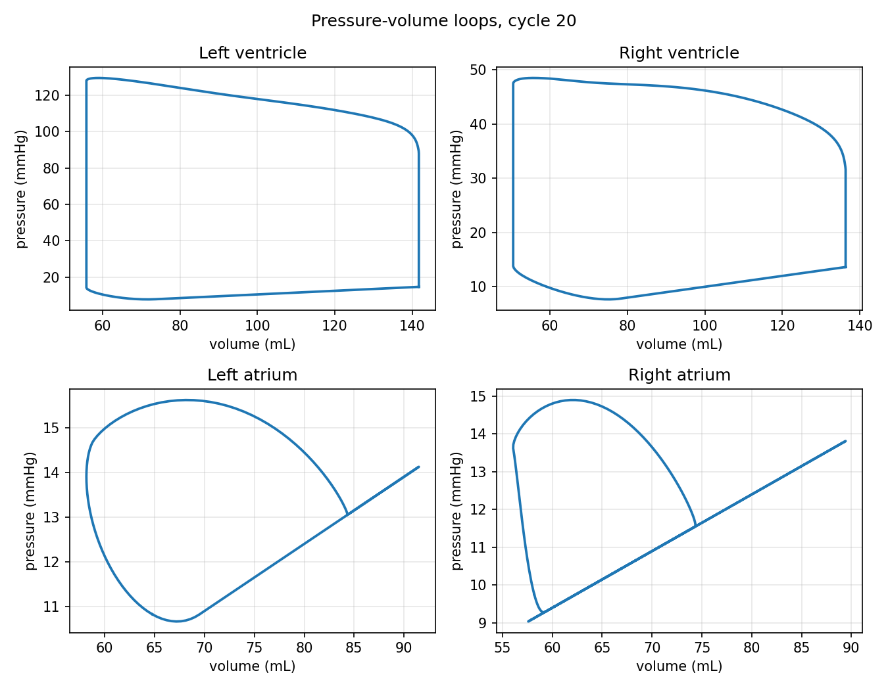
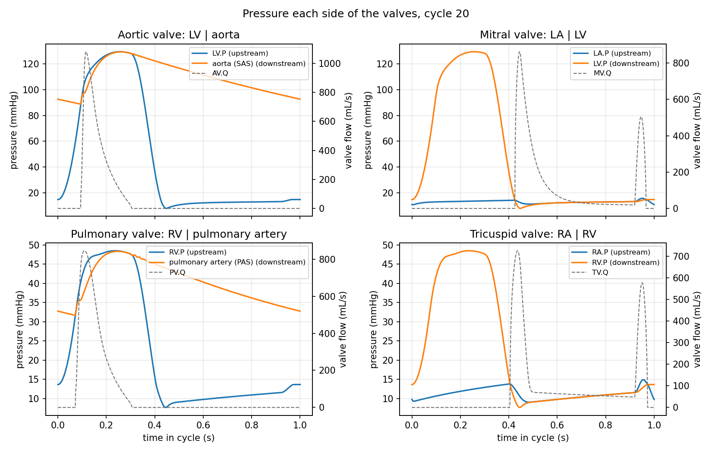
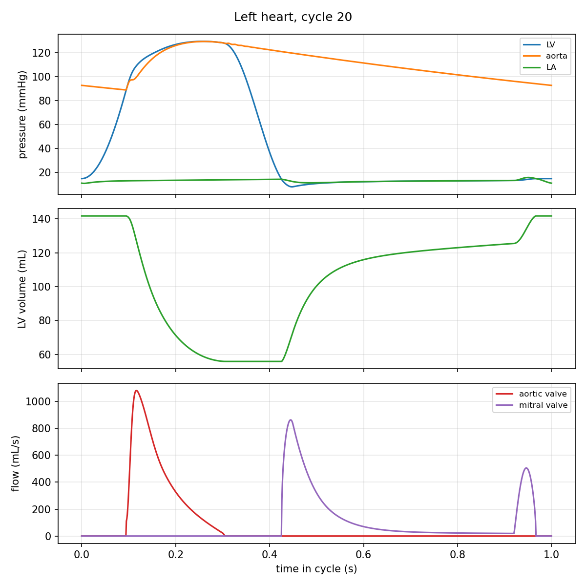

# Closed-loop healthy human circulation: `healthyHuman`

---

Prepared by David Kelly

---

## Tutorial Aims

- Demonstrate `circulationFoam`, which solves a lumped-parameter (0D)
  circulation network with no mesh.
- Show how a whole closed circulation is described as a dictionary of named
  components and a list of connections.

---

## Case Overview

### Problem description

The circuit is a closed loop through the four heart chambers, the systemic
circulation and the pulmonary circulation:

```text
LV -> AV -> SAS -> SAT -> SAR -> SCP -> SVN -> RA -> TV -> RV
   -> PV -> PAS -> PAT -> PAR -> PCP -> PVN -> LA -> MV -> LV
```

The parameters are those of the healthy human circulation of Healy (2024),
after Korakianitis and Shi (2006). The case is written in the units of the
literature, `units mmHg_mL`, with the time in seconds and a cardiac period
`Tcycle` of 1 s. Everything is SI inside the solver.

### Model

- **Chambers** `LV`, `RV`, `LA` and `RA` are `elastanceChamber`
  components: the pressure is `P = (V - V0) E(t) + P0`, where the elastance
  `E(t)` rises from `Emin` to `Emax` and falls back with a half-cosine
  activation. The atria use the same law, shifted in time.
- **Valves** `AV`, `MV`, `TV` and `PV` are `orificeValve` components: forward
  flow `Q = CQ sqrt(dP)` when the pressure drop `dP` is positive, and no flow
  otherwise.
- **Vessels** are compliances with resistance and, for the large arteries,
  inertance: `SAS`, `SAT`, `PAS` and `PAT` are `CRL` segments, `SVN` and
  `PVN` are `CR` segments, and `SAR`, `SCP`, `PAR` and `PCP` are resistors.

The equations assembled from these components are described in the
[`circulation0D`](../../../src/circulationModels/circulation0D/README.md)
README. The circuit is in `constant/circulationProperties`, and is solved
with the adaptive `RKDP45` ODE solver.

### Solver settings

- `endTime` is 20 s, 20 cardiac cycles.
- `deltaT` is 1 ms. This is only the **output interval**: the ODE solver takes
  whatever internal steps its tolerances need.

---

## Running the Case

The case is run with `circulationFoam`, which is built along with solids4foam.
No mesh is needed:

```bash
./Allrun
```

This runs `circulationFoam -check`, which describes the circuit and checks the
set-up, and then solves it, in under a second. The results are written to
`postProcessing/circulation/0/circulation.dat`: a row every `deltaT`, with the
pressure, volume and flow of every element.

The results can be plotted with `plotter.py`, which needs `matplotlib`:

```bash
python3 plotter.py
```

The figures are saved in the `plots` directory. The case is cleaned with
`./Allclean`.

---

## Expected Results

In the last cycle, the left ventricle reaches an end-diastolic volume of
141.7 mL and an end-systolic volume of 55.8 mL. The stroke volume is 85.9 mL
and the ejection fraction is 60.6 %. The pressure in the systemic arteries
varies between about 89 and 129 mmHg, with a mean of about 110 mmHg.

Note that this healthy parameter set is itself hypertensive and has a high
venous pressure, so the parameters should be checked before relying on the
physiology.

The pressure-volume loops of the four chambers:



The pressures on each side of the four valves, with the valve flows:



The left heart: pressures, left ventricular volume and aortic flow:


