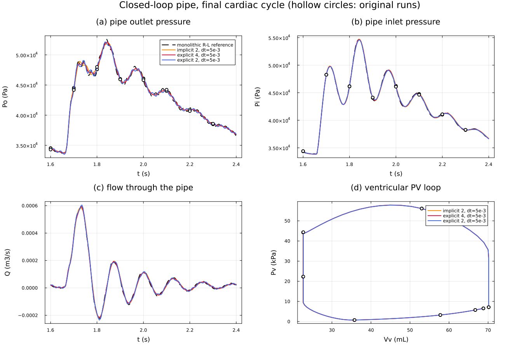

# pipeClosedLoop: a CFD pipe in a closed circulation loop

A 3D pipe (4 cm x 30 cm, 24,675 cells, `pimpleFoam`) whose **both ends** are
coupled to a lumped circulation: the outlet drains into the arterial side, the
inlet is fed by the aortic valve, and the heart (atrium, ventricle, two
valves) closes the loop. The CFD delivers the flow through each patch; the
circuit returns the pressure of the node each patch is attached to. Three
cardiac cycles (0.8 s each), `t = 0 .. 2.4 s`.

The circuit is a dictionary, `constant/circulationProperties`:

```
outlet -> C1 -R1-L1- C2 -R2- C3 -R3- atrium -mitral- ventricle -aortic(+R4)- C4 -> inlet
```

```c++
components
{
    outlet  { type externalPort; direction outlet; patch outlet; }   // CFD patch
    inlet   { type externalPort; direction inlet;  patch inlet;  }
    C1      { type compliance; C 1.5e-10; initialPressure 12720; }
    ...
    atrium  { type mixedChamber; V0 1e-6;
              active { E1 9.8e8; }  passive { P0 22.66; K 4.84e5; }
              activation { type sineSquared; offset 0.544; duration 0.24; }
              initialVolume 1.408e-05; }
    mitral  { type orificeValve; Rhat 5.333e10; }
    aortic  { type orificeValve; Rhat 5.333e9; R 1.2e7; }    // orifice in series with R4
}
connections ( (outlet C1 R1 L1 C2 R2 C3 R3 atrium mitral ventricle aortic C4 inlet) );
coupling    { scheme implicit; order 2; rho 1060; }          // explicit | implicit, 1..4
```

and `0/p` is `circulationPressure` on both `inlet` and `outlet`. Nothing about
this circuit is in C++: the seven states, their equations, the valve switching
and the two-port exchange come from the library. Two general components were
added for it, `mixedChamber` (activation x active polynomial + exponential
passive filling; also the form used by ModularCirc and Mynard) and a series
resistance on `orificeValve`.

## Running

```bash
../../Allwmake                                    # once
./makeCase implicit 2 5e-3                        # -> runs/implicit/2/5e-3
./runLadder "implicit" "2" "5e-3" 1 8             # blockMesh, decomposePar, mpirun -np 8 pimpleFoam
./runLadder "explicit implicit" "2 3 4" "5e-3" 1 8
python3 analyse.py                                # compare with the original runs and the reference
julia plotPipeClosedLoop.jl                       # plots/pipeClosedLoop_finalCycle.png
```

A coupled case at `dt = 5e-3` takes about 2.5 minutes on 8 cores. Orders 3 and
4 use the BDF3 / BDF4 CFD time schemes (`makeCase` sets them). Every order uses
`RKDP45` for the circuit, as the original closed-loop studies do. The step cap of
the circuit's ODE solver is raised (`maxSteps 1e8`) because hard-valve
switching at the very tight tolerances (relTol 1e-13) needs many small steps.

## Verification

There is no closed form for this problem, so three references are used.

**1. The circuit alone against an independent integrator.** `../pipeClosedLoopMonolithic`
is the same circuit with the pipe replaced by its rigid Poiseuille R-L surrogate,
solved as one system by `circulationFoam`. The independent reference is a plain
RK4 (stdlib Python, `verification/python/closedLoopOdeReference.py`, copied from
the original study) at `dt = 6.25e-6`:

| | worst difference over 3 cycles |
|---|---|
| all seven states (pressures swing about 4e4 Pa) | 3e-5 % of range (5e-5 Pa, 6e-13 m3/s) |

This validates the new chamber and valve components and the whole network
assembly on a stiff, non-smooth, closed-loop circuit.

**2. The coupled CFD runs against the stored runs of the original hand-written
couplings** (`../../verification/reference/pipeClosedLoop`, data only), same
mesh, settings, decomposition and time step:

| scheme | order | dt | worst state difference (% of range) | max difference in Pi, Po (Pa) | coupling iterations per step equal |
|---|---|---|---|---|---|
| explicit | 2 | 5e-3 | 8e-5 | 0.005, 0.03 | 479 / 479 |
| explicit | 3 | 5e-3 | 6e-5 | 0.007, 0.02 | 479 / 479 |
| explicit | 4 | 5e-3 | 7e-5 | 0.010, 0.03 | 479 / 479 |
| implicit | 1 | 5e-3 | 9e-4 | 0.04, 0.35 | 478 / 479 |
| implicit | 2 | 5e-3 | 1.1e-3 | 0.08, 0.43 | 479 / 479 |
| implicit | 3 | 2e-3 | 5e-4 | 0.04, 0.21 | 1026 / 1199 |
| implicit | 4 | 2e-3 | 6e-4 | 0.04, 0.23 | 869 / 1199 |
| explicit | 1 | 8e-4 | 1.5e-3 | 0.4, 2.8 | 2999 / 2999 |

The explicit schemes match to 1e-4 % because their exchange does not iterate.
The implicit ones differ at the 1e-3 % level, which is the noise of the CFD
linear solvers (tolerance 1e-6, relTol 0.01): the same case run twice with
the solver tolerances at 1e-9 differs from the 1e-6 run by 0.23 Pa in `Po`, the
same order as the difference from the stored run (0.3-0.4 Pa). Implicit orders 3 and
4 take a different number of outer iterations in some steps for the same reason.

**The unstable cases fail identically.** Explicit order 1 at `dt = 1e-3`
(stopped at `t = 1.997`), implicit order 3 at `5e-3` (stopped at `2.06`) and
implicit order 4 at `5e-3` (stopped at `0.805`) also stop in the original runs,
at the same step, and the two agree for every step before that. Those
combinations need a smaller `dt`.

**3. The modelling floor.** The coupled solution differs from the monolithic
R-L reference because the resolved pipe is not the surrogate; the original study
reports about 91.5 Pa at `dt = 1e-4`. At the coarse steps here the coupling error
dominates, and the distance from the reference over the final cycle is the same
as the original code's to within 0.4 Pa for the stable cases (e.g. explicit
order 2 at 5e-3: 723.59 vs 723.60 Pa; implicit order 4 at 2e-3: 227.75 vs 227.71 Pa).



Lines are this code, hollow circles the original runs, dashed the monolithic
reference. `plots/analysis.txt` is the full table.

## Not ported

The restart checkpoint and the per-update integration log of the original
couplings; every accepted step is logged in
`postProcessing/circulationCoupling/0/coupling.dat`.
