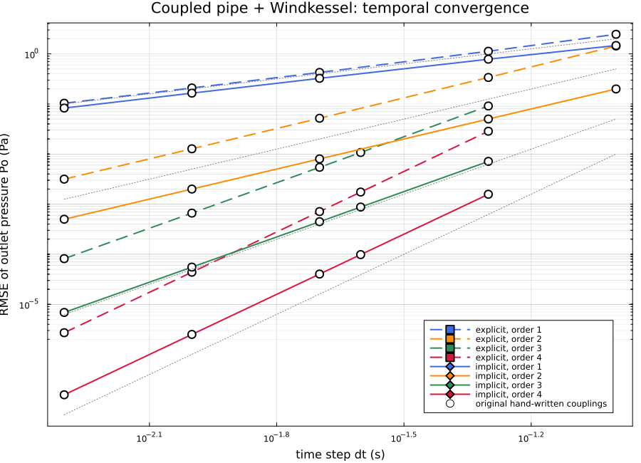
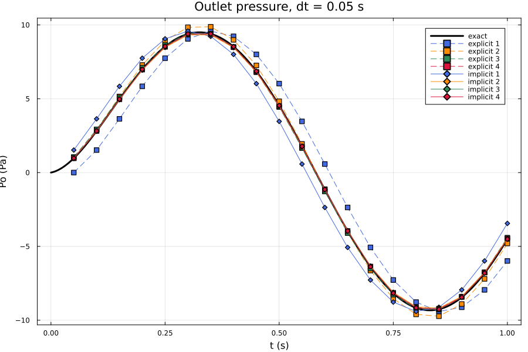

# pipeWindkessel: a CFD pipe coupled to a Windkessel

A 5 m, 0.5 m radius pipe (25,004 cells) solved with stock `pimpleFoam`. The
inlet prescribes the flow `Q(t) = sin(2 pi t)` m3/s. The outlet pressure comes
from a three-element Windkessel described in `constant/circulationProperties`
and solved by `circulation0D`. This is the problem of the original pipe + Windkessel verification study
(stored results in `../../verification/reference/pipeWindkessel`) with the same
mesh, solver settings and inlet; only the outlet changed, from one of eight
hand-written boundary conditions to one boundary condition plus a dictionary.

## Choosing the coupling

```c++
// constant/circulationProperties
coupling
{
    scheme      implicit;   // explicit | implicit
    order       2;          // 1 .. 4
    rho         1060;       // the CFD solves p/rho
}
```

```c++
// 0/p
outlet { type circulationPressure; value uniform 0; }
```

That is the whole interface. The eight original boundary condition types
(`windkesselPressure{Explicit,Implicit}{First,Second,Third,Fourth}Order`, of the original pipe study) are the eight combinations of
`scheme` and `order`.

| | explicit | implicit |
|---|---|---|
| exchanges per step | one | one per outer corrector (new flux) |
| order 1 | `Q(t_n)` held over the step | the current iterate held over the step |
| order 2 | line through `Q(t_n-1)`, `Q(t_n)`, extrapolated | line from the start flow to the current iterate |
| order 3 / 4 | quadratic / cubic through earlier flows, extrapolated | adds one / two earlier flows to order 2 |

Orders 3 and 4 want a higher-order CFD time scheme so that the CFD does not
dominate the error: `makeCase` switches `ddtSchemes` to `BDF3` / `BDF4` (from
`libcirculationDdtSchemes`, built by `Allwmake`) for them, and seeds the flow history with the exact
earlier flows so that every order starts at full order.

Coupling ports are bound to patches by name: the `outlet` port in the circuit
has `patch outlet;`. A second coupled patch would be a second port; nothing else
changes.

## Running

```bash
../../Allwmake                                   # once
./makeCase implicit 2 0.01                       # -> runs/implicit/2/0.01
cd runs/implicit/2/0.01 && blockMesh && pimpleFoam
./runLadder "explicit implicit" "1 2" "0.1 0.05 0.02 0.01 0.005" 10   # many cases
python3 analyse.py                               # compare with exact and with the old runs
```

## Exact solution

With `R = 10, Rch = 1, C = 0.01, Pc(0) = 0`, `dPc/dt = (Q - Pc/R)/C` gives

    Pc(t) = A R/(1+(wRC)^2) [ sin wt - wRC cos wt + wRC exp(-t/RC) ]
    Po(t) = Pc(t) + Rch A sin wt

and the error is the RMSE of `Po` over the steps in `0 < t <= 1`.

## Results

All 40 cases (explicit and implicit, orders 1-4, five time steps each) were run
with the original mesh and solver settings and compared with the exact solution
and with the stored results of the original hand-written couplings
(`../../verification/reference/pipeWindkessel`; `python3 analyse.py`).

* RMSE of `Po` against the exact solution agrees with the original runs to
  6 significant figures in every case.
* `Pc` and `Po` agree with the original runs at every step to **1e-11 Pa**, the
  12-digit precision of the stored logs. The circuit ODE solver follows the
  original studies: `Trapezoid` (1e-10) for orders 1 and 2, `RKDP45` (1e-12) for
  orders 3 and 4 (`makeCase` sets it; the tolerances are on the compliance volume
  `V = C Pc`, so they are scaled by `C = 0.01`).
* The number of outer-corrector updates agrees in every step of every case.
* Pairwise orders of accuracy are identical to the original study and converge
  to 1, 2, 3 and 4:

| dt | explicit 1 | explicit 2 | explicit 3 | explicit 4 | implicit 1 | implicit 2 | implicit 3 | implicit 4 |
|---|---:|---:|---:|---:|---:|---:|---:|---:|
| 0.02 -> 0.01 | 1.029 | 2.024 | 3.037 | 4.020 | 0.982 | 2.001 | 3.012 | 4.004 |
| 0.01 -> 0.005 | 1.015 | 2.012 | 3.019 | 4.012 | 0.991 | 2.001 | 3.006 | 4.003 |



Coloured markers are this code, hollow circles the original runs, dotted lines
the slopes `dt^1 .. dt^4`.



Not yet ported from the original couplings: the restart checkpoint
(`windkesselCircuitState`) and the per-update integration log. The accepted
state of every step is logged in `postProcessing/circulationCoupling/0/coupling.dat`.

