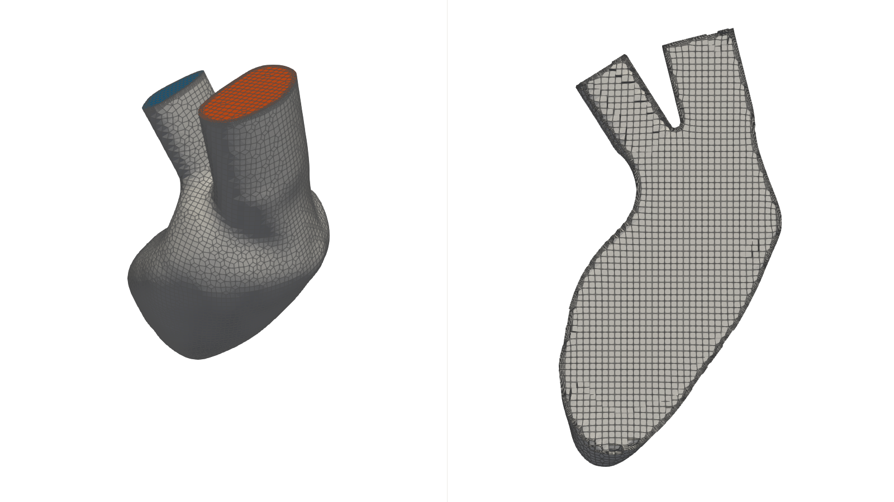
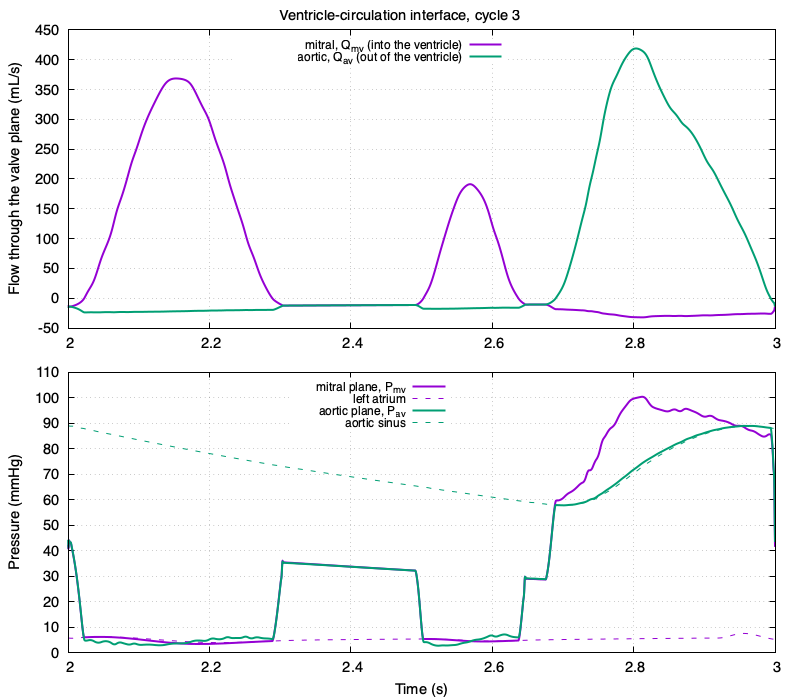
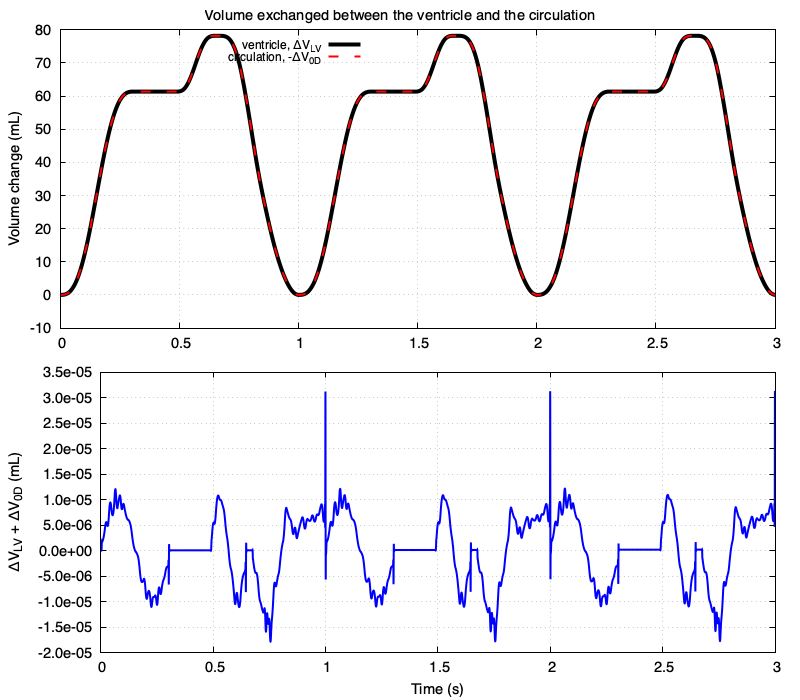

# Left ventricle coupled to a closed-loop circulation: `leftVentricle`

---

Prepared by David Kelly

---

## Tutorial Aims

- Couple a 3D left ventricle with a moving wall to a closed-loop
  lumped-parameter (0D) circulation, through its mitral and aortic valve
  planes.
- Demonstrate the `movingVentricle` mesh motion solver, which moves the wall
  so that the cavity volume follows a prescribed curve.
- Show the valve law at a coupled patch (`coupledDomain`), and check that
  volume is conserved between the 3D and 0D models.

---

## Case Overview

### Geometry and mesh



The domain is a left ventricle cavity of about 78 mL with two open valve
planes, `INLET` (mitral) and `OUTLET` (aortic), and a wall `WALL`. The surface
is `constant/geometry/leftVentricle.fms`, and `cartesianMesh` (cfMesh) makes
a hexahedral-dominant mesh of 86,048 cells with seven boundary layers growing
by 1.08 (`system/meshDict`). This is mesh M3 of the mesh study below; the
cell sizes of all five meshes are listed in `system/meshDict`.

### Wall motion

The wall moves so that the cavity volume follows a prescribed curve, after
the volume-driven approach of Lazpita et al. (2024). `constant/timeVsFlow`
gives the wall flux (m3/s against s, five cycles of 1 s); the target volume
of a step is the volume of the undeformed mesh plus the integral of a cubic
spline through these samples (`smoothFlow`). Each wall point moves along its
initial normal by `a max(0, y/ymin)`, where `y` is its initial height and
`ymin` that of the apex, so the apex moves most and the wall above `y = 0`,
around the valve planes, not at all; a Newton loop sets the factor `a` to meet
the target volume to a relative tolerance of 1e-12. The interior points
follow by a Laplacian of the displacement (`movingVentricle` in
`constant/dynamicMeshDict`). The cavity volume varies by 78.2 mL over a
cycle.

The blood is Newtonian, with a kinematic viscosity of 3e-6 m2/s and a density
of 1060 kg/m3, and the flow is laminar.

### Circulation

The valve planes are coupled to the closed-loop circulation of Healy (2024),
after Korakianitis and Shi (2006), in `constant/circulationProperties`:

```text
LV -> SAS -> SAT -> SAR -> SCP -> SVN -> RA -> TV -> RV -> PV
   -> PAS -> PAT -> PAR -> PCP -> PVN -> LA -> LV
```

`LV` is a `coupledDomain`: the 3D ventricle takes the place of the lumped
one, so it has no elastance and no volume state of its own. The right atrium,
right ventricle and left atrium are `elastanceChamber` components, the
tricuspid and pulmonary valves are smooth `orificeValve` components, and the
vessels are `CRL` and `CR` segments and resistors. Every value is the SI
value of the published mmHg/mL parameter.

### Valves at the coupled patches

The mitral and aortic valves sit between the patches and the lumped nodes
(the left atrium `LA` and the aortic sinus `SAS`), as the inverse valve law
of each port. The CFD gives the flow `Q` through a patch, and the circuit
returns the pressure on the ventricular side of the valve:

```text
aortic (OUTLET)   Pav = P_SAS + dP(Qav)
mitral (INLET)    Pmv = P_LA  - dP(Qmv)

dP(Q) =  (Q/CQ)^2                                  Q >= 0
dP(Q) = -x dPmax/(x + dPmax),  x = (Q/(fr CQ))^2    Q <  0
```

A shut valve leaks through an orifice `fr = reverseFraction = 0.005` times
the forward one, and the adverse pressure it is asked to hold is bounded by
`dPmax = reverseDPmax = 2e4 Pa` (150 mmHg). The valve planes use
`circulationPressure` for the pressure and `pressureInletOutletDdtCorrVelocity`
for the velocity, a `pressureInletOutletVelocity` that keeps the `ddtCorr`
flux correction on the patch.

### Solver settings

- Three cardiac cycles from rest, `endTime 3`, with a period `Tcycle` of 1 s.
- `deltaT 1e-4`, implicit coupling of order 2 (`coupling` in
  `constant/circulationProperties`), and the CFD time scheme `BDF 2 1`, the
  BDF scheme of the same order (`system/fvSchemes`).
- The circuit is integrated with `RKDP45` at a relative tolerance of 1e-12.
- PIMPLE iterates to convergence of the velocity (`residualControl` on `U`,
  1e-8), with at most 200 outer correctors and no relaxation.
- Convection is bounded first-order upwind, kept for robustness on the moving
  mesh; the other terms are second order.

---

## Running the Case

The case needs OpenFOAM.com with cfMesh (`cartesianMesh`), and solids4foam
with the `circulationModels` module: `libs` in `system/controlDict` loads
`libcirculationCoupling` and `libsolids4FoamModels` (the `BDF` scheme), and
`constant/dynamicMeshDict` loads `libcirculationMeshMotion`.

```bash
# cartesianMesh, checkMesh, decomposePar, pimpleFoam on the
# numberOfSubdomains (8) ranks of system/decomposeParDict, then the
# volume-conservation record and the plots
./Allrun
# back to a clean case
./Allclean
```

The run has 30,000 time steps and is meant for a workstation or a cluster:
it took about 9 hours on 32 cores (AMD EPYC 7H12); watch it with
`tail -f log.pimpleFoam`. Every step is logged in
`postProcessing/circulationCoupling/0/coupling.dat`: the flow and imposed
pressure at each valve plane, then every element's pressure, volume and flow.
`Allrun` then writes `volumeConservation.dat`, the change in the ventricle
volume (the mesh volume the motion solver reaches, `Converged: volume =` in
the log) against the change in the volume stored in the circulation, from the
first step.

If gnuplot is installed, `Allrun` plots the last complete cycle with
`plot.gnuplot`; another cycle is plotted with
`gnuplot -e "cycle=2" plot.gnuplot`. The figures are:

- `interface.png`: what the ventricle and the circulation exchange, the flow
  through each valve plane and the pressure imposed there;
- `volumeConservation.png`: the volume exchanged between the ventricle and the
  circulation over the run.

Variations to try:

- **another coupling**: `scheme explicit;` or `order 1` to `4` in
  `constant/circulationProperties`, with `BDF <order> 1` in
  `system/fvSchemes` (see the stability limits below);
- **another mesh**: `maxCellSize` and `maxFirstLayerThickness` of another
  mesh from the table in `system/meshDict`.

---

## Expected Results



Over the third cycle the ventricle fills through the mitral plane in two
waves, rapid filling (peak 368 mL/s) and atrial contraction, then ejects
through the aortic plane (peak 419 mL/s). The stroke volume is 58.1 mL and
the peak pressures are 100.3 mmHg at the mitral plane and 88.9 mmHg at the
aortic plane. Where the prescribed wall flux is zero (0.3 to 0.5 s of each
cycle) both valves are shut: blood leaks back through both, from the aortic
sinus to the left atrium at about 12 mL/s, and the cavity pressure settles
where the two leaks balance. The circuit parameters are not calibrated to the
prescribed wall motion, so the pressures are not meant to be physiological.



The circuit exchanges volume only with the ventricle, through the two valve
planes, so the change in the ventricle volume (the mesh) must be balanced by
the opposite change in the volume the circulation stores (its compliances
and chambers). The two are computed independently and agree to within
3.1e-5 mL over three cycles, less than 1e-6 of the stroke volume. The
difference is periodic, does not accumulate, and falls at the order of the
coupling as the time step is reduced.

---

## Verification and Convergence Study

The results above were obtained with this case. On meshes M1 to M5 (39,433
to 192,223 cells), the interface waveforms of the explicit and implicit
couplings of order 2 converge at close to second order in space (1.96 for
the mitral pressure, 2.21 for the aortic pressure, 2.08 for the flows), and
M3 is within 0.1 % of the extrapolated stroke volume and peak aortic flow and
pressure, and within 1.04 % of the peak mitral pressure.

On M3, the observed temporal orders by successive time-step halving (the
root-mean-square difference between the runs at `deltaT` and `deltaT/2` over
the third cycle) are:

| Coupling | `deltaT` (1e-4 s) | Pmv | Pav | Qmv | Qav |
| --- | --- | --- | --- | --- | --- |
| explicit, order 2 | 0.75, 1.0, 1.25, 1.5 | 2.00 | 2.02 | 2.00 | 2.02 |
| implicit, order 2 | 0.75, 1.0, 1.25, 1.5 | 1.92 | 1.96 | 1.89 | 1.88 |
| explicit, order 3 | 0.75, 1.0, 1.25, 1.5 | 2.90 | 2.90 | 2.75 | 2.69 |
| implicit, order 3 | 2.0, 2.5, 3.0, 3.5 | 2.74 | 2.78 | 2.73 | 2.76 |
| implicit, order 4 | 2.0, 2.5, 3.0, 3.5 | 3.57 | 3.59 | 3.54 | 3.50 |

The differences reach a floor of about 0.1 Pa in pressure and 1e-10 m3/s in
flow, set by the PIMPLE tolerance and the decomposition; the third- and
fourth-order implicit couplings reach it below `deltaT = 1.5e-4`, and the
explicit coupling of order 4 is stable only where it is already near the
floor, so its order cannot be measured.

The largest time steps at which each coupling is usable are:

| Order | 1 | 2 | 3 | 4 |
| --- | --- | --- | --- | --- |
| explicit (s) | 3.5e-4 | 2.5e-4 | 1.75e-4 | 1.25e-4 |
| implicit (s) | 2e-4 | 3e-4 | 3.5e-4 | 4e-4 |

Beyond them the explicit couplings develop a step-to-step pressure
oscillation, and the implicit couplings stall at the end of rapid filling
(t = 0.30 to 0.35 s), the outer loop no longer converging. BDF 3 and 4 are
not A-stable, and a warning is printed.

---

## References

- Korakianitis, T. and Shi, Y. (2006). A concentrated parameter model for the
  human cardiovascular system including heart valve dynamics and
  atrioventricular interaction. *Medical Engineering & Physics*, 28(7),
  613-628. <https://doi.org/10.1016/j.medengphy.2005.10.004>
- Lazpita, E., Mares, A., Quintero, P., Garicano-Mena, J. and Le Clainche, S.
  (2024). Modeling heart flow dynamics using numerical simulations to identify
  the vortex ring: A practical guide. *Results in Engineering*, 24, 103644.
  <https://doi.org/10.1016/j.rineng.2024.103644>
