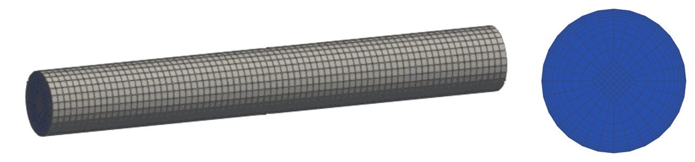
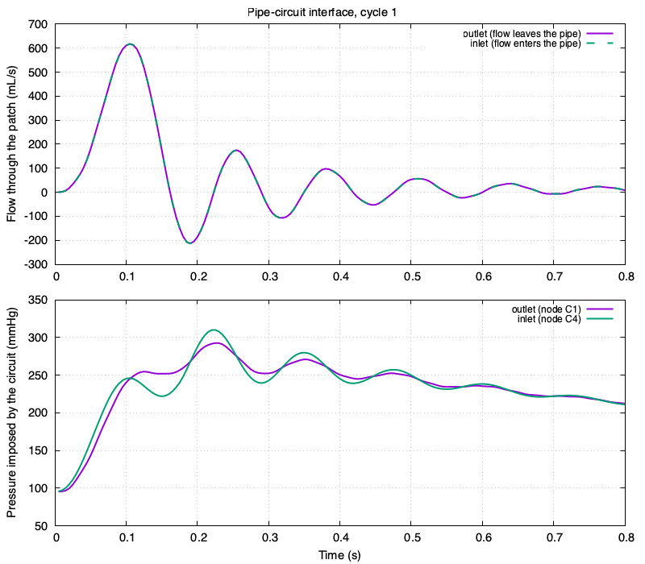
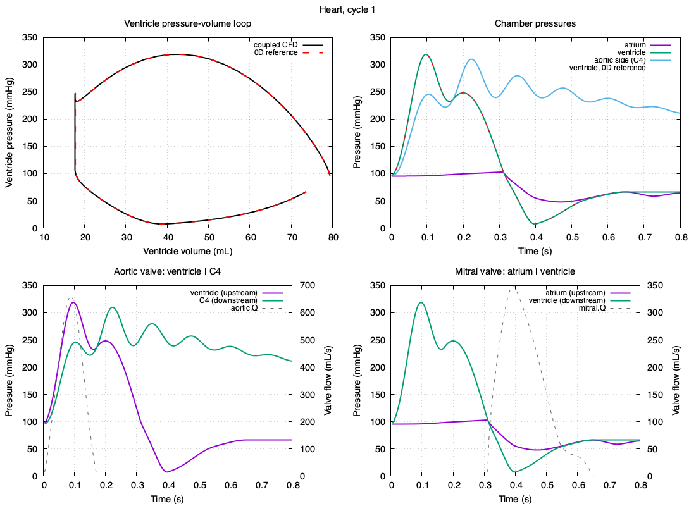

# CFD pipe in a closed circulation loop: `pipeClosedLoop`

---

Prepared by David Kelly

---

## Tutorial Aims

- Demonstrate a CFD domain with **both ends** coupled to one lumped-parameter
  (0D) closed circulation loop, through the `circulationPressure` boundary
  condition.
- Show a circuit with a heart (an atrium and a ventricle) and valves, written
  as one dictionary.
- Compare the coupled solution with a 0D reference of the same loop.

---

## Case Overview

### Geometry and mesh



The domain is a straight pipe 30 cm long with a radius of 2 cm, meshed by
`blockMesh` with an O-grid of 24,675 cells. The fluid is blood with a
dynamic viscosity of 0.004 Pa s and a density of 1060 kg/m3; the walls are
no-slip and rigid.

### Circuit

The outlet drains into the arterial side (C1, R1, L1, C2, R2, C3, R3), the
heart (atrium, mitral valve, ventricle, aortic valve) pumps, and the blood
returns to the pipe inlet (C4):

```text
outlet -> C1 -R1-L1- C2 -R2- C3 -R3- atrium -mitral- ventricle
       -aortic(+R4)- C4 -> inlet
```

The CFD gives the flow through each patch; the circuit returns the pressure of
the node each patch is attached to. The circuit is one dictionary,
`constant/circulationProperties`, and `0/p` has `circulationPressure` on
`inlet` and `outlet`, the only change from an ordinary pipe case. The coupling
library (`libs` in `system/controlDict`) builds the circuit inside the fluid
solver and integrates its ODEs at every exchange. The circuit's ODE solver is
`RKDP45` with very tight tolerances (`relTol 1e-13`), and its step cap is
raised (`maxSteps 1e8`) because hard-valve switching needs many small steps.

### Solver settings

- One cardiac cycle: `endTime 0.8`, with `Tcycle 0.8`.
- `deltaT 5e-3`, explicit coupling of order 2 and the `backward` CFD time
  scheme.
- The pipe is solved by `solids4Foam` with the `pimpleFluid` fluid model, or
  by stock `pimpleFoam` with `./Allrun pimpleFoam`. The two agree to the
  PIMPLE `residualControl` tolerance of 1e-6, which is also the run-to-run
  scatter of one solver on 8 ranks (`pipeWindkessel`, converged to 1e-10,
  agrees to all digits written).

### 0D reference

There is no closed form for this problem. `reference0D/` is the same circuit
with the 3D pipe replaced by its rigid, laminar Poiseuille surrogate, a
resistor `Rpipe` in series with an inductor `Lpipe`, so that the whole loop is
one `circulationNetwork` solved by `circulationFoam` with no CFD and no mesh:

```text
C1 -R1-L1- C2 -R2- C3 -R3- atrium -mitral- ventricle -aortic(+R4)- C4 -pipe- C1
```

- `Rpipe = 8 mu L / (pi r^4)`, with a viscosity `mu` of 0.004 Pa s, a pipe
  length `L` of 0.3 m and a radius `r` of 0.02 m;
- `Lpipe = rho L / A`, with a density `rho` of 1060 kg/m3 and the pipe
  cross-sectional area `A`.

`reference0D/system/controlDict` runs three cardiac cycles (`endTime 2.4`)
with `deltaT 1e-4`, which is only the **output interval**: the ODE solver
(`RKDP45`, tight tolerances) takes whatever internal steps it needs, many of
them small because of the hard switching of the valves.

The reference has no partitioned coupling error, so the coupled run differs
from it by the modelling error of the surrogate (the resolved pipe is not
exactly its rigid laminar surrogate) and by the coupling error, which
dominates at the coarse time steps of the tutorial. It is also a test of the
chamber and valve components and the network assembly on a stiff,
non-smooth, closed-loop circuit.

---

## Running the Case

```bash
# blockMesh, circuit check, decomposePar, solids4Foam on the
# numberOfSubdomains (8) ranks of system/decomposeParDict (1 runs serially),
# then the plots
./Allrun
# the same pipe solved by stock pimpleFoam
./Allrun pimpleFoam
# the 0D reference (no mesh, seconds)
./Allrun 0D
# back to a clean case (both the CFD case and the 0D reference)
./Allclean
```

The coupled run takes about a minute on 8 free cores; watch it with
`tail -f log.solids4Foam`. `circulationFoam -check` prints the circuit as the
program understood it (7 states, 7 nodes, 2 coupling ports) and checks that
both patches exist in the mesh. Every accepted step is logged in
`postProcessing/circulationCoupling/0/coupling.dat`, one row per time step:
the flow and imposed pressure at each port, then every element's pressure,
volume and flow. `./Allrun 0D` writes
`reference0D/postProcessing/circulation/0/circulation.dat`, a row every
`deltaT`.

If gnuplot is installed, `Allrun` plots the last complete cycle with
`plot.gnuplot`; another cycle is plotted with
`gnuplot -e "cycle=3" plot.gnuplot`. Run `./Allrun 0D` first to add the 0D
reference to the ventricle plots. The figures are:

- `interface.png`: what the pipe and the circuit exchange, the flow through
  the outlet and inlet patches and the pressure the circuit imposes there;
- `heart.png`: the ventricle pressure-volume loop, the chamber pressures, and
  the pressures each side of the aortic and mitral valves with the valve
  flows;
- `circuit.png`: the pressure in every compliance of the loop.

Variations to try:

- **three cycles (the periodic state)**: `endTime 2.4` in
  `system/controlDict` (about 2.5 minutes);
- **implicit coupling (iterates the exchange within each step)**:
  `scheme implicit;`
- **higher-order coupling**: `order 3;` (limited to second order by the
  `backward` CFD time scheme);
- **a stiffer ventricle**: `ventricle { ... active { E1 3.0e9; ... } }`.

---

## Expected Results



The ventricle ejects in the first 0.17 s, after which the flow through the
pipe oscillates with a decaying amplitude through the rest of the cycle. The
inlet and outlet flows coincide, as the pipe is rigid and the fluid
incompressible.



In the first cycle, the ventricle has an end-diastolic volume of 79.3 mL and
an end-systolic volume of 17.8 mL, a stroke volume of 61.6 mL, and a peak
pressure of 319 mmHg; the pressure-volume loop and the ventricle pressure of
the coupled run lie on the 0D reference. These pressures are those of the
demonstration circuit, which starts every compliance at the same pressure,
and are not meant to be physiological.

---

## Checks and Known Limits

- Explicit order 1 is unstable at `deltaT 1e-3` and stops at `t = 1.997`; use
  a smaller `deltaT`.
- Implicit coupling needs many outer correctors on this loop: at
  `deltaT 5e-3` every step reaches the limit of 120, so the run completes but
  the coupling is not converged. Use a smaller `deltaT` (about 1e-3 or below)
  for a converged implicit solution, or the explicit scheme.
- With the `backward` CFD time scheme the coupled solution is limited to
  second order for coupling orders 3 and 4 (the coupler prints a warning). A
  third- or fourth-order BDF CFD time scheme is not A-stable, so it can
  amplify the pipe-compliance oscillation of this loop (about 30 Hz): with
  explicit coupling of order 2, BDF3 and BDF4 diverged at `deltaT 5e-3`.
