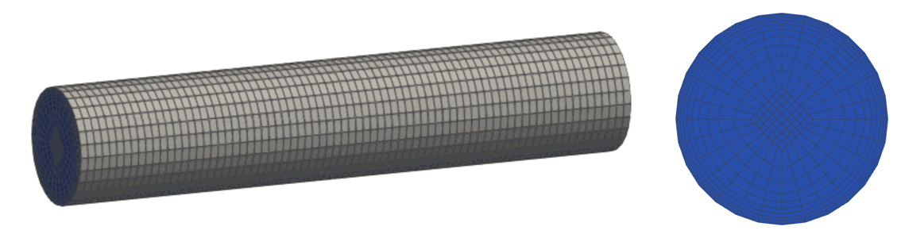
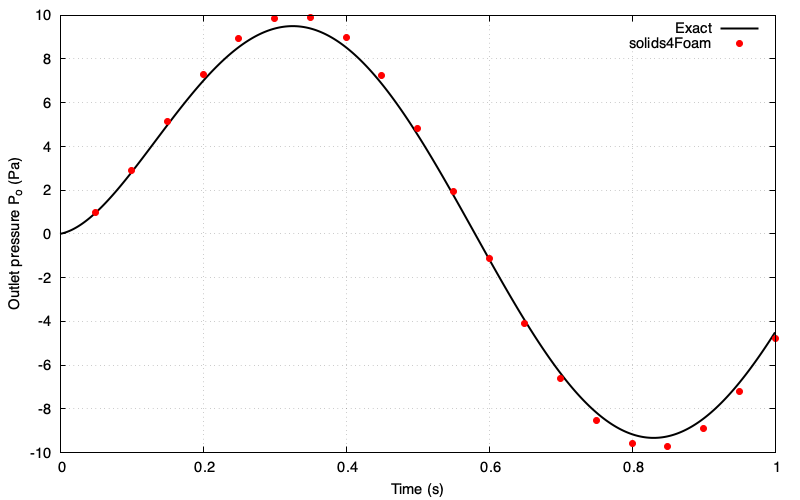

# CFD pipe coupled to a Windkessel: `pipeWindkessel`

---

Prepared by David Kelly

---

## Tutorial Aims

- Demonstrate the `circulationPressure` boundary condition, which couples an
  outlet of a CFD domain to a lumped-parameter (0D) circuit.
- Show how the coupling scheme (explicit or implicit) and its order (1 to 4)
  are chosen in one dictionary.
- Verify the coupling against an exact solution.

---

## Case Overview

### Geometry and mesh



The domain is a straight pipe 5 m long with a radius of 0.5 m, meshed by
`blockMesh` with an O-grid of 25,004 cells. The inlet prescribes the flow
`Q(t) = sin(2 pi t)` m3/s, and the walls are no-slip. The fluid has a
kinematic viscosity of 0.01 m2/s and a density of 1060 kg/m3.

### Windkessel

The outlet pressure comes from a three-element Windkessel, a characteristic
resistance `Rch` in series with a compliance `C` in parallel with a resistance
`R`. It is described in `constant/circulationProperties` and solved by
`circulation0D`. The outlet is a single boundary condition plus a dictionary,
whichever coupling scheme is used:

```c++
// constant/circulationProperties
coupling
{
    scheme      implicit;   // explicit | implicit
    order       2;          // 1 .. 4
    rho         1060;       // the CFD solves p/rho
}
```

```c++
// 0/p
outlet
{
    type            circulationPressure;
    value           uniform 0;
}
```

Coupling ports are bound to patches by name: the `outlet` port in the circuit
has `patch outlet;`. A second coupled patch would be a second port; nothing
else changes.

### Coupling schemes

The eight combinations of `scheme` and `order` are the eight coupling
algorithms:

| | explicit |
| --- | --- |
| exchanges per step | one |
| order 1 | `Q(t_n)` held over the step |
| order 2 | line through `Q(t_n-1)`, `Q(t_n)`, extrapolated |
| order 3 / 4 | quadratic / cubic through earlier flows, extrapolated |

| | implicit |
| --- | --- |
| exchanges per step | one per outer corrector (new flux) |
| order 1 | the current iterate held over the step |
| order 2 | line from the start flow to the current iterate |
| order 3 / 4 | adds one / two earlier flows to order 2 |

Orders 3 and 4 want a higher-order CFD time scheme so that the CFD does not
dominate the error. The stock `backward` scheme is used here, which limits the
coupled solution to second order (the coupler prints a warning). The case as
supplied is explicit coupling of order 2 at `deltaT 0.05`.

### Exact solution

With `R = 10`, `Rch = 1`, `C = 0.01` and `Pc(0) = 0`, the compliance pressure
obeys `dPc/dt = (Q - Pc/R)/C`, which gives

```text
Pc(t) = A R/(1+(wRC)^2) [ sin wt - wRC cos wt + wRC exp(-t/RC) ]
Po(t) = Pc(t) + Rch A sin wt
```

with `A = 1` and `w = 2 pi`. The error is the RMSE of the outlet pressure
`Po` over the steps in `0 < t <= 1`.

### Solvers

The case is solved by `solids4Foam` with the solids4foam `pimpleFluid` fluid
model, so the `circulationPressure` boundary condition is shown working with
the solids4foam fluid models, and so with fluid-solid interaction cases.
`./Allrun pimpleFoam` solves the same pipe, inflow, Windkessel and coupling
with stock `pimpleFoam`: the boundary condition and the coupling live in
`libcirculationCoupling`, so any OpenFOAM.com fluid solver can use them. The
solids4Foam files are ignored by `pimpleFoam`:

```c++
// constant/physicsProperties
type    fluid;

// constant/fluidProperties
fluidModel pimpleFluid;
```

together with `constant/dynamicMeshDict` (`staticFvMesh`), `constant/g` and
the density in `constant/transportProperties` (the same 1060 kg/m3 as the
coupling `rho`). The circuit, `0/p` and `0/U` are the same for both solvers.

---

## Running the Case

```bash
# blockMesh, solids4Foam (about a minute), the comparison with the exact
# solution and its plot
./Allrun
# the same pipe solved by stock pimpleFoam
./Allrun pimpleFoam
# back to a clean case
./Allclean
```

`analyse.py` compares the run with the exact solution; it needs only Python 3
and is skipped by `Allrun` if it is not there. `outletPressure.gnuplot` plots
the outlet pressure against the exact solution in `outletPressure.png`, if
gnuplot is installed. The accepted state of every step is logged in
`postProcessing/circulationCoupling/0/coupling.dat`.

---

## Expected Results



The outlet pressure follows the exact solution. `analyse.py` prints

```text
20 steps, RMSE of the outlet pressure Po against the exact solution: 0.3385
```

with either solver: the `coupling.dat` files of the two runs agree to the 12
digits written, as the PIMPLE loop is converged to `residualControl` 1e-10
in both. The regression test checks this RMSE for `solids4Foam`, a
parallel-then-serial restart, and `pimpleFoam`.

---

## Verification and Convergence Study

All 40 cases of an earlier sweep (explicit and implicit, orders 1-4, five
time steps each) were run and compared with the exact solution above, using
`analyse.py`'s formula. The pairwise orders of accuracy of the RMSE of `Po`
converge to 1, 2, 3 and 4. The orders 3 and 4 in this table were obtained
with third- and fourth-order BDF time schemes in the CFD; with `backward`
they are limited by the CFD time error:

| dt | explicit 1 | explicit 2 | explicit 3 | explicit 4 |
| --- | ---: | ---: | ---: | ---: |
| 0.02 -> 0.01 | 1.029 | 2.024 | 3.037 | 4.020 |
| 0.01 -> 0.005 | 1.015 | 2.012 | 3.019 | 4.012 |

| dt | implicit 1 | implicit 2 | implicit 3 | implicit 4 |
| --- | ---: | ---: | ---: | ---: |
| 0.02 -> 0.01 | 0.982 | 2.001 | 3.012 | 4.004 |
| 0.01 -> 0.005 | 0.991 | 2.001 | 3.006 | 4.003 |

To repeat the study, copy the case for each scheme, order and time step;
there is no script to do it for you. Three things go together:

- `scheme`, `order` (and `deltaT` in `system/controlDict`).
- **The flow history** (`seed` and `seedDeltaT` in `coupling`). Orders above
  1 extrapolate from earlier flows. Seeding them with the exact earlier outlet
  flows `Q(-k dt) = -sin(2 pi k dt)` gives full order from the first step:
  explicit needs `order - 1` values, `k = 1..order-1`; implicit order 1 and 2
  need none, and implicit order 3 and 4 need `order - 2`. `seedDeltaT` is the
  `deltaT` the values were computed for. For example, explicit order 3 at
  `deltaT 0.01` is
  `seed { outlet ( -0.062790519529313374 -0.12533323356430426 ); }`
  with `seedDeltaT 0.01;`.
- **The circuit ODE solver**: `Trapezoid` (`absTol 1e-12; relTol 1e-10`) for
  orders 1 and 2, and `RKDP45` (`absTol 1e-14; relTol 1e-12`) for orders 3
  and 4. The tolerances are on the compliance volume `V = C Pc`, so they are
  scaled by `C = 0.01`.

`analyse.py` compares whichever case is run with the exact solution; compare
the RMSEs of the copies to obtain the orders.
