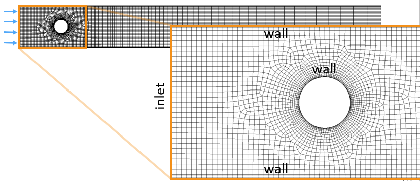
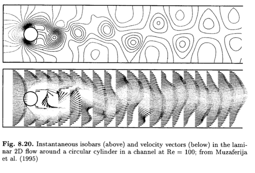
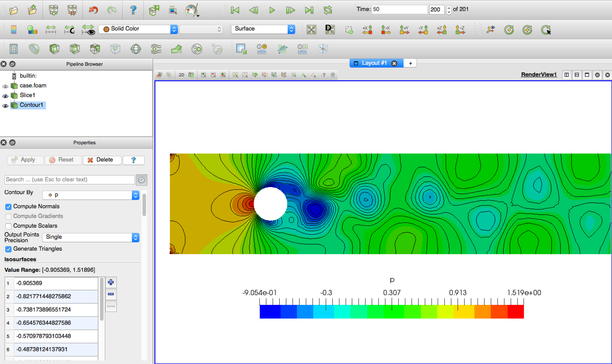

# My second tutorial: `cylinderInChannel`

You can find the files for this tutorial under
[`tutorials/fluids/cylinderInChannel`](https://github.com/solids4foam/solids4foam/tree/master/tutorials/fluids/cylinderInChannel).

---

## Tutorial Aims

- Demonstrate how to perform a fluid-only analysis in solids4foam;
- Explain how a solids4foam fluid case differs from a standard OpenFOAM fluid
  case.

## Case Overview



This is the classic “flow over a cylinder in a channel” test case, as analysed
by, for example, Ferziger and Peric (2002). The problem is modelled as 2-D. The
inlet flow velocity profile is specified (coming in from the left), and the
outlet (right) gauge pressure is zero. The upper wall, lower wall and cylinder
are no-slip walls.

We assume an incompressible Newtonian isothermal laminar fluid, where the
Navier-Stokes governing equations take the form:

$$
\nabla \cdot \boldsymbol{v} = 0
$$

$$
\frac{\partial \boldsymbol{v}}{\partial t}
+ \nabla \cdot (\boldsymbol{v}\boldsymbol{v})
= \nu \nabla^2 \boldsymbol{v}
- \frac{1}{\rho} \nabla p
+ \boldsymbol{f_b}
$$

Two pressure-velocity coupling algorithms are available in this tutorial:

**PIMPLE** (default, `pimpleFluid`): a segregated predictor-corrector loop:

```pseudocode
for all time-steps
    do
        solve momentum equation for U (terms depending on p are calculated explicitly)
        solve pressure equation for p (terms depending on U are calculated explicitly)
    while not converged
end
```

**Newton** (`newtonIcoFluid`): a monolithic Newton–Krylov approach that solves U
and p simultaneously using PETSc SNES:

```pseudocode
for all time-steps
    solve coupled (U, p) system with Newton–Krylov (SNES)
end
```

---

## Expected Results

For Re = 100, the flow is expected to be unsteady, with vortices shedding from
the cylinder.



**Pressure contours (top) and velocity vectors (bottom) from Ferziger and
Peric (2002)**

---

## Running the Case

The tutorial case can be run using the included `Allrun` script. Two fluid
models are available:

```bash
./Allrun                 # default: pimpleFluid (segregated PIMPLE)
./Allrun newtonIcoFluid  # monolithic Newton–Krylov solver (requires PETSc)
./Allrun pimpleFluid     # explicit selection of pimpleFluid
```

The `Allrun` script patches `constant/fluidProperties` to select the requested
fluid model before running; `./Allclean` restores the default (`pimpleFluid`).
The mesh in Fluent format is converted to OpenFOAM format first, and a
`force.pdf` plot is generated afterwards if `gnuplot` is installed.

```tip
Remember that a tutorial case can be cleaned and reset using the included
 `Allclean` script, i.e. `./Allclean`.
```

### Short outlet with backflow

```bash
./Allrun shortOutlet                 # pimpleFluid
./Allrun shortOutlet newtonIcoFluid  # requires PETSc
```

The `shortOutlet` option cuts the channel 4 D behind the cylinder (`setSet`
and `subsetMesh`), so that the starting vortices cross the outlet. About 1 %
of the outflow comes back in at t ≈ 6.4 s (with OpenFOAM; with foam-extend
the wake does not reverse the outlet flow, see issue #733). The outlet
velocity uses the `backflowStabilisedOutletVelocity` condition
(`0/U.shortOutlet`), with the backflow-stabilised traction of Esmaily
Moghadam et al. (2011):

$$
\boldsymbol{\sigma} \cdot \boldsymbol{n}
= \rho \beta \min(\boldsymbol{v} \cdot \boldsymbol{n}, 0) \boldsymbol{v}
$$

with $\beta = 0.2$, as in the Hessenthaler et al. (2017) benchmark. On
backflow faces the traction cancels a fraction $2\beta$ of the incoming
kinetic energy flux; on outflow faces the condition is zero gradient. With
`pimpleFluid`, the peak kinetic energy influx through the outlet is about
half that of a zero-gradient outlet ($1.7 \times 10^{-5}$ of the outflux,
against $3.3 \times 10^{-5}$), while the backflow flux itself is about the
same. The condition is smooth as faces change between outflow and backflow, so with
`newtonIcoFluid` it converges in at most three Newton iterations per time
step here. `./Allclean` restores the default `0/U`.

---

## Analysing the Results

In the ParaView, a [von Kármán vortex street](https://en.wikipedia.org/wiki/Kármán_vortex_street)
is clearly visible by viewing the pressure field `p`:


**Pressure field**

---

## Delving Deeper

---

If you would like to learn more about the case, then please continue; if not,
how about you check out another tutorial.

---

### Case Structure

The case follows the typical `pimpleFoam` (or `pimpleDyMFoam`) case structure:

```plaintext
cylinderInChannel
├── 0
│   ├── U
│   └── p
├── Allclean
├── Allrun
├── constant
│   ├── RASProperties
│   ├── dynamicMeshDict
│   ├── fluidProperties
│   ├── physicsProperties
│   ├── polyMesh
│   │   └── …
│   ├── transportProperties
│   └── turbulenceProperties
├── cylinderInChannel.msh
└── system
    ├── changeDictionaryDict
    ├── controlDict
    ├── fvSchemes
    └── fvSolution
```

The only difference with a `pimpleFoam` case is that a
`constant/physicsProperties` dictionary must be present, where the type of
analysis is specified:

```c++
type     fluid;
//type   solid;
//type   fluidSolidInteraction;
```

In addition, as this is a "fluid" analysis, a `constant/fluidProperties`
dictionary must also be present. This tutorial supports two fluid models; both
coefficient sub-dictionaries are included so that either model can be selected
via `Allrun` without editing the file manually:

```c++
fluidModel pimpleFluid;   // switched to newtonIcoFluid by Allrun if requested

pimpleFluidCoeffs
{}

newtonIcoFluidCoeffs
{}
```

```note
`pimpleFluid` requires no settings here — PIMPLE parameters are specified in
`system/fvSolution` as for `pimpleFoam`. `newtonIcoFluid` uses PETSc SNES
options defined in the `Up` solver block of `system/fvSolution`.
```

Apart from specifying the `physicsProperties` and `fluidProperties`
dictionaries, the case is equivalent to a standard `pimpleFOAM` case, e.g. in
terms of `transportProperties`, `RASProperties`, `dynamicMeshDict`, `U`, `p`,
`fvSchemes`, etc.

---

### Code: `fluidModel`

For the `cylinderInChannel` test case, we have selected a “fluid” analysis in
the `physicsProperties` dictionary: this means a `fluidModel` class will be
selected; then, we specify the actual `fluidModel` class to be `pimpleFluid`
(default) or `newtonIcoFluid`.

The code for the pimpleFluid class is located at:

```bash
solids4foam/src/solids4FoamModels/fluidModels/pimpleFluid/pimpleFluid.C
```

and this code directly ports the `pimpleFoam` solver code; in particular, see
the `evolve()` function with `pimpleFluid.C`.

---

## References

- M. Esmaily Moghadam, Y. Bazilevs, T.-Y. Hsia, I. E. Vignon-Clementel, A. L.
  Marsden (2011). A comparison of outlet boundary treatments for prevention of
  backflow divergence with relevance to blood flow simulations. *Comput.
  Mech.* 48:277–291.
- A. Hessenthaler, O. Röhrle, D. Nordsletten (2017). Validation of a
  non-conforming monolithic fluid-structure interaction method using
  phase-contrast MRI. *Int. J. Numer. Meth. Biomed. Engng.* 33:e2845.
