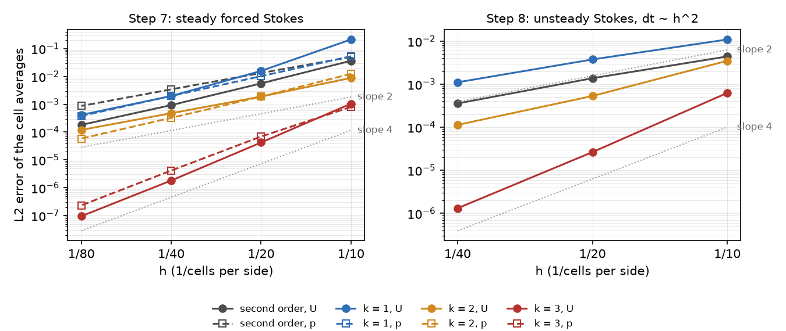

# decayingTaylorGreenVortex high-order verification

These opt-in studies verify the high-order (k-exact) finite volume residual of
`newtonIcoFluid`. The reconstruction check tests the data the residual needs
without running the solver. The Stokes studies run the solver.

A k-exact scheme treats the cell values as cell averages and reconstructs a
polynomial of degree k in each cell. The cell average differs from the
cell-centre value by a term of second order in the cell size, so second-order
initial fields or error norms would hide any gain in accuracy. The boundary
data must also be exact at the face quadrature points, not only at the face
centres.

It is separate from `regressionTest.sh`, and nothing here is run by
`tutorials/Alltest` or `tutorials/Alltest-regression`.

## Reconstruction check

### What is checked

`checkTaylorGreenVortexReconstruction` sets U and p to the exact cell averages
of the Taylor-Green solution, computed with a cell quadrature that is exact
for polynomials of degree 6. It reconstructs both fields with the
`kExactLeastSquares` scheme in `system/reconstructionCheckDict`, for
`polynomialOrder` 1, 2 and 3, and prints the L2 and maximum errors of

- the values and gradients at the cell centres,
- the values (from both sides) and gradients at the internal-face quadrature
  points,
- the values and gradients at the boundary-face quadrature points.

The velocity walls are in the U stencils, and the
`decayingTaylorGreenVortexVelocity` condition gives the exact velocity at their
quadrature points. The pressure walls have a fixed gradient, so the pressure
reconstruction is one-sided there.

The driver runs the utility on the uniform and graded meshes of the tutorial
(levels 2 to 6, from 100 to 25,600 cells) and computes the observed order of
each L2 error, with the cell size taken as $$h \propto N^{-1/2}$$. On the two
finest meshes, the orders of the cell and internal-face errors must be at
least $$k + 1 - 0.2$$ for the values and $$k - 0.2$$ for the gradients. The
boundary-face errors are reported but not checked.

### Running the check

```bash
./Allverify
./Allverify --families uniform --levels 2 3 4
./Allclean
```

`Allverify` builds the utility and the boundary condition library, runs the
meshes in `work/`, and writes all errors to
`postProcessing/reconstruction_errors.csv`. It exits with 1 if a check fails.
The full study takes under a minute.

### Results

Observed orders of the L2 errors between the two finest meshes (6,400 and
25,600 cells), written as uniform / graded.

| k | Field | Cell value | Cell gradient | Face value | Face gradient |
| - | ----- | ---------- | ------------- | ---------- | ------------- |
| 1 | U | 2.00 / 2.00 | 1.51 / 1.59 | 2.31 / 2.10 | 1.52 / 1.55 |
| 1 | p | 2.00 / 2.00 | 1.50 / 1.62 | 2.08 / 2.03 | 1.51 / 1.60 |
| 2 | U | 3.53 / 3.67 | 1.99 / 1.98 | 2.99 / 2.99 | 2.00 / 1.98 |
| 2 | p | 4.35 / 3.92 | 2.01 / 1.98 | 3.02 / 2.98 | 2.01 / 1.98 |
| 3 | U | 3.98 / 3.98 | 3.50 / 3.67 | 4.04 / 4.00 | 3.07 / 2.99 |
| 3 | p | 4.22 / 3.99 | 3.52 / 3.58 | 4.27 / 4.03 | 3.28 / 3.02 |

Every measure reaches the k-exact order, and several exceed it. For k = 1 and
3, the cell-centre gradients converge at about k + 1/2, and for k = 1 so do
the face gradients. For k = 2, the cell-centre values converge at 3.5 to 4.4.
This is most likely because the stencils on these smooth meshes are nearly
symmetric, so part of the leading error cancels. For k = 2 and 3, the face
values and gradients are close to the plain k-exact orders.

### Stencil size

With `faceStencilExtraCells 15`, some stencils in the stretched cells near
the walls of the graded meshes are rank-deficient for `polynomialOrder 3`
(condition numbers near $$10^{16}$$ on `graded.4`), and the gradients in those
cells are wrong by many orders of magnitude while the cell values look
correct. The check uses 20 extra cells, which removes them on all levels. The
scheme does not warn about such stencils.

## Stokes studies

`./Allverify stokes` runs `newtonIcoFluid` with `convection no`, the `alpha`
pressure stabilisation and either the second-order residual or the high-order
residual (`highOrderCoeffs`, `kExactLeastSquares` with 20 extra stencil
cells), on the static uniform meshes. The fields start from exact cell
averages (`initialiseTaylorGreenVortex -cellAverage`), and the errors are those
of the cell averages.

- **Steady forced Stokes (step 7).** `initialiseTaylorGreenVortex
  -steadyStokesSource 0.1` writes the cell averages of the body force
  $$\mathbf{f} = 2 \pi^2 \nu A(t) \mathbf{u}_0 + \nabla p_0$$ to
  `0/momentumSource`, with $$A(t) = e^{-2 \pi^2 \nu t}$$. One step of the
  `steadyState` time scheme to $$t = 0.1$$ then has the exact solution
  $$\mathbf{u} = A(t) \mathbf{u}_0$$, the Taylor-Green velocity that the
  walls impose, and $$p = p_0 = \tfrac{1}{4} [\cos(2 \pi x) +
  \cos(2 \pi y)]$$. This pressure is not constant, so the study tests the
  pressure force, the mass flux and the stabilisation, and its normal
  gradient is zero on the walls, so the wall condition of the second-order
  residual is exact. The velocity and pressure errors are checked, the
  pressure up to a constant, on 10 to 80 cells per side.
- **Unsteady Stokes (step 8).** The decaying Taylor-Green vortex without
  convection, whose exact pressure is constant, with the `backward` scheme to
  $$t = 0.04$$ and $$\Delta t = 0.2 h^2$$. The second-order time error then
  falls like $$h^4$$ and does not hide the spatial order. The velocity error is
  checked on 10 to 40 cells per side.

The observed order between the two finest meshes must be at least the
expected order minus 0.2. By default the steady study runs the second-order,
k = 2 and k = 3 residuals and the unsteady study the second-order and k = 3
residuals; `--configs` selects others.

```bash
./Allverify stokes
./Allverify stokes --studies steady --configs secondOrder k1 k2 k3
```

### Stokes results

L2 errors on the finest mesh and observed orders between the two finest
meshes, from a run with all four residuals. The steady study's finest mesh
has 80 cells per side and the unsteady study's 40.

| Residual | Steady U | Order | Steady p | Order | Unsteady U | Order |
| -------- | -------- | ----- | -------- | ----- | ---------- | ----- |
| second order | 1.81e-4 | 2.36 | 8.70e-4 | 1.98 | 3.57e-4 | 1.95 |
| k = 1 | 4.14e-4 | 2.26 | 3.79e-4 | 2.39 | 1.11e-3 | 1.76 |
| k = 2 | 1.20e-4 | 1.99 | 5.88e-5 | 2.46 | 1.14e-4 | 2.23 |
| k = 3 | 9.52e-8 | 4.26 | 2.33e-7 | 4.16 | 1.31e-6 | 4.33 |



With k = 3 the velocity and the pressure converge at fourth order, and on
80 cells per side the velocity error is about 2,000 times smaller than with
the second-order residual. k = 1 and k = 2 are second order. For k = 2 this
is not specific to the fluid. The solid manufactured solution
(`solids/hyperelasticity/manufacturedSolution`) with a quadratic
`kExactLeastSquares` reconstruction also converges at second order
(displacement order 1.96 on 5 to 20 cells per side), while its cubic one
converges at fourth order. k = 1 on the unsteady meshes has not reached its
asymptotic order; with a small fixed time step it reaches 2.26 on 80 cells
per side.

Run times on one core, finest meshes: steady 1.4 s (second order), 11 s
(k = 2) and 33 s (k = 3); unsteady 11 s (second order) and 330 s (k = 3).
Newton converges in two iterations in all of these. The steady k = 1 run is
the exception. Its linear solves stop at the 10,000 iteration limit before
reaching the tolerance, Newton needs 11 iterations, and the run takes 30
minutes, although the solution converges. Most of the high-order cost is
the residual, which evaluates the reconstructions at every face quadrature
point from both sides once per Krylov iteration.
