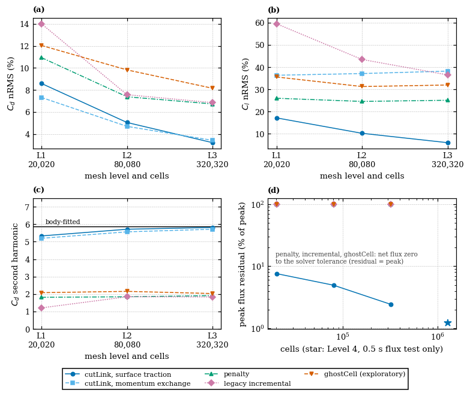
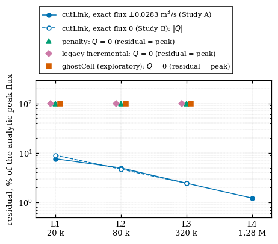
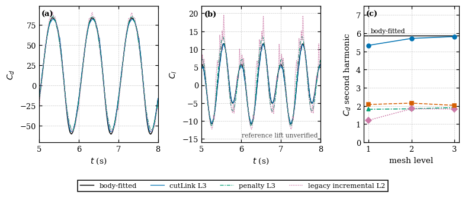
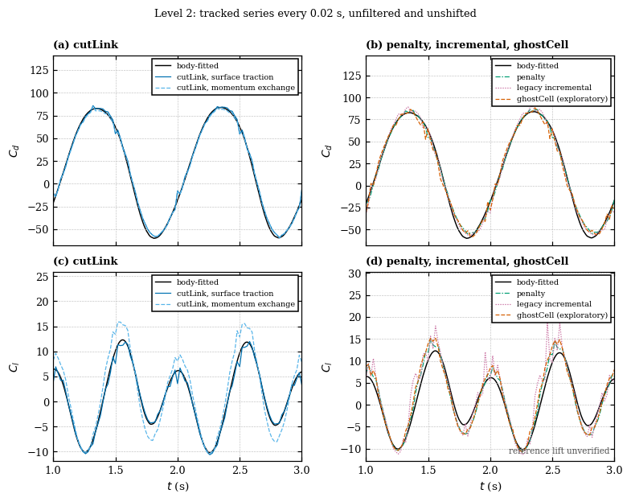
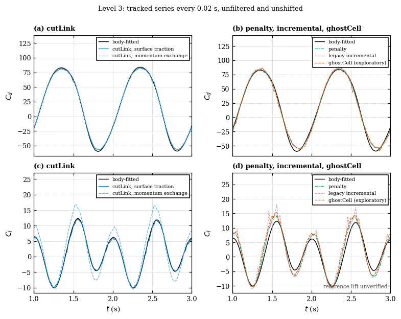
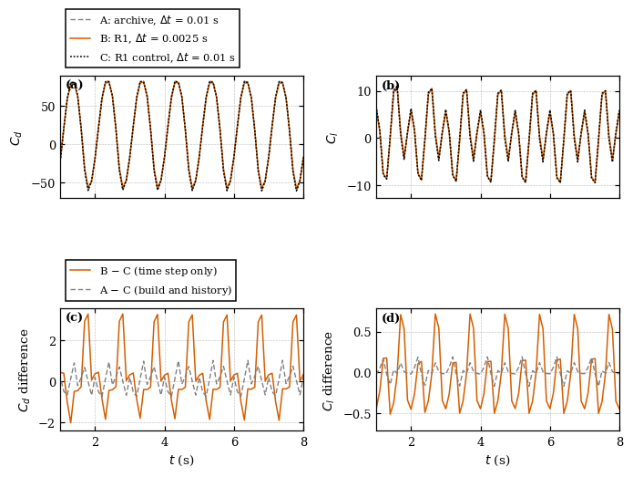
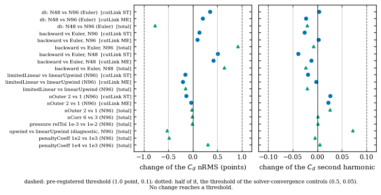
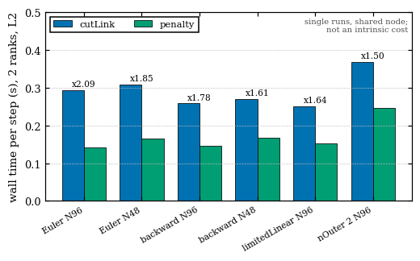

# bendingBeamInChannel verification: results

Every number below is read from the tracked files of `reference/results/`
(computed by the functions of `scripts/bending_beam_verification.py` from the
complete saved runs), and `scripts/test_bending_beam_verification.py` checks
that
the tables of this file agree with them. Solver: solids4foam `f33b244a2`
(`development`), OpenFOAM v2412, cutLink (surface traction and momentum
exchange), penalty, legacy incremental and ghostCell on the mesh levels of the
tutorial (20,020 / 80,080 / 320,320 / 1,281,280 cells). The comparisons are made
over $1 < t < 8$ s with the body-fitted series `reference/CdBodyFitted.dat`,
whose provenance is incomplete (`README.md`). **No formal order of convergence
is claimed, no ranking of the lift is made, and no method is declared
superior.** What was observed, what is interpreted and what is not shown are
kept apart in each section.

## Summary of the comparison

Study A, Levels 1 to 3, every run to 8 s on the adaptive time step; the three
groups of columns answer different questions and are not combined:

- **Flux residual (exact reference).** The peak residual of the net exterior
  flux in per cent of the peak of the exact analytic rate
  $dV/dt = 0.028306 \sin(4 \pi t)$ m$^3$/s. penalty, incremental and
  ghostCell have a net flux of zero to the solver tolerance, so their residual
  is the whole peak: the flux of the volume change is not represented.
- **$C_d$ and $C_l$ nRMS, $C_d$ second harmonic (numerical reference).**
  Differences from the tracked body-fitted series, which has unresolved
  uncertainty (Section 2.1) and an unverified lift: agreement with it, not
  accuracy, and no lift ranking.
- **ghostCell is exploratory** (documented for static bodies) and its forces
  carry a decomposition scatter (Section 2.2).

cutLink's surface traction and momentum exchange are two estimators of one run
(one flux value, one cost).

<!-- markdownlint-disable MD013 -->

<!-- markdownlint-disable MD013 -->

| Method | Mesh | Flux residual, % of the exact peak | $C_d$ nRMS (%) | $C_l$ nRMS (%) | $C_d$ second harmonic (reference 5.889) |
| --- | --- | --- | --- | --- | --- |
| cutLink, surface traction | L1 20,020 | 7.62 | 8.59 | 17.17 | 5.332 |
| cutLink, surface traction | L2 80,080 | 4.96 | 5.04 | 10.23 | 5.716 |
| cutLink, surface traction | L3 320,320 | 2.45 | 3.20 | 6.00 | 5.818 |
| cutLink, momentum exchange | L1 20,020 | 7.62 | 7.31 | 36.35 | 5.197 |
| cutLink, momentum exchange | L2 80,080 | 4.96 | 4.69 | 37.11 | 5.566 |
| cutLink, momentum exchange | L3 320,320 | 2.45 | 3.42 | 38.20 | 5.717 |
| penalty | L1 20,020 | 100.00 (zero to solver tolerance) | 10.94 | 26.00 | 1.814 |
| penalty | L2 80,080 | 100.00 (zero to solver tolerance) | 7.38 | 24.57 | 1.844 |
| penalty | L3 320,320 | 100.00 (zero to solver tolerance) | 6.72 | 25.09 | 1.911 |
| legacy incremental | L1 20,020 | 100.00 (zero to solver tolerance) | 14.02 | 59.54 | 1.208 |
| legacy incremental | L2 80,080 | 100.00 (zero to solver tolerance) | 7.56 | 43.46 | 1.844 |
| legacy incremental | L3 320,320 | 100.00 (zero to solver tolerance) | 6.84 | 36.52 | 1.834 |
| ghostCell (exploratory) | L1 20,020 | 100.00 (zero to solver tolerance) | 12.04 | 35.58 | 2.080 |
| ghostCell (exploratory) | L2 80,080 | 100.00 (zero to solver tolerance) | 9.82 | 31.27 | 2.155 |
| ghostCell (exploratory) | L3 320,320 | 100.00 (zero to solver tolerance) | 8.15 | 31.96 | 2.031 |

<!-- markdownlint-enable MD013 -->

<!-- markdownlint-enable MD013 -->

*Mesh refinement of the four methods on Levels 1 to 3 (20,020, 80,080 and
320,320 cells): (a) $C_d$ nRMS, (b) $C_l$ nRMS, (c) $C_d$ second harmonic, (d)
peak flux residual (the star is the Level 4 flux test of cutLink, 0.5 s, not a
force simulation). Differences from a numerical reference of unresolved
uncertainty; no order of convergence is implied by three levels.*

## 1. A. Exact volume balance

**Observed.** The net flux $Q$ through the inlet and the outlet (outward
positive) at the quarter periods $t = 0.125, 0.25, ...$ of the volume rate
against $dV/dt = 0.028306 \sin(4 \pi t)$ m$^3$/s. Study A is the tutorial
($A_y$ = 0.8 m), Study B has $A_y$ = 0: the exact flux is zero.

<!-- markdownlint-disable MD013 -->

<!-- markdownlint-disable MD013 -->

<!-- markdownlint-disable MD013 -->

<!-- markdownlint-disable MD013 -->

<!-- markdownlint-disable MD013 -->

| Level | Cells | cutLink $Q$/peak at the extremes | peak residual, % of the peak | Study B: max $\lvert Q \rvert$ ($10^{-3}$ m$^3$/s) | Study B, % of the Study A peak |
| --- | --- | --- | --- | --- | --- |
| L1 | 20,020 | 0.9238 | 7.62 | 2.534 | 8.95 |
| L2 | 80,080 | 0.9504 | 4.96 | 1.327 | 4.69 |
| L3 | 320,320 | 0.9755 | 2.45 | 0.691 | 2.44 |
| L4 | 1,281,280 | 0.9878 | 1.22 | - | - |

<!-- markdownlint-enable MD013 -->

<!-- markdownlint-enable MD013 -->

<!-- markdownlint-enable MD013 -->

<!-- markdownlint-enable MD013 -->

<!-- markdownlint-enable MD013 -->

- The cutLink residual falls by the factors 1.54, 2.03, 2.00 between successive
  levels: it halves with each
  refinement from Level 2. This is the observed decay of one diagnostic on four
  levels with a fixed 80-segment surface (whose chordal error is below 0.75 %
  of a cell even on Level 4); it is not a formal order of convergence of the
  method. The flux does not depend on the time step (a factor 2), the time
  scheme
  (Euler, `backward`), the convection scheme, the corrector counts or the number
  of ranks (two ranks against serial: differences below $3 \times 10^{-9}$
  m$^3$/s).
- With $A_y$ = 0 the exact flux is zero and cutLink still has a flux bias
  (2.53, 1.33, 0.69 $\times 10^{-3}$ m$^3$/s, falling by 1.91 and 1.92). On
  Level 3 it equals the
  Study A shortfall to 0.3 %. This is an association shown by two runs on three
  levels, not an identified mechanism.
- penalty, incremental and ghostCell have a net exterior flux of zero to the
  solver tolerance in every run (largest $\lvert Q \rvert$, m$^3$/s):

| Method | max $\lvert Q \rvert$ |
| --- | --- |
| penalty | L1: 2.7e-09, L2: 2.7e-09, L3: 2.0e-09 |
| incremental | L1: 7.9e-09, L2: 2.3e-09, L3: 1.5e-09 |
| ghostCell | L1: 2.9e-09, L2: 1.8e-09, L3: 1.3e-09 |

**Interpretation, not shown by a controlled test.** The continuity treatment of
penalty and incremental, enforced in every cell including the interior of the
body, is consistent with a net flux through the inlet and the outlet of zero
whatever the volume change: their flux residual is the whole peak in every run,
and no finer mesh or time step was observed to change it (none was tested for
these methods beyond the runs listed).
That this missing flux causes the second-harmonic
deficit of Section 2 is **not** shown.

## 2. B. Reference-relative force coefficients

The normalised RMS difference (nRMS) to the body-fitted series, the mean, RMS,
fundamental ($A_1$) and second ($A_2$) harmonic amplitudes of $C_d$ (direct
least
squares over $1 < t < 8$ s; the reference has $A_1$ = 72.06 and $A_2$ = 5.889),
the
high-frequency noise of $C_d$ (RMS of the series minus its 0.01 s moving mean),
and the nRMS and $A_2$ of $C_l$. Adaptive time step, as in the tutorial.

<!-- markdownlint-disable MD013 -->

<!-- markdownlint-disable MD013 -->

<!-- markdownlint-disable MD013 -->

<!-- markdownlint-disable MD013 -->

<!-- markdownlint-disable MD013 -->

| Method (estimator) | Level | $C_d$ nRMS (%) | $C_d$ mean | $C_d$ RMS | $C_d$ $A_1$ | $C_d$ $A_2$ | $C_d$ noise | $C_l$ nRMS (%) | $C_l$ $A_2$ |
| --- | --- | --- | --- | --- | --- | --- | --- | --- | --- |
| cutLink, surface traction | L1 | 8.59 | 18.57 | 55.13 | 73.13 | 5.332 | 2.48 | 17.17 | 7.456 |
| cutLink, surface traction | L2 | 5.04 | 17.71 | 53.50 | 71.10 | 5.716 | 1.70 | 10.23 | 7.775 |
| cutLink, surface traction | L3 | 3.20 | 17.21 | 53.19 | 70.87 | 5.818 | 1.91 | 6.00 | 7.804 |
| cutLink, momentum exchange | L1 | 7.31 | 16.61 | 52.32 | 69.89 | 5.197 | 2.02 | 36.35 | 10.568 |
| cutLink, momentum exchange | L2 | 4.69 | 16.83 | 52.67 | 70.29 | 5.566 | 1.62 | 37.11 | 10.618 |
| cutLink, momentum exchange | L3 | 3.42 | 17.04 | 52.92 | 70.55 | 5.717 | 1.93 | 38.20 | 10.683 |
| penalty | L1 | 10.94 | 17.20 | 52.59 | 70.01 | 1.814 | 5.78 | 26.00 | 9.506 |
| penalty | L2 | 7.38 | 17.17 | 52.48 | 70.07 | 1.844 | 1.34 | 24.57 | 9.553 |
| penalty | L3 | 6.72 | 17.18 | 52.64 | 70.31 | 1.911 | 1.32 | 25.09 | 9.581 |
| legacy incremental | L1 | 14.02 | 16.88 | 55.49 | 74.58 | 1.208 | 3.15 | 59.54 | 10.651 |
| legacy incremental | L2 | 7.56 | 17.20 | 54.40 | 72.87 | 1.844 | 2.79 | 43.46 | 10.194 |
| legacy incremental | L3 | 6.84 | 17.16 | 53.98 | 72.29 | 1.834 | 1.35 | 36.52 | 9.972 |
| ghostCell (exploratory) | L1 | 12.04 | 16.60 | 52.60 | 69.78 | 2.080 | 10.52 | 35.58 | 10.037 |
| ghostCell (exploratory) | L2 | 9.82 | 16.70 | 52.43 | 70.03 | 2.155 | 3.97 | 31.27 | 9.875 |
| ghostCell (exploratory) | L3 | 8.15 | 16.95 | 52.94 | 70.71 | 2.031 | 4.93 | 31.96 | 9.759 |

<!-- markdownlint-enable MD013 -->

<!-- markdownlint-enable MD013 -->

<!-- markdownlint-enable MD013 -->

<!-- markdownlint-enable MD013 -->

<!-- markdownlint-enable MD013 -->

- **Observed.** The cutLink $C_d$ difference falls with the mesh level, 8.6, 5.0
  and 3.2 % (surface traction). That of penalty is larger at the same level
  (10.9, 7.4, 6.7 %), of legacy incremental 14.0, 7.6 and 6.8 %, and of
  ghostCell 12.0, 9.8 and 8.1 %; the decrease from Level 2 to 3 is 9 % of the
  Level 2 value for penalty, 10 % for incremental, 17 % for ghostCell and 36 %
  for cutLink. The second harmonic of cutLink is within 10 % of the reference's
  on
  every level (5.33, 5.72 and 5.82 against 5.89); that of penalty, incremental
  and ghostCell is 1.2 to 2.2, at most 37 % of it, and incremental does not
  recover any more of it on Level 3 (1.21, 1.84, 1.83).
- **Lift (not ranked).** The $C_l$ nRMS of incremental falls on Levels 1 to 3
  (59.5, 43.5, 36.5 %) and that of ghostCell is nearly flat after Level 1
  (35.6, 31.3, 32.0 %), against 26.0, 24.6, 25.1 % for penalty. The reference
  lift is unverified, so these are differences from that series and not a lift
  accuracy ranking.
- **Time step and mesh are not separated except on Level 2.** On Level 2 a
  factor
  2 in the time step changes the $C_d$ nRMS by 0.2 to 0.8 point (Section 3),
  against 4 to 5 points over Levels 1 to 3, so the mesh trend of $C_d$ is
  predominantly spatial. This was not tested on other levels.
- **The reference is uncertain.** The coarse body-fitted solution of the
  archived case changes when its time step is changed (Section 2.1), by about
  the
  size of the differences between formulations. A difference of the nRMS between
  methods of 2 to 4 points is therefore agreement with an uncertain reference,
  not a ranking of accuracy.
- **Lift.** The reference lift is unverified (it is from the same series), the
  lift nRMS of cutLink's surface traction and momentum exchange differ by a
  factor of 2 to 6 (17.2, 10.2, 6.0 % against 36.4, 37.1, 38.2 %), and **no lift
  ranking is made**.

*$C_d(t)$ and $C_l(t)$, $1 < t < 3$ s (two periods), of the four methods at
Levels 2 and 3 against the tracked body-fitted series (black): (a, c) cutLink,
surface traction and momentum exchange; (b, d) penalty, legacy incremental and
exploratory ghostCell. The tracked series are sampled every 0.02 s (the
spikes of ghostCell and incremental are partly undersampled; the raw
time-step series are in the research archive). Unfiltered and unshifted. The
reference lift is unverified.*

### 2.1 The body-fitted case at two time steps

The archived body-fitted case (24,720 cells) was run with the time step of its
archive (0.01 s, A), reduced to 0.0025 s (B), and again at 0.01 s as a control
(C) on one installation (OpenFOAM v2512), with only `deltaT`, the write
intervals
and the decomposition changed (a complete diff of the inputs of B and C shows
those and nothing else). Same sample times and interval ($1 < t < 8$ s); no
phase
alignment.

<!-- markdownlint-disable MD013 -->

<!-- markdownlint-disable MD013 -->

<!-- markdownlint-disable MD013 -->

<!-- markdownlint-disable MD013 -->

<!-- markdownlint-disable MD013 -->

| Quantity | Coefficient | A, archive, 0.01 s | B, 0.0025 s | C, control, 0.01 s |
| --- | --- | --- | --- | --- |
| mean (1<t<8, native samples) | Cd | 17.5467 | 16.8736 | 16.7882 |
| RMS (1<t<8, native samples) | Cd | 54.1821 | 52.5478 | 53.6562 |
| fundamental amplitude (direct LSQ, 0.1 s grid) | Cd | 71.7766 | 70.0404 | 71.6641 |
| second harmonic amplitude (direct LSQ, 0.1 s grid) | Cd | 6.2533 | 5.8566 | 6.3255 |
| second harmonic phase (deg, direct LSQ) | Cd | 70.02 | 65.47 | 69.0 |
| nRMS to tracked reference (%), same sample times, no interpolation of the force | Cd | 1.354 | 3.047 | 1.053 |
| nRMS to tracked reference (%), 0.01 s grid | Cd | - | 3.035 | 0.994 |
| nRMS difference B-C (%), 0.1 s grid, normalised by the second | Cd | 2.906 | - | - |
| nRMS difference A-C (%), 0.1 s grid, normalised by the second | Cd | 0.989 | - | - |
| nRMS difference A-B (%), 0.1 s grid, normalised by the second | Cd | 2.886 | - | - |
| nRMS difference B-C (%), 0.01 s grid | Cd | 2.767 | - | - |
| mean (1<t<8, native samples) | Cl | 0.501 | 0.5367 | 0.5717 |
| RMS (1<t<8, native samples) | Cl | 6.4693 | 6.2658 | 6.447 |
| fundamental amplitude (direct LSQ, 0.1 s grid) | Cl | 4.2229 | 4.4592 | 4.2389 |
| second harmonic amplitude (direct LSQ, 0.1 s grid) | Cl | 7.9518 | 7.5727 | 7.9752 |
| second harmonic phase (deg, direct LSQ) | Cl | 69.52 | 68.04 | 70.2 |
| nRMS to tracked reference (%), same sample times, no interpolation of the force | Cl | 2.338 | 4.874 | 2.317 |
| nRMS to tracked reference (%), 0.01 s grid | Cl | - | 4.916 | 1.886 |
| nRMS difference B-C (%), 0.1 s grid, normalised by the second | Cl | 6.157 | - | - |
| nRMS difference A-C (%), 0.1 s grid, normalised by the second | Cl | 1.405 | - | - |
| nRMS difference A-B (%), 0.1 s grid, normalised by the second | Cl | 5.713 | - | - |
| nRMS difference B-C (%), 0.01 s grid | Cl | 5.814 | - | - |

<!-- markdownlint-enable MD013 -->

<!-- markdownlint-enable MD013 -->

<!-- markdownlint-enable MD013 -->

<!-- markdownlint-enable MD013 -->

<!-- markdownlint-enable MD013 -->

- **B against C is the controlled time-step comparison**: $C_d$ differs by 2.9 %
  and $C_l$ by 6.2 % (normalised by C); in each of the windows 1-2, 2-4, 4-6
  and 6-8 s it is 2.7 to 2.9 % and 5.8 %, i.e. not a start-up effect.
- **A against C** (1.0 % and 1.4 %) is the difference of the historical archive
  from the same case run now: a different build of the solver (the archive was
  run with the build `bd2b6720`, C with `87ed40d2`), recompiled boundary
  conditions and any undocumented detail of the archive.
- The coarser time step is **closer** to the tracked series (nRMS 1.05 and
  2.32 %) than the finer one (3.05 and 4.87 %): reducing the time step of the
  coarse mesh does not move it towards the reference; the reference has about
  four
  times as many cells and its own, partly unknown, settings. **This does not
  establish the uncertainty of the tracked 98,880-cell series**, and the
  agreement of A and C does not either.
- The 0.1 s output interval of the archive matters when comparing: linear
  interpolation of a series sampled every 0.1 s on the reference times raises
  the nRMS from 1.4 and 2.3 % to 4.1 and 13.0 % (A) because the second
  harmonic has five samples per period; the comparisons above use the same
  sample times and no interpolation of the force.

### 2.2 Levels 2 and 3 of incremental and ghostCell, and the time-step history

Legacy incremental was run on Level 3 (8 ranks) and ghostCell on Levels 1 to 3
(1, 4 and 8 ranks), with the settings of Levels 1 and 2 of the baseline matrix
and no parameter changed. The earlier ghostCell Level 1 run wrote fields every
2 s, not every 0.125 s as the other runs, so it was repeated with the matched
write interval and the new run is the one tabulated (the 2 s run gave nRMS
11.58 % and $A_2$ 2.044 against 12.04 % and 2.080: a difference of 0.46 point,
below the threshold of 1.0 point). The number of steps and the mean time step of
every method on
a level agree within 3 % (table), so the differences in the nRMS are not due to
different time-step histories. The last column is a **filtered diagnostic**
(the force is replaced by its 0.0104 s moving mean before the comparison; the
unfiltered comparison above is the result): it shows how much of the nRMS is
high-frequency content.

<!-- markdownlint-disable MD013 -->

<!-- markdownlint-disable MD013 -->

<!-- markdownlint-disable MD013 -->

<!-- markdownlint-disable MD013 -->

| Method | Level | steps | mean $\Delta t$ (ms) | $C_d$ nRMS (%) | filtered $C_d$ nRMS (%) |
| --- | --- | --- | --- | --- | --- |
| cutLink, surface traction | L1 | 1234 | 6.495 | 8.59 | 7.69 |
| cutLink, surface traction | L2 | 2559 | 3.100 | 5.04 | 3.86 |
| cutLink, surface traction | L3 | 5216 | 1.519 | 3.20 | 2.47 |
| penalty | L1 | 1235 | 6.483 | 10.94 | 8.83 |
| penalty | L2 | 2554 | 3.107 | 7.38 | 7.08 |
| penalty | L3 | 5202 | 1.522 | 6.72 | 6.61 |
| legacy incremental | L1 | 1222 | 6.562 | 14.02 | 12.66 |
| legacy incremental | L2 | 2551 | 3.110 | 7.56 | 6.70 |
| legacy incremental | L3 | 5195 | 1.525 | 6.84 | 6.48 |
| ghostCell (exploratory) | L1 | 1264 | 6.348 | 12.04 | 9.81 |
| ghostCell (exploratory) | L2 | 2572 | 3.089 | 9.82 | 7.74 |
| ghostCell (exploratory) | L3 | 5203 | 1.524 | 8.15 | 6.62 |

<!-- markdownlint-enable MD013 -->

<!-- markdownlint-enable MD013 -->

<!-- markdownlint-enable MD013 -->

<!-- markdownlint-enable MD013 -->

- **Observed.** The filtered nRMS of penalty, incremental and ghostCell on
  Level 3 is the same, 6.6, 6.5 and 6.6 %, and that of cutLink is 2.5 %. The
  unfiltered difference of ghostCell (8.1 %) is larger than that of the others
  (6.7 and 6.8 %) because of its force fluctuations: the high-frequency
  residual of $C_d$ is 10.5, 4.0 and 4.9 on Levels 1 to 3 (penalty 5.8, 1.3,
  1.3; incremental 3.1, 2.8, 1.4; the reference 0.1). The ghostCell residual
  falls from Level 1 to 2 and rises again on Level 3, with isolated downward
  spikes of the drag that persist in amplitude with refinement (appendix figure
  of the close-up).
- **Observed.** The net exterior flux of ghostCell and incremental is zero to
  the solver tolerance on every level (largest $\lvert Q \rvert$ 2.9e-09 and
  7.9e-09 m$^3$/s).
- **Decomposition scatter of ghostCell.** On Level 1, 1 s, the serial run and
  the runs on 2 and 4 ranks have the same steps and time steps; the force
  differs between them by 0.5 to 1.0 % of its RMS (the largest instantaneous
  difference of $C_d$ is 3.5 to 5.4 % of it, at spikes), and the means differ by
  0.1 to 0.3 %. The same comparison for penalty (2 against 4 ranks, Level 2) and
  incremental (serial against 2 ranks, Level 1) gave 0.7 % and 0.02 % at the
  largest instantaneous difference. The ghostCell forces on Levels 2 and 3 were
  run on 4 and 8 ranks and carry this scatter; no replicate was made. The
  cross-processor search for donor cells was exercised (up to 55 ghost cells
  with
  a donor on another processor on Level 3) and the flux is unchanged.
- **Interpretation (not tested).** The unfiltered nRMS of ghostCell falls with
  the mesh, and so does the filtered one (9.8, 7.7, 6.6 %), so the improvement
  is not only a reduction of noise; its excess over penalty and incremental on
  Level 3 (1.4 point) disappears after filtering. The persistence of the
  second-harmonic deficit of incremental and ghostCell on Level 3, like that of
  penalty, is consistent with a property of the formulations. That the missing
  flux causes the deficit is not shown, and no order of convergence is claimed
  from three levels.

## 3. C. Finite-volume sensitivity

Level 2, Study A, fixed time step $\Delta t$ = 0.125/96 (the control), 0 to 8 s,
two ranks, Euler, `linearUpwind`, `nOuterCorrectors` 1, `nCorrectors` 3,
pressure
`relTol` 0.01 (final 0); one setting changed at a time. Pre-registered
thresholds, set before the runs and not changed: a change of 1.0 point of the
$C_d$
nRMS or 0.1 of $C_d$ $A_2$ is material (0.5 and 0.05 for the solver-convergence
controls). Changes of the nRMS and $A_2$ are test minus control.

<!-- markdownlint-disable MD013 -->

<!-- markdownlint-disable MD013 -->

<!-- markdownlint-disable MD013 -->

<!-- markdownlint-disable MD013 -->

<!-- markdownlint-disable MD013 -->

| Q | Comparison | Estimator | change of $C_d$ nRMS (points) | change of $C_d$ $A_2$ | noise ratio | material |
| --- | --- | --- | --- | --- | --- | --- |
| Q1 | dt: N48 vs N96 (Euler) | cutLink ST | +0.35 | +0.004 | 1.037 | no |
| Q1 | dt: N48 vs N96 (Euler) | cutLink ME | +0.20 | -0.023 | 1.058 | no |
| Q1 | dt: N48 vs N96 (Euler) | total | -0.76 | -0.020 | 0.587 | no |
| Q2 | backward vs Euler, N96 | cutLink ST | +0.13 | -0.026 | 1.154 | no |
| Q2 | backward vs Euler, N96 | cutLink ME | +0.10 | +0.002 | 1.146 | no |
| Q2 | backward vs Euler, N96 | total | +0.93 | -0.008 | 1.6 | no |
| Q2 | backward vs Euler, N48 | cutLink ST | +0.50 | -0.040 | 1.165 | no |
| Q2 | backward vs Euler, N48 | cutLink ME | +0.42 | -0.012 | 1.147 | no |
| Q2 | backward vs Euler, N48 | total | +0.65 | -0.024 | 1.663 | no |
| Q4 | limitedLinear vs linearUpwind (N96) | cutLink ST | -0.15 | -0.019 | 0.978 | no |
| Q4 | limitedLinear vs linearUpwind (N96) | cutLink ME | -0.20 | -0.002 | 0.987 | no |
| Q4 | limitedLinear vs linearUpwind (N96) | total | -0.15 | -0.020 | 0.989 | no |
| Q5 | nOuter 2 vs 1 (N96) | cutLink ST | -0.14 | +0.026 | 0.95 | no |
| Q5 | nOuter 2 vs 1 (N96) | cutLink ME | -0.04 | +0.023 | 0.942 | no |
| Q5 | nOuter 2 vs 1 (N96) | total | -0.02 | +0.026 | 0.995 | no |
| Q5 | nCorr 6 vs 3 (N96) | total | -0.01 | +0.001 | 1.0 | no |
| Q5 | pressure relTol 1e-3 vs 1e-2 (N96) | total | -0.00 | +0.001 | 1.001 | no |
| Q4 | upwind vs linearUpwind (diagnostic, N96) | total | -0.52 | +0.072 | 0.992 | no |
| Q6 | penaltyCoeff 1e2 vs 1e3 (N96) | total | -0.48 | -0.005 | 0.635 | no |
| Q6 | penaltyCoeff 1e4 vs 1e3 (N96) | total | +0.31 | +0.005 | 1.164 | no |

<!-- markdownlint-enable MD013 -->

<!-- markdownlint-enable MD013 -->

<!-- markdownlint-enable MD013 -->

<!-- markdownlint-enable MD013 -->

<!-- markdownlint-enable MD013 -->

- **Observed.** No setting reached a threshold: the largest changes are +0.93
  point (penalty, `backward`) and +0.07 of $A_2$ (penalty, first-order
  `upwind`, a diagnostic). `backward` raises the high-frequency noise of penalty
  by a factor 1.6 and of cutLink by 1.15, and halving the time step lowers
  that of penalty. The exterior flux was identical in every cutLink run
  (ratio 0.95039) and zero in every penalty run.
- **Interpretation.** For these metrics the baseline (Euler, `linearUpwind`, one
  outer and three pressure correctors) is a defensible finite-volume choice and
  is not what limits the agreement. This says the metrics are insensitive to the
  tested settings at Level 2; it is not a proof of accuracy against the
  reference.
- **Time scheme caveat.** For penalty, incremental and ghostCell the reported
  force includes the inertia of the fluid inside the body as a first-order
  difference of its momentum, independent of `ddtSchemes`. `backward` changes
  the
  flow solution but not this estimator (the inertia statistics of penalty runs
  with Euler and `backward` are identical). Second-order accuracy of the force
  is
  not claimed from using `backward` in the fluid equations.
- **Not run**: `CrankNicolson` (it rings after the impulsive start), a third
  time
  step, these settings on other levels, and nCorr, pressure tolerance and upwind
  for cutLink.

## 4. D. Formulation sensitivity

- **penaltyCoeff** over 1e2, 1e3, 1e4 changes the $C_d$ nRMS by -0.48 and +0.31
  point
  (monotone), the $C_d$ second harmonic by less than 0.01, and the
  high-frequency noise
  from 0.64 to 1.16 times that of 1e3 (a stiffer penalty is noisier); the flux
  stays zero to the solver tolerance. The second-harmonic deficit and the zero
  flux did not change with the coefficient over this range. This is one
  parameter at one level and not a recommendation.
- **Interior velocity.** The velocity imposed inside the body by the code is the
  velocity of the *nearest surface point* (`immersedBody::velocity` interpolates
  the surface point velocities to the nearest point), because
  `customProfileBend::velocity()` is defined on the surface only. Inside a
  bending beam this is a non-material extension: the vertical component jumps by
  up to 0.64 m/s across the centreline where the rigid-extension velocity of the
  same material points is about 0.04 m/s. Both cutLink and penalty use it. On a
  fixed physical region deep inside the beam (material coordinates, 0.04 m from
  the surfaces) the velocity of penalty differs from that imposed by cutLink by
  1.2, 1.7 and 2.1 % of the peak body speed on Levels 1 to 3: small, **not
  decreasing with refinement** (cause not isolated), and independent of the
  coefficient (1.67 to 1.69 %), the time step and the scheme. That this
  extension
  causes the second-harmonic deficit is not shown.
- **Not run**: `surfaceRateCoeff` and occupancy variants, incremental
  parameters,
  ghostCell fresh-cell diagnostics (the code writes no per-cell state; they
  need a source change).

## 5. E. Applicability

- A body whose enclosed volume changes is represented by cutLink with a flux
  error that decreases with the mesh and by penalty and incremental with none of
  the flux: for deforming chambers or any non-rigid immersed body they
  cannot be expected to give the exterior flow demanded by the volume
  change. This is a property of their present continuity treatment, not of the
  finite-volume settings.
- The tutorial motion is horizontal bending with a rotation of the sections;
  with $A_y$ = 0 the volume does not change, and the cutLink flux bias then is a
  discretisation property of the aperture treatment, not of the volume change.
- ghostCell is documented for static bodies; its Levels 1 to 3 results here are
  exploratory and are shown beside the others, not as a validated comparison.
- Applicability beyond this tutorial (turbulence, three dimensions, other
  Reynolds numbers, FSI) was not tested.

## 6. F. Observed computational cost

Allocated rank-hours are ranks times wall time. The tracked costs are from the
runs of Section 2; Level 4 on four ranks for 0.5 s cost 1.709 allocated
rank-hours (9.4 rank-microseconds per cell-step, 512 steps).

**Contamination and what was done.** The first four sensitivity runs ran with
all eight MPI ranks of four simultaneous `mpirun` jobs bound to two cores (Open
MPI 4.1.2 binds each job's ranks to the first cores by default), about 18 % of
their steps at 25 % CPU, and were freed without a restart. Their allocated
hours overstate their cost; they are kept in the ledger, and their cost is
quoted at the rate of their last 40 % of steps:

<!-- markdownlint-disable MD013 -->

<!-- markdownlint-disable MD013 -->

<!-- markdownlint-disable MD013 -->

<!-- markdownlint-disable MD013 -->

<!-- markdownlint-disable MD013 -->

| Run | allocated rank-h | at the unaffected rate | share of steps while pinned |
| --- | --- | --- | --- |
| T-cutLink-Euler-N48 | 1.8261 | 0.525 | 0.19 |
| T-penalty-backward-N96 | 1.835 | 0.496 | 0.19 |
| T-penalty-Euler-N96 | 1.3356 | 0.481 | 0.18 |
| T-cutLink-Euler-N96 | 2.3144 | 1.003 | 0.18 |

<!-- markdownlint-enable MD013 -->

<!-- markdownlint-enable MD013 -->

<!-- markdownlint-enable MD013 -->

<!-- markdownlint-enable MD013 -->

<!-- markdownlint-enable MD013 -->

**Matched pairs.** cutLink and penalty runs with identical settings whose
last-40 % windows were entirely after the correction (two ranks, Level 2, 6144
or 3072 steps, wall time per step; the last column is the number of other ranks
of the same campaign running at the time, unknown load of other users
excluded):

<!-- markdownlint-disable MD013 -->

<!-- markdownlint-disable MD013 -->

<!-- markdownlint-disable MD013 -->

<!-- markdownlint-disable MD013 -->

<!-- markdownlint-disable MD013 -->

| Settings | cutLink s/step | penalty s/step | ratio | other campaign ranks (cutLink / penalty) |
| --- | --- | --- | --- | --- |
| Euler N96 | 0.2939 | 0.1408 | 2.09 | 6.0 / 6.0 |
| Euler N48 | 0.3078 | 0.1661 | 1.85 | 6.0 / 4.0 |
| backward N96 | 0.2584 | 0.1453 | 1.78 | 4.0 / 6.0 |
| backward N48 | 0.2695 | 0.1669 | 1.61 | 6.0 / 2.0 |
| limitedLinear N96 | 0.2507 | 0.153 | 1.64 | 4.0 / 4.0 |
| nOuter 2 N96 | 0.3675 | 0.2458 | 1.5 | 4.1 / 4.0 |

<!-- markdownlint-enable MD013 -->

<!-- markdownlint-enable MD013 -->

<!-- markdownlint-enable MD013 -->

<!-- markdownlint-enable MD013 -->

<!-- markdownlint-enable MD013 -->

- **Observed.** The ratio is 1.50 to 2.09 in the six matched pairs (median
  1.71). The tracked adaptive runs
  give 1.4, 1.8 and 2.0 on Levels 1 to 3 (serial and two ranks, SLURM). The two
  sets of runs agree on "cutLink costs more per run, by a factor of about 1.5 to
  2".
- **Not established.** A single ratio (the earlier "1.8 to 2.0" overstates the
  matched range), an intrinsic efficiency (single runs, node load average about
  130
  to 195 on a node with 192 cores, 0.7 to 6 other ranks of this campaign
  running, scatter of nominally identical runs about 15 %), or a cost at fixed
  accuracy: the
  methods differ in accuracy and in what they represent (Section 1), and
  cutLink's cost includes the evaluation of both force estimators. The
  incremental cost is dominated by its five outer correctors (a setting).
- The cost of the cutLink time steps is proportional to the number of steps:
  the fixed-step runs of 3072 steps cost about the same as the adaptive ones of
  2559 steps.

## 7. Not executed

A full Level 4 eight-second run (estimated 27 to 35 allocated rank-hours), a
body-fitted run with the mesh of the tracked series, a second time-step level
other than Level 2, a geometry refinement of the surface (the polygonal
surface changes the volume rate by $6 \times 10^{-8}$ of the peak),
`CrankNicolson`,
and the incremental and ghostCell parameter studies. None is needed for the
statements above; a Level 4 force run would not be interpretable as an accuracy
gain while the reference is uncertain at the level of 2 to 3 points.
