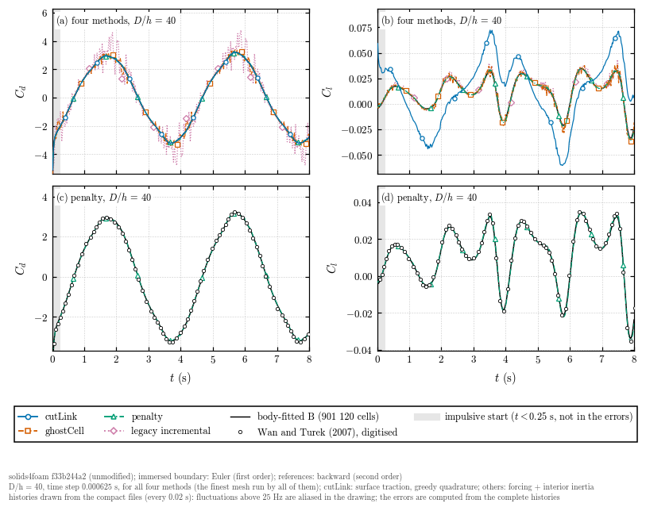
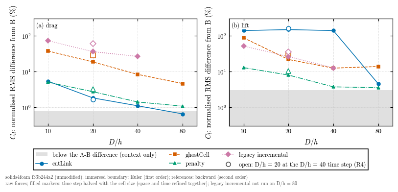
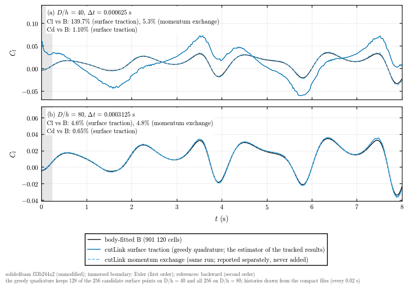

# Results

These results were obtained with solids4foam `f33b244a2` and OpenFOAM v2412
on one shared node. The immersed-boundary, fluid-model and tutorial sources
of that revision are identical to those of `development` at `09b315b3c`.
The cutLink surface traction uses the greedy quadrature, the only one of
that revision (see `README.md`, Quadrature). The values are those of
`reference/results/cases.csv`, computed by `./Allverify analyse` from the
complete force histories.

## Summary

The four methods are compared on a body that moves and accelerates through
a stationary mesh. The main findings, each specific to this case, these
settings and the tested revision:

- **Steady drag accuracy is not enough.** In the static-cylinder
  verification of solids4foam pull request #595, the mean drag on the
  finest mesh (D/h = 80) differs from the high-precision reference by
  0.003 % (cutLink), 0.16 % (ghostCell), 1.2 % (penalty) and 2.8 % (legacy
  incremental, a limit-cycle mean). The cutLink value there is its
  momentum-exchange estimate; its greedy surface traction, the estimator
  of this verification, is 1.5 % below the reference on that mesh, so the
  cutLink errors of the two verifications are not errors of the same
  estimator. On the moving cylinder, the force estimator, the surface
  quadrature, the resolution, the time scheme and the crossing of cells by
  the body all matter.
- **Drag and lift must both be examined.** The lift of this case is about
  100 times smaller than the drag, so an error in the force estimator that
  is invisible in the drag can dominate the lift. At the common D/h = 40
  the raw drag differs from reference B by 1.10 % (cutLink), 1.41 %
  (penalty), 8.32 % (ghostCell) and 26.45 % (legacy incremental), and the
  raw lift by 139.7 %, 3.7 %, 12.4 % and 12.7 %.
- **penalty is the most balanced method in this comparison.** At
  D/h = 40 it is the only method whose drag and lift differences are both
  a few per cent (1.41 % and 3.7 %, the lift close to the A-B difference
  of 3.0 %), its force has no visible cell-crossing fluctuation, and its
  run was the least expensive (1.493 allocated CPU hours). This is why it
  is shown against B and the Wan and Turek result in panels (c, d) of the
  force-history figure, with the same run for both coefficients. It is not
  a general ranking: the cutLink drag is more accurate, and the ranking of
  the lift may change with a corrected cutLink quadrature.
- **cutLink drag is accurate; its greedy lift is not.** The cutLink surface
  traction gives the most accurate drag of the four (1.10 % at D/h = 40,
  0.65 % at D/h = 80). Its lift differs from B by 140 %, 149 % and 140 %
  on D/h = 10, 20 and 40 (161 % on D/h = 20 with the time step halved).
  The greedy thinning of the candidate surface points (in the order of the
  STL facets, with the area of the discarded points given to the kept
  ones) breaks the cancellation of the transverse pressure force: the
  spurious lift is -0.013 to -0.014 times Cd, about 1 % of the drag force
  (small in the drag) but larger than the lift itself; reversing the facet
  order reverses its sign (see Limitations).
- **The D/h = 80 result is not a convergence of the greedy quadrature.** On
  D/h = 80 all 256 candidate points are kept, the defect is absent and the
  lift differs by 4.6 %. This is a property of this mesh and surface; it
  does not make the greedy quadrature reliable for the lift of moving
  bodies on other meshes or surfaces. The momentum-exchange estimate of
  the same runs, reported separately and never added to the surface
  traction, gives 17.7 %, 8.7 %, 5.3 % and 4.8 %.
- **The clustered quadrature is a separate change.** A quadrature without
  the greedy area transfer is introduced in solids4foam pull request #612.
  Every result here uses the greedy quadrature of `f33b244a2`, selected
  explicitly by the driver when the keyword exists; the final form of that
  pull request has not been run over this 8 s study.
- **Cell-crossing fluctuations.** ghostCell and the legacy method have
  force fluctuations at the frequency with which the moving surface
  crosses cell centres (157 Hz on D/h = 40), from cells changing between
  solid and fluid (the binary inside test and image-point donors of
  ghostCell; the occupancy jumps divided by the time step in the inertia
  of the legacy method). They do not vanish with more outer correctors,
  grow when the time step is halved, and dominate the raw errors of those
  methods.
- **Raw, not filtered, histories are compared.** All errors and figures use
  the raw force. The 5 Hz low-passed errors are a diagnostic of the slowly
  varying force only, not a substitute for the raw comparison, and the
  compact 0.02 s histories of `reference/results/` are for drawing only
  (they cannot resolve the 39-314 Hz cell crossing).
- **The references are not exact or interchangeable.** Both body-fitted
  references are numerical solutions with a second-order time scheme and
  differ from each other by 0.77 % (Cd) and 3.0 % (Cl), a measure of
  reference sensitivity, not an uncertainty bound. The digitised Wan and
  Turek (2007) result leads both by about 18 ms and differs from B by
  3.3 % and 7.3 %; it is a secondary published comparison and is not
  shifted. The immersed-boundary runs use the first-order Euler scheme.
- **Cost figures need care.** At D/h = 40 (8 ranks, 8 s simulated) the runs
  took 3.391 (cutLink), 2.731 (ghostCell), 1.493 (penalty) and 14.278
  (legacy incremental) allocated CPU hours (ranks times job wall time) on
  one shared node. Reference B took about 1.13e3 MPI rank-hours, estimated
  from its solver elapsed time and 96 ranks; no scheduler accounting
  exists for it, so its consumed CPU time is unknown. Allocated CPU hours,
  rank-hours and consumed CPU time are not interchangeable, no scaling
  study was made, and no speed-up relative to the body-fitted solver is
  derived.

## Case and references

The centre of the cylinder (D = 0.1 m) moves as
`x_c = 1.1 + 0.25 sin(2 pi t/4)` m, `y_c = 0.2` m, in a closed channel of
`2.2 x 0.41` m with no-slip walls, filled with fluid at rest (`nu = 1e-3` m^2/s,
`rho = 1` kg/m^3; Re = U_ref D/nu = 39). The motion starts impulsively at
the maximum velocity `U_ref = 2 pi A/T = 0.3927` m/s, so the force is
singular at `t = 0`.

| Reference | Source | Use |
| --- | --- | --- |
| A | `CdBodyFitted.dat`, `ClBodyFitted.dat` | primary |
| B | `bodyFitted901k.csv` | primary |
| digitised | `Cd.dat`, `Cl.dat` | secondary |

- **A:** moving body-fitted mesh, solids4foam `newtonIcoFluid`, 282 624
  cells, backward scheme, `deltaT = 0.005` s, to `t = 7.58` s (the case of
  fluid-benchmarks).
- **B:** moving body-fitted mesh, solids4foam `pimpleFluid`, 901 120 cells,
  backward scheme, `deltaT = 0.00025` s, at most 30 outer correctors per
  step, to `t = 8` s. The provenance is in the file header; the solids4foam
  revision of that run is not recorded. Its solver log (not tracked here)
  shows one continuous run of 32 000 steps on 96 MPI ranks: the residual
  control (1e-6) ended every step but one after 5 to 30 outer correctors
  (mean 7.75), and the solver clock time was 42 524 s (11.8 h, about
  1 134 rank-hours). No scheduler accounting of that run exists. It is a
  high-resolution reference computation, not an optimised production
  setting, and its cost is not compared with that of the runs here.
- **digitised:** the result of Wan and Turek (2007) as shown in a figure of
  Erzincanli and Sahin (2013), digitised for fluid-benchmarks (commit
  `0dc5a6d`). It differs from B by 3.3 % (Cd) and 7.3 % (Cl), and leads both
  body-fitted solutions by about 18 ms.

A and B differ from each other by 0.77 % (Cd) and 3.0 % (Cl) in normalised
RMS over the window below. This difference measures how sensitive the
reference is to its mesh, time step and solver. It is not a certified
uncertainty, and smaller differences between methods are not ranked.
Neither reference uses the immersed-boundary discretisation. Both use a
second-order time scheme, whereas the cases here use the tutorial's Euler
scheme.

## Analysis

- **Window:** `0.25 <= t <= 7.5` s, excluding the impulsive start.
- **Error:** the time-weighted RMS difference from a reference, normalised by
  the RMS of the reference. Both series are interpolated linearly on the
  union of their sample times; nothing is extrapolated, shifted or smoothed.
  This raw-force error is the primary result.
- **Diagnostics, reported separately:**
  - the same error after a zero-phase 5 Hz low-pass filter (4th-order
    Butterworth, forward and backward; window shortened by 0.25 s at each
    end); this is not a force estimator;
  - the RMS of the force above 5 Hz;
  - the time shift that minimises the error.
- **The 5 Hz cut-off:** reference B has an RMS of 8e-5 above 5 Hz, while at
  its maximum velocity the cylinder crosses 39 cells per second on Level 1
  (U_ref/h; 79, 157 and 314 on Levels 2-4).

## Runs

Every run reaches its end time and passes the numerical integrity checks.
At each level the background meshes of all methods have identical hashes.
The levels have 5 084, 20 336, 81 344 and 325 376 cells. The time step is
halved with the cell size (R1-R3, R5); R4 repeats Level 2 with the Level 3
time step. N5-N20 repeat R2C for the first 2.25 s with 5, 10 and 20 outer
correctors. O4 repeats R2A on one rank, and `smoke` is the first 0.5 s of
R1A. Of the 24 tracked runs, 20 are full 8 s runs (19 at one rank count
plus the serial repeat O4), 3 are the 2.25 s outer-corrector runs and 1 is
the 0.5 s smoke run. Only the 8 s runs enter the convergence tables and
figures; the shorter runs have their own section and are used by
`./Allverify check`.

| Run | Method | D/h | dt (s) | End (s) | Ranks | Max Co | CPU-h |
| --- | --- | --- | --- | --- | --- | --- | --- |
| R1A | cutLink | 10 | 0.0025 | 8 | 1 | 0.121 | 0.023 |
| R2A | cutLink | 20 | 0.00125 | 8 | 2 | 0.129 | 0.238 |
| R3A | cutLink | 40 | 0.000625 | 8 | 8 | 0.130 | 3.391 |
| R5A | cutLink | 80 | 0.0003125 | 8 | 8 | 0.135 | 37.747 |
| R4A | cutLink | 20 | 0.000625 | 8 | 2 | 0.067 | 0.437 |
| O4 | cutLink | 20 | 0.00125 | 8 | 1 | 0.129 | 0.187 |
| smoke | cutLink | 10 | 0.0025 | 0.5 | 1 | 0.121 | 0.002 |
| R1D | ghostCell | 10 | 0.0025 | 8 | 1 | 0.147 | 0.020 |
| R2D | ghostCell | 20 | 0.00125 | 8 | 2 | 0.165 | 0.212 |
| R3D | ghostCell | 40 | 0.000625 | 8 | 8 | 0.180 | 2.731 |
| R5D | ghostCell | 80 | 0.0003125 | 8 | 8 | 0.200 | 24.778 |
| R4D | ghostCell | 20 | 0.000625 | 8 | 2 | 0.084 | 0.354 |
| R1B | penalty | 10 | 0.0025 | 8 | 1 | 0.119 | 0.014 |
| R2B | penalty | 20 | 0.00125 | 8 | 2 | 0.122 | 0.124 |
| R3B | penalty | 40 | 0.000625 | 8 | 8 | 0.128 | 1.493 |
| R5B | penalty | 80 | 0.0003125 | 8 | 8 | 0.136 | 18.131 |
| R4B | penalty | 20 | 0.000625 | 8 | 2 | 0.061 | 0.216 |
| R1C | incremental | 10 | 0.0025 | 8 | 1 | 0.128 | 0.075 |
| R2C | incremental | 20 | 0.00125 | 8 | 2 | 0.161 | 0.694 |
| R3C | incremental | 40 | 0.000625 | 8 | 8 | 0.165 | 14.278 |
| R4C | incremental | 20 | 0.000625 | 8 | 2 | 0.081 | 1.321 |
| N5 | incremental | 20 | 0.00125 | 2.25 | 2 | 0.161 | 0.252 |
| N10 | incremental | 20 | 0.00125 | 2.25 | 2 | 0.152 | 0.463 |
| N20 | incremental | 20 | 0.00125 | 2.25 | 2 | 0.145 | 0.847 |

The legacy incremental method was not run on Level 4: its Level 3 run
already costs 14 CPU-h, and Level 4 would cost an estimated 130-175 CPU-h.
CPU-h are allocated CPU hours, i.e. ranks times wall time, on a node shared
with other jobs; they depend on the machine, and no parallel scaling was
measured.

## Reproduction checks and physical acceptance

`./Allverify check` is a numerical regression check. It compares a rerun
with the tracked result of the same case (5 % relative or 0.002 absolute
on the normalised RMS differences and the fluctuation level). It detects a
change of a method, its settings or the force estimator; it does not test
accuracy. The physical assessment below has no automatic pass/fail. It
compares the raw force histories with the body-fitted references, and
reads differences against the A-B difference (0.77 % in Cd, 3.0 % in Cl),
which is the resolution of the comparison.

## Agreement with the references

The cutLink rows use its `forceEstimator surfaceTraction`. The ghostCell,
penalty and incremental rows use the forcing plus the inertia of the fluid
inside.

| Run | Cd vs A | Cd vs B | Cd vs B, < 5 Hz | Cl vs B | Cl vs B, < 5 Hz |
| --- | --- | --- | --- | --- | --- |
| R1A | 5.21% | 5.36% | 1.83% | 139.9% | 138.8% |
| R2A | 1.74% | 1.83% | 1.00% | 149.0% | 148.0% |
| R3A | 1.08% | 1.10% | 0.67% | 139.7% | 141.3% |
| R5A | 0.64% | 0.65% | 0.58% | 4.6% | 4.0% |
| R4A | 1.88% | 1.68% | 0.53% | 161.0% | 157.7% |
| R1D | 37.77% | 37.48% | 2.44% | 87.2% | 17.0% |
| R2D | 18.69% | 18.53% | 1.23% | 21.7% | 5.7% |
| R3D | 8.49% | 8.32% | 0.82% | 12.4% | 3.9% |
| R5D | 4.87% | 4.62% | 0.99% | 13.8% | 3.6% |
| R4D | 28.21% | 28.00% | 1.46% | 31.6% | 5.1% |
| R1B | 5.07% | 5.03% | 2.68% | 12.9% | 7.4% |
| R2B | 2.56% | 2.73% | 1.43% | 8.0% | 4.3% |
| R3B | 1.51% | 1.41% | 0.48% | 3.7% | 3.0% |
| R5B | 1.56% | 1.08% | 0.51% | 3.5% | 3.1% |
| R4B | 3.08% | 3.26% | 1.57% | 10.4% | 4.1% |
| R1C | 73.28% | 72.67% | 8.30% | 51.6% | 17.6% |
| R2C | 36.39% | 36.02% | 4.82% | 26.2% | 9.6% |
| R3C | 26.76% | 26.45% | 3.77% | 12.7% | 6.5% |
| R4C | 60.25% | 59.76% | 4.72% | 35.0% | 9.4% |

The cutLink momentum exchange (columns 11-13, from the same runs):

| Run | Cd vs B | Cl vs B | Cd > 5 Hz RMS |
| --- | --- | --- | --- |
| R1A | 8.96% | 17.7% | 0.1823 |
| R2A | 3.57% | 8.7% | 0.0702 |
| R3A | 2.08% | 5.3% | 0.0346 |
| R5A | 1.34% | 4.8% | 0.0070 |
| R4A | 4.13% | 9.2% | 0.0825 |

### Drag

- cutLink and penalty: the raw drag error decreases monotonically with
  refinement against B. cutLink reaches 0.65 % on Level 4, within the A-B
  difference; penalty reaches 1.08 %. Against A, the penalty error is 1.51 %
  on Level 3 and 1.56 % on Level 4: at these levels the comparison is
  limited by the references.
- At the common time step of 0.000625 s, from Level 2 to Level 3 (R4 to R3),
  the error decreases from 1.68 % to 1.10 % (cutLink) and from 3.26 % to
  1.41 % (penalty).
- ghostCell and incremental: the raw error decreases with refinement
  (ghostCell 37 % to 4.6 %, incremental 73 % to 26 %). It is dominated by
  force fluctuations above 5 Hz (see below); the low-passed drag is within
  0.8-2.4 % (ghostCell) and 3.8-8.3 % (incremental) of B.
- No order of convergence is derived: space and time are refined together,
  with a first-order time scheme and four levels.

### Lift

- penalty: 12.9 %, 8.0 %, 3.7 % and 3.5 % on Levels 1-4.
- cutLink momentum exchange: 17.7 %, 8.7 %, 5.3 % and 4.8 %.
- cutLink surface traction: 140 %, 149 % and 140 % on Levels 1-3 (161 % on
  Level 2 with the time step halved) and 4.6 % on Level 4.
  This is a property of the default quadrature (see Limitations), not of
  the flow solution.
- ghostCell: 87 % to 12.4 % on Levels 1-3, and 13.8 % on Level 4, where
  its lift fluctuation no longer decreases.
- incremental: 51.6 %, 26.2 % and 12.7 % on Levels 1-3.

### Inertia of the fluid inside

For penalty, ghostCell and incremental the inertia of the fluid inside the
cylinder is part of the hydrodynamic force. For penalty, the forcing alone
differs from B by 22 % in Cd. Adding the inertia (amplitude 0.63 in Cd, the
rigid value `rho pi R^2 L_z a_max`) brings this to 1.1-5.0 %.

### Force fluctuations

The force above 5 Hz comes from the cells that change role as the cylinder
crosses them: its spectrum peaks at the cell-crossing frequency U_ref/h.
Its RMS in Cd is:

| Method | L1 | L2 | L3 | L4 |
| --- | --- | --- | --- | --- |
| cutLink | 0.1042 | 0.0320 | 0.0176 | 0.0049 |
| ghostCell | 0.7685 | 0.3805 | 0.1714 | 0.0934 |
| penalty | 0.0886 | 0.0484 | 0.0275 | 0.0197 |
| legacy incremental | 1.4826 | 0.7344 | 0.5399 | (not run) |

- Halving the time step on Level 2 (R4 against R2) multiplies it by 1.03
  (cutLink), 1.23 (penalty), 1.51 (ghostCell) and 1.67 (incremental). For
  ghostCell and incremental, a smaller time step therefore increases the
  raw force error, while the low-passed force does not change.
- For penalty and incremental, it comes mostly from the inertia term
  `rho (M - M0)/dt`, whose occupancy jumps are divided by the time step.
- For ghostCell, the cells are penalised by a binary inside test. The ghost
  cells take their velocity through image points whose donor cells change
  as the body moves, and the cells that the body leaves (fresh cells) get no
  special treatment. The method's documentation recommends it for static
  bodies; it is included here as the moving-body behaviour of the current
  implementation.

### Outer correctors of the legacy method

| Run | nOuter | Cd vs B | Cd < 5 Hz | Cl vs B | Cd > 5 Hz RMS | CPU-h |
| --- | --- | --- | --- | --- | --- | --- |
| N5 | 5 | 37.06% | 5.15% | 27.0% | 0.746 | 0.252 |
| N10 | 10 | 36.79% | 4.42% | 31.0% | 0.740 | 0.463 |
| N20 | 20 | 36.79% | 4.24% | 32.2% | 0.739 | 0.847 |

These runs cover only 0.25-2.25 s, so their values are not comparable with
the 8 s runs. More outer correctors change the low-passed drag by less than
1 point, at 1.8 and 3.4 times the cost. They leave the fluctuation and the
raw error unchanged: the jumps belong to the converged discrete solution,
not to an unconverged coupling. N5 reproduces the first 2.25 s of R2C
bitwise.

### Parallel consistency

O4 (Level 2 cutLink, 1 rank) against R2A (2 ranks, with a processor
boundary near the mean position of the cylinder):

- Cd: RMS difference 2.4e-5 (surface traction) and 2.5e-5 (momentum
  exchange), 1e-5 of the RMS of Cd.
- Cl: RMS difference about 1.8e-5.
- Peak times agree within 1e-6 s.

## Figures

The figures are drawn by `./Allverify plot` from `reference/results/`. The
force histories are drawn from the compact histories there, sampled every
0.02 s: the fluctuations above 25 Hz (the cell-crossing frequencies are
39-314 Hz) are aliased in the drawing, and no frequency content is read
from them. Every error is computed from the complete histories, and
`cell_crossing` uses the full-resolution extracts (`zoom-*.csv`).

**Force histories.** (a, b) Cd and Cl of the four methods at D/h = 40 and
`deltaT = 0.000625` s, the finest mesh run by all of them, against
body-fitted reference B: cutLink with its surface traction and the greedy
quadrature; the other methods with the forcing plus the inertia of the
fluid inside. (c, d) The same penalty run against B and the digitised
Wan and Turek (2007) result, which leads B by about 18 ms and is not
shifted (every second digitised point drawn). Raw histories, no filter
or shift; a marker every second identifies each method. The impulsive
start (`t < 0.25` s, shaded) is excluded from the errors. Reference A is
compared with B in the error figure and in the Summary.

**Error against resolution.** Normalised RMS difference of the raw Cd and
Cl from reference B against `D/h`. Filled markers: the time step halved
with the cell size, so that space and time are refined together; open
markers: D/h = 20 at the D/h = 40 time step (R4), a separate time-step
sensitivity. The grey band is below the A-B difference, shown as context
for the reference sensitivity, not as an uncertainty bound. The legacy method
was not run on D/h = 80. No order of convergence is derived.

**cutLink force estimators.** Cl of the same cutLink runs from the surface
traction with the greedy quadrature (the estimator of the tracked results)
and from the momentum exchange, reported separately and never added. On
D/h = 40 the quadrature keeps 128 of the 256 candidate points and the lift
differs from B by 139.7 %, while the drag differs by 1.10 %; on D/h = 80
all 256 points are kept and the lift differs by 4.6 %.

Further diagnostics, not discussed above:

- [`images/error_vs_cost.png`](images/error_vs_cost.png): the same errors
  against the allocated CPU hours of each run (MPI ranks times wall time,
  1, 2, 8 and 8 ranks on Levels 1-4, one shared node; not a speed-up
  measurement or a comparison with body-fitted solvers);
- [`images/cell_crossing.png`](images/cell_crossing.png): Cd at every time
  step over 1.8-2.2 s, from the full-resolution extracts, showing the
  force fluctuations as the cylinder crosses the cells.

## Limitations

- **cutLink surface-traction lift with the greedy quadrature.** On Levels
  1-3 its error is -0.013 to -0.014 times Cd (linear fit, R^2 0.95-1.00):
  drag leaks into lift.
  - Cause: the candidate surface points (256 for this STL) are thinned in
    the order of the STL facets, to a spacing of 0.7 times the mean cell
    width. Each kept point takes the area of its neighbours but keeps its
    own position and normal (`immersedSurfaceTraction.C`, `createPoints`).
  - Evidence: the same cylinder with its facets in reverse order gives
    +0.012 times Cd, with identical drag and momentum exchange.
  - On Level 4 the spacing is below that of the candidate points, so all
    256 are kept and the lift agrees with the references (4.6 %). This is a
    coincidence of this surface and mesh: it does not make the thinning
    reliable on other meshes or surfaces.
  - The surface-traction drag and the momentum-exchange lift are not
    affected. Changes to the quadrature are outside this verification.
- **Coverage.** One benchmark and two periods. The time steps are fixed,
  with one time-step comparison (R4) and one matched-time-step spatial
  comparison (R4 to R3). The legacy method was not run on Level 4, and
  ghostCell only with its default settings.
- **ghostCell on Level 4.** Its lift fluctuation does not decrease from
  Level 3 to Level 4, and its drag fluctuation peaks at twice the
  cell-crossing frequency there. Neither effect is explained.
- **References.** They are numerical solutions with a second-order time
  scheme. B is a single solution whose solids4foam revision is not
  recorded, and A has no run record. The digitised data are secondary.
- **Cost.** CPU hours are allocated (ranks times wall time) on a shared
  node, with 1, 2, 8 and 8 ranks on Levels 1-4. They indicate the relative
  cost of the methods on this machine; they are not a speed-up measurement
  or a comparison with body-fitted solvers.
