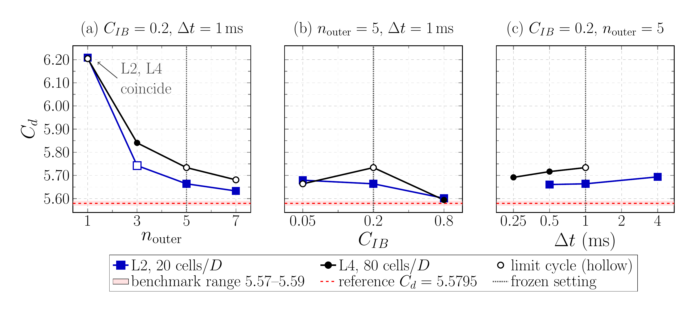
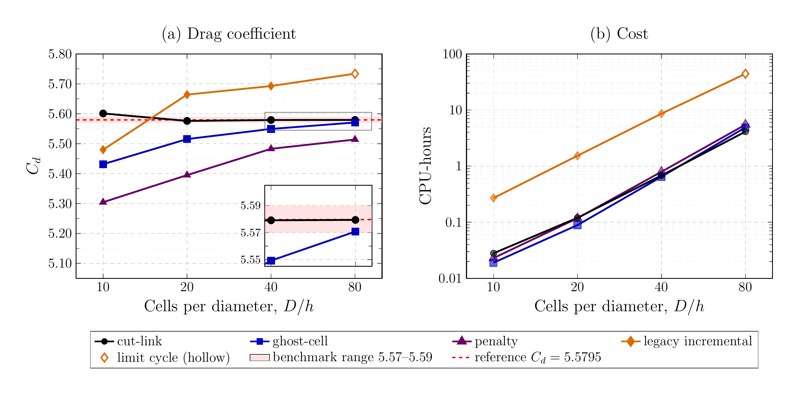

# staticCylinderInChannel verification

Opt-in verification of the four forcing formulations of
`immersedBoundaryForce` (`cutLink`, `ghostCell`, `penalty` and legacy
incremental, `method incremental`) on the steady 2D-1 benchmark of Schäfer
and Turek (1996). It characterises the legacy incremental formulation once
(outer correctors, coupling coefficient, time step and parity with the
historical pimpleHFDIBFoam implementation), freezes the settings of each
formulation, and compares the four formulations on the four `MESH_LEVEL`s of
the tutorial in drag and cost. It is not run by `tutorials/Alltest` or
`tutorials/Alltest-regression`.

| File | Content |
| ---- | ------- |
| `results.md` | meshes, results of all the studies and the frozen methodology |
| `postProcessing/figures/` | generated figures, tables and draft captions (not tracked) |
| `calibration.md` | time step and rank calibration |
| `reference/*.csv` | compact results of every case (tracked) |
| `images/mesh_L2_closeup.png` | the L2 mesh around the cylinder (tracked preview, `scripts/plot_mesh.py`) |
| `images/legacy_incremental_sensitivity.png`, `images/four_method_comparison.png` | summary figures (tracked previews, see below) |
| `scripts/` | case generation, analysis, export and figures |
| `.gitignore` | keeps `work/`, `postProcessing/`, job output and logs untracked |
| `work/`, `postProcessing/` | generated cases, results and figures (not tracked) |

## Summary figures



The legacy incremental drag on L2 and L4 against (a) the outer correctors,
(b) the coupling coefficient and (c) the time step. Five outer correctors
are the historical setting; they do not make the drag independent of the
outer iterations.



(a) Drag and (b) CPU hours of the four formulations on the identical
non-body-fitted L1-L4 meshes. `cutLink`, `ghostCell` and `penalty` use
`nOuterCorrectors 1` and legacy incremental uses `nOuterCorrectors 5`. The
reference drag is a numerical benchmark value, not an analytical solution.

Hollow markers are limit cycles. The full captions are in `results.md`.
`scripts/plot_publication_figures.py` regenerates the same data from
`reference/*.csv`.

## Frozen settings

All the formulations use a fixed time step (0.001 s for this benchmark, from
the Courant number on the finest mesh) and `nCorrectors 3`:

| Formulation | Settings |
| ----------- | -------- |
| `cutLink`, `ghostCell`, `penalty` | `nOuterCorrectors 1` (the defaults of the option) |
| legacy incremental | `couplingCoeff 0.2`, body `occupancy vertexFraction`, `nOuterCorrectors 5` |

`nOuterCorrectors 5` is the historical setting of the legacy incremental
formulation; its drag still depends on the number of outer correctors (see
`results.md`).

## Running

Source OpenFOAM and solids4foam, or set `S4F_VERIFY_ENV` to a script that
does; optionally set `S4F_VERIFY_PARTITION` (SLURM partition) and
`S4F_VERIFY_MAX_CPUS` (aggregate CPU limit of `submit` and `extend`, default
96). Each case is generated from the tutorial in
`work/<study>/<method>-L<level>[-<tag>]/`, with only `MESH_LEVEL`, the fixed
time step and end time, `nOuterCorrectors`, the method settings and the
decomposition changed, and has a SLURM script and a `case.json` record:

```bash
./Allverify generate --methods cutLink --levels 1 2 3 4
./Allverify generate --study final-F --methods incremental --levels 1 \
    --tag cc0p2-n5 --coupling-coeff 0.2 --n-outer 5 --end-time 15
./Allverify submit [--study ...] --yes        # without --yes: summary only
./Allverify analyse [--study ...]             # postProcessing/<study>/runs.csv
./Allverify extend --study ... --methods ... --levels ... --add 5 --yes
./Allclean                                    # remove work/ and postProcessing/
```

The commands of every study are listed in `results.md`. The historical parity
cases are generated by `scripts/historical_parity.py` from a historical
pimpleHFDIBFoam case.

## Results and figures

```bash
python3 scripts/export_reference.py           # work/ -> reference/*.csv
python3 scripts/plot_publication_figures.py   # reference/*.csv -> figures
python3 scripts/plot_publication_figures.py --variant expanded
python3 scripts/plot_publication_figures.py --variant presentation
python3 scripts/plot_publication_figures.py --variant all
python3 scripts/plot_mesh.py --preview        # work/mesh/cutLink-L2 -> mesh figure
```

`plot_mesh.py` draws the cells of a generated case (its `polyMesh`, the same
for all the formulations at a level), the section of the cylinder surface
and the cells penalised by `cutLink` (from its `immersedBoundary:kappa`), to
`postProcessing/figures/mesh/` and, with `--preview`, `images/`; it reads the
existing case files and runs no OpenFOAM application. The meshes (two-block
Cartesian, not fitted to the body, `D/h` = 10, 20, 40 and 80) and the
geometric limitations are described in `results.md`.

`plot_publication_figures.py` reads only `reference/*.csv`, checks that
they hold the intended final datasets, and runs no CFD; it writes vector PDF
and 600 dpi PNG figures, and Markdown and LaTeX tables, to
`postProcessing/figures/<variant>/` (`--out` to change the root, `--usetex`
for LaTeX text):

| Variant | Files |
| ------- | ----- |
| `manuscript` (default) | `Figure_A_legacy_incremental_sensitivity` ((a) `C_d` vs `n_outer`, (b) vs `C_IB`, (c) vs `Delta t`, L2 and L4), `Figure_B_method_comparison` ((a) `C_d`, (b) CPU-hours vs cells/D), `historical_parity_table` |
| `expanded` | `fig_outer_corrector_sensitivity`, `fig_coupling_coefficient_sensitivity`, `fig_timestep_sensitivity`, `fig_four_method_Cd`, `fig_four_method_CPU_hours`, `historical_parity_table`, `final_comparison_table` |
| `presentation` | `talk_outer_corrector_sensitivity`, `talk_coupling_and_timestep`, `talk_four_method_Cd`, `talk_four_method_CPU_hours` (larger text) |

Open markers are limit cycles. The panels of Figure A share their `C_d`
scale; the expanded and presentation sensitivity figures are scaled to their
own data. `C_d = 2 F_x/(rho Ubar^2 D L_z)` and `C_l = 2 F_y/(rho Ubar^2 D L_z)`
are time-weighted means over the final 2 s of each run (15 s), and each case
is classified as steady, limit cycle (constant mean, stationary oscillation)
or drifting. The Schäfer and Turek (1996) benchmark ranges are
`5.57 <= C_d <= 5.59` and `0.0104 <= C_l <= 0.0110`; the high-precision
reference values are `C_d = 5.57953523384` and `C_l = 0.010618948146`,
numerical values from high-order reference computations (Nabh, 1998), as
given by FeatFlow and by John and Matthies (2001), not exact solutions.
Results are reported as relative deviations from these numerical
references, `C/C_ref - 1`.

## References

- Schäfer, M., Turek, S. (1996). Benchmark computations of laminar flow around
  a cylinder. In: Hirschel, E.H. (ed.) Flow Simulation with High-Performance
  Computers II. Notes on Numerical Fluid Mechanics, 52, 547-566.
- John, V., Matthies, G. (2001). Higher-order finite element discretizations
  in a benchmark problem for incompressible flows. International Journal for
  Numerical Methods in Fluids, 37, 885-903. https://doi.org/10.1002/fld.195
- FeatFlow, DFG benchmark 2D-1 (Re = 20), reference values:
  https://wwwold.mathematik.tu-dortmund.de/~featflow/en/benchmarks/cfdbenchmarking/flow/dfg_benchmark1_re20.html
- Nabh, G. (1998). On high order methods for the stationary incompressible
  Navier-Stokes equations. PhD thesis, University of Heidelberg, Preprint
  42/98 (the reference values, as cited by John and Matthies, 2001).
