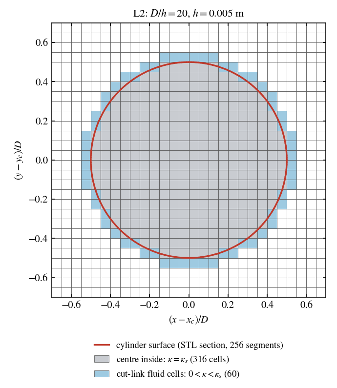

# Results

These results are for solids4foam `f33b244a2` with OpenFOAM v2412.

## Definitions and reference values

- `C_d` and `C_l` are time-weighted means over the final 2 s of each run
  (`t = 13-15 s`).
- Each case is classified as steady, a limit cycle (constant mean and an
  oscillation of stationary amplitude) or drifting. No case was drifting at
  the end of its run.
- The Schäfer and Turek (1996) benchmark ranges for case 2D-1 are
  `5.57 <= C_d <= 5.59` and `0.0104 <= C_l <= 0.0110`.
- The high-precision reference values are `C_d = 5.57953523384` and
  `C_l = 0.010618948146`. They come from the high-order reference
  computations of Nabh (1998), as given by FeatFlow and by John and Matthies
  (2001). They are numerical references, not analytical or exact solutions.
- Each relative deviation from the numerical reference is `C/C_ref - 1`.
  It is not an error with respect to an exact solution.
- The values below are those of `reference/*.csv`, which hold every case
  with its settings, statistics, status and cost.

The study characterises the legacy incremental method once, freezes the
settings of the four methods, and compares them on the four mesh levels of
the tutorial. Every case uses `nCorrectors 3` and a fixed time step of
0.001 s, which keeps the maximum Courant number below 0.5 on Level 4 (0.42).

The reference cases were run on 2 x AMD EPYC 9684X with an earlier version
of the driver, which submitted them to SLURM. Some cases were run to 10 s
and restarted to 15 s. `./Allverify analyse` reproduces the values of
`final_method_comparison.csv` from those runs to 5e-7. The commands below
give the same settings with the current driver.

## Summary figures


**Legacy incremental sensitivity.** Drag of the legacy incremental method
on L2 (20 cells/D) and L4 (80 cells/D), against:

- (a) the outer correctors, with `couplingCoeff 0.2` and `deltaT = 1 ms`;
- (b) the coupling coefficient, with `nOuterCorrectors 5` and
  `deltaT = 1 ms`;
- (c) the time step, with `couplingCoeff 0.2` and `nOuterCorrectors 5`.

Hollow markers are limit cycles, and dotted lines mark the frozen settings.
The `n_outer = 1` points are the common-settings incremental baseline.
`nOuterCorrectors 5` is the historical setting. It does not establish
independence from the outer iterations: the drag still changes between 5
and 7 outer correctors.


**Four-method comparison.** (a) Drag and (b) CPU hours of `cutLink`,
`ghostCell`, `penalty` and legacy incremental on L1-L4. All four use the
same non-body-fitted background meshes, `deltaT = 1 ms` and
`nCorrectors 3`. `cutLink`, `ghostCell` and `penalty` use
`nOuterCorrectors 1`; legacy incremental uses `nOuterCorrectors 5` with
`couplingCoeff 0.2`.

The inset in (a) enlarges L3-L4. The band is the Schäfer and Turek (1996)
range and the dashed line is `C_d = 5.57953523384`, a high-precision
numerical benchmark value, not an analytical solution. In (b) the marker
fills are translucent, so that overlapping markers stay visible. The only
limit cycle is the legacy incremental point on L4, drawn with a hollow
marker.

These previews were rendered from LaTeX/PGFPlots figures of the same data
as `reference/*.csv`. `python3 scripts/plot_verification.py` regenerates
equivalent figures from the tracked CSVs; they differ in style only.

## Meshes

Each case runs `blockMesh` on the tutorial's `system/blockMeshDict`, with
only `MESH_LEVEL` set. At each level, all four methods therefore use
byte-identical background `polyMesh` files. The cases of the final
comparison have identical SHA-256 hashes for `points`, `faces`, `owner`,
`neighbour` and `boundary`. They also share the same cylinder surface,
initial and boundary conditions and transport properties.

| Level | Cells | `D/h` | `h` (m) | Upstream (x by y) | Downstream (x by y) |
| --- | --- | --- | --- | --- | --- |
| L1 | 4 510 | 10 | 0.010 | 60 x 41 | 50 x 41 |
| L2 | 18 040 | 20 | 0.005 | 120 x 82 | 100 x 82 |
| L3 | 72 160 | 40 | 0.0025 | 240 x 164 | 200 x 164 |
| L4 | 288 640 | 80 | 0.00125 | 480 x 328 | 400 x 328 |

Mesh details:

- **Topology:** a two-block Cartesian hexahedral mesh that is not fitted to
  the body. The cylinder (`D = 0.1 m`, centred at `(0.2, 0.2) m`) is a closed
  surface, `constant/triSurface/cylinder.stl`, that cuts through the cells.
  Cells inside it remain part of the mesh.
- **Upstream block (`0 <= x <= 0.6 m`):** uniform square cells of size `h`.
  This block contains the cylinder and its wake to 4D behind the centre.
- **Downstream block (`0.6 <= x <= 2.2 m`):** graded in x by a factor of 10
  from the first to the last cell, from `0.82 h` to `8.2 h`, and uniform `h`
  in y.
- **Thickness:** one cell through the 0.1 m thickness, with `empty` front
  and back patches.
- **Refinement:** `h` is exactly halved from each level to the next (the
  cell counts double in each direction), and the upstream block is nested.
- **Geometry and boundary conditions:** unchanged at every level and for
  every method. The inlet is the exact parabola `U_m = 0.3 m/s` evaluated
  at the inlet faces, the outlet has `p = 0`, the walls are no-slip, and
  `nu = 1e-3 m^2/s`, `rho = 1 kg/m^3`.
- **Force normalisation:** the same for every method,
  `C = 2F/(rho Ubar^2 D L_z)`, applied to the force columns of the body's
  force file.

Identical background meshes do not mean identical immersed-boundary fields.
Each method builds its own occupancy and forcing on the mesh:

- the body occupancy is `signedDistance` for `cutLink`, `ghostCell` and
  `penalty`, and `vertexFraction` for legacy incremental;
- `ghostCell` and `cutLink` penalise the cells whose centre is inside;
- `cutLink` also penalises the fluid cells across the cut links.

On L2, 316 cells are penalised with their centre inside and 60 are cut-link
fluid cells. Legacy incremental has 268 fully covered cells, against 276 with
`signedDistance`.



The figure shows the L2 mesh of a reference run around the cylinder, with
the section of the surface and the cells that `cutLink` penalises, taken
from its recorded `immersedBoundary:kappa`. `scripts/plot_mesh.py` draws it
from the files of a generated case, with no OpenFOAM run.

Geometric limitations:

- The surface has 512 triangles, of which 128 segments run around the
  circumference (2.8 degrees each, a chord of 2.45 mm). The segment vertices
  lie on the circle.
- On L4 a surface segment spans about two cells (chord/h = 1.96), and the
  surface normals change by 2.8 degrees between segments.
- The effect of this faceting on `C_d` has not been quantified. A finer
  surface has not been run. The area deficit of the polygon (4e-4) is not a
  deviation of the drag.
- The cylinder centre and its extreme points lie on grid lines at every
  level. The position of the cylinder relative to the grid was not varied.
- The four levels show the mesh-refinement behaviour of each method under
  controlled conditions. They do not establish a formal asymptotic order of
  convergence, or mesh independence beyond this benchmark.

## Outer correctors (`outer_corrector_study.csv`)

```bash
./Allverify --study outer --methods all --levels 2 4 --n-outer 3
./Allverify --study outer --methods incremental --levels 2 4 --n-outer 7
./Allverify --study outer --methods cutLink ghostCell penalty \
    --levels 2 4 --n-outer 5
```

| Method | Level | n = 1 | n = 3 | n = 5 | n = 7 |
| --- | --- | --- | --- | --- | --- |
| `cutLink` | 2 | 5.576002 | 5.576001 | 5.576001 | |
| `cutLink` | 4 | 5.579376 | | 5.579376 | |
| `ghostCell` | 2 | 5.515370 | 5.515369 | 5.515369 | |
| `ghostCell` | 4 | 5.570778 | | 5.570778 | |
| `penalty` | 2 | 5.394955 | 5.394955 | 5.394955 | |
| `penalty` | 4 | 5.513867 | | 5.513867 | |
| legacy incr. | 2 | 6.208687 | 5.742672* | 5.663897 | 5.633053 |
| legacy incr. | 4 | 6.204342* | 5.840637 | 5.733871* | 5.680981* |

\* Limit cycle: a bounded oscillation, whose mean over the final 2 s is
given. These are the hollow markers in the figures.

- The legacy incremental rows use `couplingCoeff 0.2`.
- Their `n = 1` values come from the common-settings incremental baseline
  (`couplingCoeff 0.2`, `deltaT = 0.001 s`).
- The drag of `cutLink`, `ghostCell` and `penalty` changes by at most 1e-6
  with the number of outer correctors, so they keep `nOuterCorrectors 1`.
- The legacy incremental drag decreases with every outer corrector. From 5
  to 7 it changes by 0.54% (L2) and 0.92% (L4) of its value at `n = 5`, so
  it is still not independent of the outer correctors at `n = 7`.
- Its pressure iterations per time step grow with `n` (L2: 71, 177, 266 and
  344; L4: 104, 259, 390 and 500), because the forcing is corrected again in
  every outer corrector. The other methods need no further iterations after
  the first outer corrector.
- The legacy incremental method keeps `nOuterCorrectors 5`, its historical
  setting, which is not outer-converged.

## Legacy incremental coupling coefficient

`legacy_incremental_coupling.csv`. These runs use `nOuterCorrectors 5` and
`deltaT = 0.001 s`.

```bash
./Allverify --study coupling --methods incremental --levels 2 4 \
    --coupling-coeff 0.05                # likewise 0.8
```

| couplingCoeff | Cd, L2 | Cd, L4 |
| --- | --- | --- |
| 0.05 | 5.679425 | 5.663779* |
| 0.2 | 5.663897 | 5.733871* |
| 0.8 | 5.601524 | 5.593957 |

- Over the coefficients, the drag spans 1.4% (L2) and 2.5% (L4) of its
  smallest value. The variation is not monotonic on L4, and whether a limit
  cycle occurs depends on the coefficient.
- With c = 0.8, the L4 drag is within 0.26% of the reference. It is not
  adopted, because choosing it for that reason would calibrate the method to
  the benchmark.
- This study is a characterisation only: the legacy value
  `couplingCoeff 0.2` is retained.

## Legacy incremental time step

`legacy_incremental_timestep.csv`. These runs use `couplingCoeff 0.2` and
`nOuterCorrectors 5`.

```bash
./Allverify --study timestep --methods incremental --levels 2 --deltaT 0.004
./Allverify --study timestep --methods incremental --levels 2 4 \
    --deltaT 0.0005
./Allverify --study timestep --methods incremental --levels 4 \
    --deltaT 0.00025
```

| deltaT (s) | Cd, L2 (max Co) | Cd, L4 (max Co) |
| --- | --- | --- |
| 0.004 | 5.693868 (0.42) | |
| 0.001 | 5.663897 (0.11) | 5.733871* (0.42) |
| 0.0005 | 5.660755 (0.06) | 5.716619 (0.21) |
| 0.00025 | | 5.691711 (0.11) |

- On Level 2 the drag converges with the time step: it changes by 0.06%
  from 0.001 to 0.0005 s.
- On Level 4 it decreases by 0.30% and 0.44% at each halving, each relative
  to the previous time step. The legacy incremental drag on this mesh is
  therefore not time-step independent at `deltaT = 0.001 s`.
- The common time step of 0.001 s is kept for the comparison, because it
  was chosen from the Courant number independently of the drag.

## Final comparison (`final_method_comparison.csv`)

All cases use the frozen settings on the meshes above:

```bash
./Allverify --methods all
```

| Cd | L1 (10/D) | L2 (20/D) | L3 (40/D) | L4 (80/D) |
| --- | --- | --- | --- | --- |
| `cutLink` | 5.601032 | 5.576002 | 5.579090 | 5.579376 |
| `ghostCell` | 5.431424 | 5.515370 | 5.549261 | 5.570778 |
| `penalty` | 5.304363 | 5.394955 | 5.482845 | 5.513867 |
| legacy incremental | 5.479757 | 5.663897 | 5.692606 | 5.733871* |

| Cl | L1 | L2 | L3 | L4 |
| --- | --- | --- | --- | --- |
| `cutLink` | 0.007889 | 0.010175 | 0.010541 | 0.010594 |
| `ghostCell` | 0.011864 | 0.011887 | 0.010952 | 0.010799 |
| `penalty` | 0.004930 | 0.009109 | 0.010239 | 0.010090 |
| legacy incremental | 0.016603 | 0.018711 | 0.014111 | 0.012273* |

Relative deviations from the numerical references:

| Cd deviation | L1 | L2 | L3 | L4 |
| --- | --- | --- | --- | --- |
| `cutLink` | +0.385% | -0.063% | -0.008% | -0.003% |
| `ghostCell` | -2.655% | -1.150% | -0.543% | -0.157% |
| `penalty` | -4.932% | -3.308% | -1.733% | -1.177% |
| legacy incremental | -1.788% | +1.512% | +2.027% | +2.766% |

| Cl deviation | L1 | L2 | L3 | L4 |
| --- | --- | --- | --- | --- |
| `cutLink` | -25.7% | -4.2% | -0.7% | -0.2% |
| `ghostCell` | +11.7% | +11.9% | +3.1% | +1.7% |
| `penalty` | -53.6% | -14.2% | -3.6% | -5.0% |
| legacy incremental | +56.4% | +76.2% | +32.9% | +15.6% |

| CPU hours | L1 | L2 | L3 | L4 |
| --- | --- | --- | --- | --- |
| `cutLink` | 0.028 | 0.120 | 0.682 | 4.116 |
| `ghostCell` | 0.019 | 0.089 | 0.647 | 4.896 |
| `penalty` | 0.023 | 0.118 | 0.794 | 5.487 |
| legacy incremental | 0.270 | 1.533 | 8.619 | 44.218 |

The runs use 1, 1, 2 and 8 ranks on Levels 1-4. CPU hours are ranks times
the wall time on 2 x AMD EPYC 9684X, and depend on the machine.

Drag:

- `cutLink` overshoots on L1, is within the benchmark range from L2, and is
  within 0.01% of the reference from L3.
- `ghostCell` approaches the reference from below and is within the range on
  Level 4.
- `penalty` remains 1.2% low on Level 4.
- The legacy incremental drag increases with the mesh beyond L2, away from
  the benchmark range.

Lift (about 1/500 of the drag, and more sensitive):

- `cutLink` increases monotonically, to 0.2% below the reference on L4.
- `ghostCell` is almost unchanged from L1 to L2, then approaches the
  reference from above, to +1.7% on L4.
- `penalty` is 5.0% low on L4, further from the reference than on L3.
- Legacy incremental is 16% high on L4.
- On L4, the `cutLink` and `ghostCell` lift lie within the benchmark range
  `0.0104 <= C_l <= 0.0110`; the `penalty` and legacy incremental lift do
  not.

Cost:

- Legacy incremental costs 8-17 times the CPU hours of the other methods,
  because each time step takes five outer correctors with 9-51 times as many
  pressure iterations.

None of these sequences establishes an asymptotic order of convergence, and
no method is shown to be mesh independent. The `cutLink` difference between
L3 and L4 (5e-5 of `C_d`) is of the order of the unquantified geometric and
time-step effects (see "Meshes").

The verification check of `./Allverify` is the `cutLink` Level 4 drag
within the Schäfer and Turek range. The reference run passes it, with
`C_d = 5.579376`.

## Frozen settings for the next benchmarks

| Method | Settings |
| --- | --- |
| `cutLink`, `ghostCell`, `penalty` | `nOuterCorrectors 1`, `nCorrectors 3` |
| legacy incremental | `nOuterCorrectors 5`, `nCorrectors 3`, below |

The legacy incremental method also uses `couplingCoeff 0.2` and
`occupancy vertexFraction`.

These settings are carried forward unchanged. The outer corrector and
coupling coefficient studies are not repeated, and no parameter is tuned to
a benchmark result. Each later benchmark has:

- a mesh refinement study;
- a time step from a stability (Courant) criterion, with one time-step
  halving check where appropriate;
- the comparison with its reference;
- the CPU hours of each method.

## Common-settings incremental baseline

Before the final comparison, all four methods were run with common
settings, `nOuterCorrectors 1` (`mesh_study.csv`):

```bash
./Allverify --study baseline --methods all --n-outer 1 \
    --coupling-coeff 0.8
```

The incremental method with one outer corrector is the common-settings
incremental baseline. It was run with `couplingCoeff 0.8`, and with
`couplingCoeff 0.2-1.0` and time steps of 0.00025-0.004 s
(`incremental_sensitivity.csv`).

This baseline is distinct from the legacy incremental configuration
(`nOuterCorrectors 5`). Its drag is 6.0-6.9 and moves away from the
benchmark as the mesh is refined. The data are kept for reference; its
`couplingCoeff 0.2` cases give the `n = 1` values of the outer corrector
study.

## Historical parity (`historical_parity.csv`)

This is supporting evidence, separate from the L1-L4 study. Its meshes and
values are not used in the mesh-refinement tables or figures. It cannot be
reproduced from this repository alone, because it needs the historical
openHFDIB-DEM `pimpleHFDIBFoam` cases, which are not included.

The historical cases were run with the current legacy incremental port:

- scaled by 10 (D = 1, rho = 1000, Ubar = 1), on their own 12-block meshes;
- `couplingCoeff 0.2`, vertexFraction, threshold `1e-4`;
- `deltaT = 0.005 s`, 20 s;
- `nOuterCorrectors 5`, `nCorrectors 3`, 2 non-orthogonal correctors;
- relaxation 0.7/0.3;
- their schemes, solvers, meshes, surface and fluid.

Only the unsupported `grad(U)` cache was removed. Each case was run with its
own inlet, and again with the inlet replaced by the exact parabola.

| Mesh | Saved Cd | Port, own inlet | Port, exact inlet | Inlet effect |
| --- | --- | --- | --- | --- |
| 20 000 cells | 5.721240 | 5.721243 | 5.807792 | +1.51% |
| 80 000 cells | 5.706180 | 5.706177 | 5.748280 | +0.74% |

The inlet effect is relative to the port with its own inlet.

- The current port reproduces the saved historical drag to 3e-6.
- The historical inlet was coded over the extreme inlet face centres. It
  carried a flow rate below the nominal one, by about the inlet cell height
  over the channel height, while the drag was normalised by the nominal
  velocity.
- It therefore biased `C_d` downwards, more on the coarser mesh, and hid
  most of the mesh dependence: the change between the two meshes is -0.015
  with the historical inlet, against -0.060 with the exact inlet.

## Other reference data

`mpi_scaling.csv` records the rank check on the reference machine that set
the decomposition of the reference runs (1, 1, 2 and 8 ranks on L1-L4). It
is specific to that machine.
