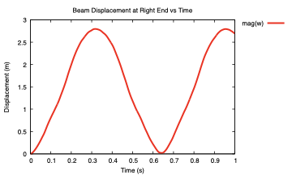

# Dynamic 3-D cantilever under a sudden end force: `beamDynamicCantilever`

---

Prepared by Seevani Bali

---

## Tutorial Aims

- Demonstrate a dynamic, geometrically exact beam analysis with the
  `beamSolid` solid model, which runs the beamFoam beam formulation through
  `solids4Foam`.
- Rotate a beam mesh into its initial position with `setInitialPositionBeam`.
- Write displacement, force, convergence and energy histories with the beam
  function objects.

## Case Overview

A column with a square cross-section is clamped at its lower end and loaded at
its upper end by a constant force $$(2000, 2000, 0)$$ N, applied suddenly at
$$t = 0$$. The column vibrates with large three-dimensional deformation until
$$t = 1$$ s. This is the first benchmark of the beamFoam paper, where the
beam results are compared with detailed 3-D solids4foam and ABAQUS solutions.

| Property            | Value                 |
| ------------------- | --------------------: |
| Length              | 2 m                   |
| Cross-section       | 0.2 m × 0.2 m square  |
| Young's modulus     | 15.293 MPa            |
| Shear modulus       | 5.882 MPa             |
| Density             | 1000 kg/m³            |
| Beam segments       | 20                    |
| Time step           | 0.001 s               |
| Time scheme         | Newmark               |

`createBeamMesh` creates the beam along the $$x$$ axis, and the `Allrun`
script then rotates it by 90° about the $$-y$$ axis so that it stands
vertically:

```bash
setInitialPositionBeam -cellZone beam_0 \
    -translate '(0 0 0)' -rotateAngle '((0 -1 0) 90)'
```

The boundary conditions are:

- `left` (lower end): `fixedValue` displacement `W` and rotation `Theta`;
- `right` (upper end): an applied force (`forceBeamDisplacementNR`, read from
  `constant/timeVsForce`) and a zero moment (`momentBeamRotationNR`).

## Running the Case with solids4foam

The beam model, its solver settings, the cross-section and the material are
read from `constant/beamProperties`, as in beamFoam. The case selects the beam
solid model with three additions:

- `system/controlDict` loads the library: `libs ("libS4FBeamSolid.so");`
- `constant/physicsProperties` selects `type solid;`
- `constant/solidProperties` selects `solidModel beamSolid;`

`constant/g` is required by the solid model base class and is zero here.

```bash
./Allrun
```

## Expected Results

The free end oscillates with a first bending period of about 1 s and can fall
below its initial base level. Figure 1 shows the displacement magnitude of the
loaded end.



Figure 1: Displacement magnitude of the loaded end

The histories are written to `postProcessing/0`. Reference displacement
histories from solids4foam (3-D continuum) and ABAQUS are supplied in
`solidPointDisplacement_pointDisp.dat` and `cantilever_abaqus_50percent.txt`.
The results are identical to those of standalone beamFoam, and
`regressionTest.sh` checks the final free-end displacement.

To view the deformed beam in ParaView, apply **Warp By Vector** with `pointW`.

## References

- Bali, S., Taran, A., Tuković, Ž., Pakrashi, V., & Cardiff, P. (2025).
  beamFoam: A cell-centred finite volume solver for nonlinear
  geometrically-exact beams in OpenFOAM. _OpenFOAM Journal_, 5, 180–210.
  <https://doi.org/10.51560/ofj.v5.170>
