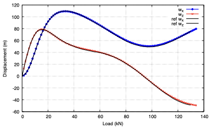

# Cantilever under an end follower force: `beamFollowerForce`

---

Prepared by Seevani Bali

---

## Tutorial Aims

- Demonstrate a quasi-static, geometrically exact beam analysis with the
  `beamSolid` solid model, which runs the beamFoam beam formulation through
  `solids4Foam`.
- Apply a non-conservative follower force, whose direction rotates with the
  end of the beam.
- Compare the free-end displacement with the Simo and Vu-Quoc (1986)
  reference solution.

## Case Overview

A straight cantilever is clamped at its left end and loaded at its right end
by a follower force. The force increases linearly in pseudo-time from zero to
134 kN at $$t = 1$$ over 1000 increments. Both time-derivative schemes are
`steadyState`, so pseudo-time only sets the load increments. This is the second
benchmark of the beamFoam paper.

| Property              | Value                       |
| --------------------- | --------------------------: |
| Length                | 100 m                       |
| Cross-section         | circle, radius 0.65828153 m |
| Young's modulus       | 2.3731844e8 Pa              |
| Shear modulus         | 1.1865922e8 Pa              |
| Maximum force         | 134 kN                      |
| Beam segments         | 40                          |

The boundary conditions are:

- `left`: `fixedValue` displacement `W` and rotation `Theta` (clamped);
- `right`: a follower force (`followerForceBeamDisplacementNR`, read from
  `constant/timeVsFollowerForce`) and a zero moment (`momentBeamRotationNR`).

## Running the Case with solids4foam

The beam model, its solver settings, the cross-section and the material are
read from `constant/beamProperties`, as in beamFoam. The case selects the beam
solid model with three additions:

- `system/controlDict` loads the library: `libs ("libS4FBeamSolid.so");`
- `constant/physicsProperties` selects `type solid;`
- `constant/solidProperties` selects `solidModel beamSolid;`

`constant/g` is required by the solid model base class and is zero here.

```bash
./Allrun
```

## Expected Results

Figure 1 compares the free-end displacement components with the reference
solution in `referenceResultsSimo.dat`. At the last reference point, 129.7 kN,
the vertical displacement is within 1.4% of the beam length of the reference
value.



Figure 1: Free-end displacement against the follower force

The free-end history is written to
`postProcessing/0/beamDisplacements_right.dat`. The results are identical to
those of standalone beamFoam, and `regressionTest.sh` checks them against both
beamFoam and the reference solution.

To view the deformed beam in ParaView, apply **Warp By Vector** with `pointW`.

## References

- Simo, J.C., & Vu-Quoc, L. (1986). A three-dimensional finite-strain rod
  model. Part II: Computational aspects. _Computer Methods in Applied Mechanics
  and Engineering_, 58, 79–116.
- Argyris, J., et al. (1981). Nonlinear finite element analysis of elastic
  systems under nonconservative loading: natural formulation. Part I:
  quasistatic problems.
- Bali, S., Taran, A., Tuković, Ž., Pakrashi, V., & Cardiff, P. (2025).
  beamFoam: A cell-centred finite volume solver for nonlinear
  geometrically-exact beams in OpenFOAM. _OpenFOAM Journal_, 5, 180–210.
  <https://doi.org/10.51560/ofj.v5.170>
