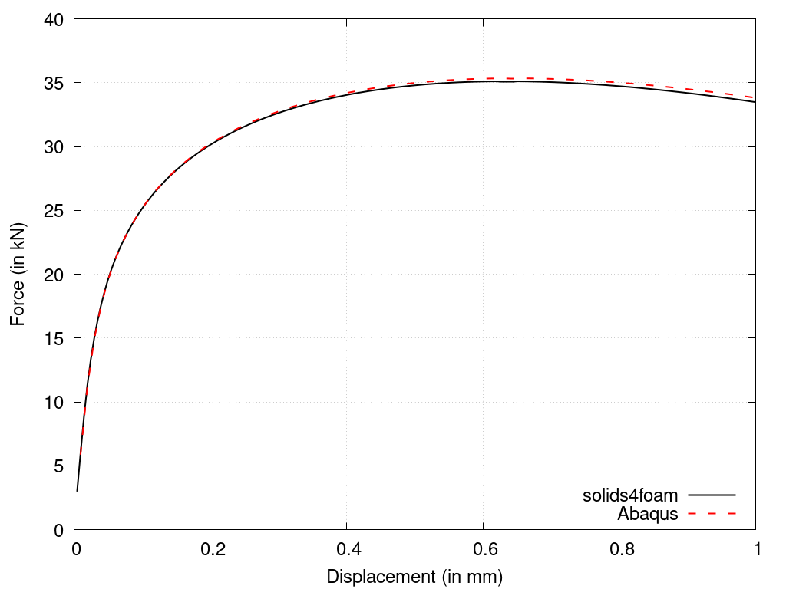

# Tension of a Notched Round Bar: `notchedBar`

Prepared by Andrew Whelan and Philip Cardiff

---

## Tutorial Aims

- Demonstrate the `logStrain` law, which uses a small-strain plasticity law,
  here `linearElasticMisesPlastic`, at finite strain through the elastic
  logarithmic strain.
- Compare the reaction force with the Abaqus result of Whelan et al. [1].

---

## Case Overview

This case is the notched round bar used by Whelan et al. [1] to verify their
finite-strain plasticity model before adding damage, and widely used for
benchmarking plasticity and damage procedures. The bar is $$40$$ mm long with
a diameter of $$18$$ mm and a notch of radius $$4$$ mm, leaving a minimum
diameter of $$10$$ mm. It is modelled as axisymmetric, on a $$5^\circ$$
wedge, with a symmetry plane through the notch, so the solution domain is the
upper half of the bar.

The upper boundary is displaced axially by $$1$$ mm over $$200$$ equal
loading increments, with no radial displacement; the outer surface and the
notch are traction free. Gravity and transient effects are neglected. The
mesh has $$2000$$ cells; the mesh of [1], with $$8000$$ cells, is obtained by
setting `N 40;` in `system/blockMeshDict`.

The material is an aluminium alloy, described by the `logStrain` law over
`linearElasticMisesPlastic`: the sub-law's return mapping is performed on the
elastic logarithmic strain and gives the Kirchhoff stress, following the
exponential map of Eterovic and Bathe [2] and Simo [3]. The case is solved
with the updated Lagrangian solid model.

Table 1 - Mechanical properties

| Parameter       | Symbol       | Value                                      |
| --------------- | ------------ | ------------------------------------------ |
| Young's modulus | $$E$$        | $$69$$ GPa                                 |
| Poisson's ratio | $$\nu$$      | $$0.3$$                                    |
| Hardening law   | $$\sigma_Y$$ | $$589(10^{-4}+\varepsilon_p)^{0.216}$$ MPa |

The hardening law is tabulated in `constant/plasticStrainVsYieldStress`.

---

## Expected Results

The reaction force rises to a maximum of $$35.1$$ kN at a displacement of
$$0.64$$ mm, after which the notch necks and the force falls. Figure 1
compares the force with the Abaqus result of [1], given in
`reference/abaqusForceDisplacement.csv`, whose maximum is $$35.3$$ kN at the
same displacement. The two agree to within $$1\%$$ from a displacement of
$$0.05$$ mm onwards, and to within $$1.6\%$$ before it, where the notch
begins to yield. As Whelan et al. [1] note, the logarithmic strain
formulation gives a slightly lower force than Abaqus, whose default
formulation is based on the Jaumann stress rate.

Figure 1: Reaction force at the loading boundary against displacement

---

## Running the Case

The case can be run using the included `Allrun` script, i.e. `> ./Allrun`,
which creates the mesh with `blockMesh` and runs `solids4Foam`. Optionally, if
`gnuplot` is installed, the force against displacement is plotted with the
Abaqus result in `forceDisplacement.png`. The force on the wedge is scaled by
$$360/5 = 72$$ to give the force on the whole bar.

---

## References

[1]
[A. Whelan, T. Tang, V. Pakrashi and P. Cardiff, "A finite volume framework
for damage and fracture prediction in wire drawing," International Journal
for Numerical Methods in Engineering, 2025.](https://doi.org/10.1002/nme.7640)

[2] A. L. Eterovic and K.-J. Bathe, "A hyperelastic-based large strain
elasto-plastic constitutive formulation with combined isotropic-kinematic
hardening using the logarithmic stress and strain measures," International
Journal for Numerical Methods in Engineering, vol. 30, pp. 1099-1114, 1990.

[3] J. C. Simo, "Algorithms for static and dynamic multiplicative plasticity
that preserve the classical return mapping schemes of the infinitesimal
theory," Computer Methods in Applied Mechanics and Engineering, vol. 99,
pp. 61-112, 1992.
