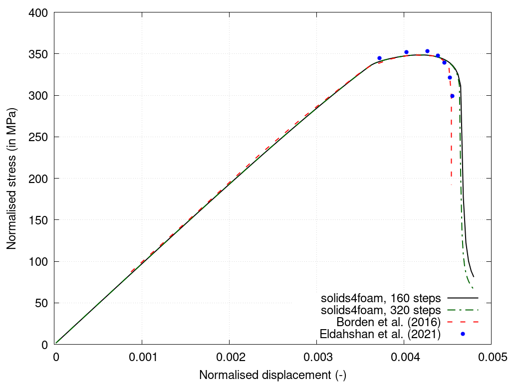

# Ductile Phase Field Fracture of a Flat Notched Bar: `flatNotchedBarPhaseField`

Prepared by Andrew Whelan and Philip Cardiff

---

## Tutorial Aims

- Demonstrate the ductile phase field fracture law,
  `linearElasticMisesPlasticPhaseFieldFracture`, at finite strain under the
  `logStrain` law.
- Show the phase field `phaseField`, which the solid model solves as an
  implicit-gradient field.
- Compare the normalised stress with the results of Borden et al. [2] and
  Eldahshan et al. [3], as in Whelan et al. [1].

---

## Case Overview

The flat notched tensile specimen of Borden et al. [2] is a plate
$$152.4$$ mm long, $$25.4$$ mm wide and $$2.37$$ mm thick, with side
notches of radius $$4.06$$ mm leaving a minimum width of $$17.28$$ mm. One
quarter of the plate is modelled, with symmetry planes through the notch and
along the axis, on a mesh of $$10\,000$$ hexahedral cells, five through the
thickness. The upper boundary is displaced by $$0.366$$ mm over $$160$$
equal loading increments.

The material is an aluminium alloy with linear hardening, coupled to the
ductile phase field model of Borden et al. [2] with the parameters of [1]
(Table 1). The phase field $$d$$, $$0$$ for intact material and $$1$$ for a
crack, degrades the stress by $$(1 - d)^2$$, except for its volumetric part
in compression. It is the solution of

$$
(1 + A) d - (2 l)^2 \nabla^2 d = A, \qquad
A = \frac{4 l}{G_c} \left( H + \langle W_p - w_0 \rangle \right)
$$

with zero flux on the boundary, where $$H$$ is the history of the tensile
elastic energy and $$W_p$$ the plastic work: the crack is driven by both,
once the plastic work passes the threshold $$w_0$$. The solid model solves
this equation once per outer iteration, after the stress update, and the law
reads its solution at the next one.

Table 1 - Material properties

| Parameter | Symbol | Value |
| --- | --- | --- |
| Young's modulus | $$E$$ | $$68.8$$ GPa |
| Poisson's ratio | $$\nu$$ | $$0.33$$ |
| Hardening law | $$\sigma_Y$$ | $$320 + 688\varepsilon_p$$ MPa |
| Critical fracture energy | $$G_c$$ | $$60$$ kJ/m$$^2$$ |
| Plastic work threshold | $$w_0$$ | $$10$$ MPa |
| Characteristic length | $$l$$ | $$0.3226$$ mm |

The material is set in `constant/mechanicalProperties`:

```text
type            logStrain;
...
mechanicalLaw
{
    type            linearElasticMisesPlasticPhaseFieldFracture;
    ...
    Gc              Gc [1 0 -2 0 0 0 0] 60e3;
    characteristicLength characteristicLength [0 1 0 0 0 0 0] 3.226e-4;
    w0              w0 [1 -1 -2 0 0 0 0] 1e7;
}
```

and the linear solver for `phaseField` in `system/fvSolution`.

---

## Expected Results

The results are given, as in [1-3], as the normalised stress, the reaction
force over the area of the notched section, against the normalised
displacement, the displacement of the upper boundary over the half-length of
the plate (Figure 1). The normalised stress rises to a maximum of
$$348.7$$ MPa at a normalised displacement of $$0.0042$$, against
$$348.8$$ MPa for Borden et al., and follows their curve up to it. The
crack then runs across the notched section, and the stress
falls sharply at a normalised displacement of $$0.00466$$, against
$$0.00455$$ for Borden et al. and Eldahshan et al. With half the step, the
stress is the same to within $$0.5\%$$ up to a normalised displacement of
$$0.0046$$, and the crack runs slightly earlier.



Figure 1: Normalised stress against normalised displacement

---

## Running the Case

The case can be run using the included `Allrun` script, i.e. `> ./Allrun`,
which creates the mesh with `blockMesh` and runs `solids4Foam`, in about
twenty minutes. Optionally, if `gnuplot` is installed, the normalised stress
is plotted with the reference results in `stressDisplacement.png`. The
field `phaseField` is written with the results.

---

## References

[1]
[A. Whelan, T. Tang, V. Pakrashi and P. Cardiff, "A finite volume framework
for damage and fracture prediction in wire drawing," International Journal
for Numerical Methods in Engineering, 2025.](https://doi.org/10.1002/nme.7640)

[2]
[M. J. Borden, T. J. R. Hughes, C. M. Landis, A. Anvari and I. J. Lee, "A
phase-field formulation for fracture in ductile materials: finite
deformation balance law derivation, plastic degradation, and stress
triaxiality effects," Computer Methods in Applied Mechanics and Engineering,
vol. 312, pp. 130-166, 2016.](https://doi.org/10.1016/j.cma.2016.09.005)

[3]
[H. Eldahshan, P. O. Bouchard, J. Alves, E. Perchat and D. P. Munoz, "Phase
field modeling of ductile fracture at large plastic strains using adaptive
isotropic remeshing," Computational Mechanics, vol. 67, pp. 763-783,
2021.](https://doi.org/10.1007/s00466-020-01962-7)
