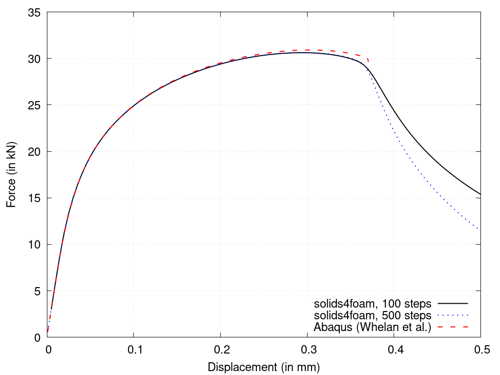

# Porous Plasticity in a Notched Round Bar: `notchedBarGTN`

Prepared by Andrew Whelan and Philip Cardiff

---

## Tutorial Aims

- Demonstrate the Gurson-Tvergaard-Needleman (GTN) law,
  `linearElasticGTNPlastic`, at finite strain under the `logStrain` law.
- Show the void fraction field `voidFraction`, which grows with the plastic
  dilatation and by nucleation.
- Compare the reaction force with the Abaqus result of Whelan et al. [1].

---

## Case Overview

This case is the notched round bar of the `notchedBar` and
`notchedBarLemaitre` tutorials: the bar is $$40$$ mm long with a diameter of
$$18$$ mm and a notch of radius $$4$$ mm, leaving a minimum diameter of
$$10$$ mm. It is modelled as axisymmetric, on a $$5^\circ$$ wedge, with a
symmetry plane through the notch. The upper boundary is displaced axially by
$$0.5$$ mm over $$100$$ equal loading increments. The mesh has $$2000$$
cells.

The material is an aluminium alloy, described by the GTN model [2, 3] with
the parameters of [1] (Table 1). The voids, with an initial volume fraction
$$f_0$$, grow with the plastic dilatation and nucleate with the plastic
strain under a tensile mean stress, following a normal distribution about
$$\varepsilon_N$$ [4]. As they grow, the yield surface shrinks, and the bar
softens at the centre of the notch, where the stress triaxiality is
highest. As in [1], neither coalescence nor the shear term is used, and the
void fraction is local.

Table 1 - Material properties

| Parameter | Symbol | Value |
| --- | --- | --- |
| Young's modulus | $$E$$ | $$69$$ GPa |
| Poisson's ratio | $$\nu$$ | $$0.3$$ |
| Hardening law | $$\sigma_Y$$ | $$589(10^{-4}+\varepsilon_p)^{0.216}$$ MPa |
| Tvergaard parameters | $$q_1, q_2, q_3$$ | $$1.5, 1, 2.25$$ |
| Initial void fraction | $$f_0$$ | $$0.002$$ |
| Nucleation void fraction | $$f_N$$ | $$0.2$$ |
| Mean nucleation strain | $$\varepsilon_N$$ | $$0.15$$ |
| Nucleation strain deviation | $$s_N$$ | $$0.08$$ |

The material is set in `constant/mechanicalProperties`:

```text
type            logStrain;
...
mechanicalLaw
{
    type            linearElasticGTNPlastic;
    ...
    q1              1.5;
    q2              1;
    q3              2.25;
    f0              0.002;
    fN              0.2;
    sN              0.08;
    epsilonN        0.15;
}
```

---

## Expected Results

The reaction force rises to a maximum of $$30.6$$ kN at a displacement of
$$0.30$$ mm, against $$30.9$$ kN at $$0.30$$ mm for Abaqus, and then falls
as the voids grow at the centre of the notch (Figure 1). The two agree to
within $$1\%$$ up to the peak and $$2\%$$ up to $$0.36$$ mm, with the
solids4foam force slightly lower, as for the `notchedBar` and
`notchedBarLemaitre` tutorials. The Abaqus simulation stops at
$$0.37$$ mm, as it failed to converge [1]; solids4foam continues through
the sharp loss of strength that follows, as the void fraction at the centre
of the notch passes $$0.3$$. Since the void fraction is local, this last
part of the curve depends on the mesh, and on the step: with $$500$$ steps,
the step of [1], the force agrees with that of $$100$$ steps to within
$$0.2\%$$ up to $$0.35$$ mm, but falls faster after $$0.37$$ mm, to
$$15.6$$ kN at $$0.45$$ mm against $$18.8$$ kN.



Figure 1: Reaction force at the loading boundary against displacement

---

## Running the Case

The case can be run using the included `Allrun` script, i.e. `> ./Allrun`,
which creates the mesh with `blockMesh` and runs `solids4Foam`, in about
twenty minutes. Optionally, if `gnuplot` is installed, the force against
displacement is plotted with the Abaqus result in `forceDisplacement.png`.
The force on the wedge is scaled by $$360/5 = 72$$ to give the force on the
whole bar. The field `voidFraction` is written with the results.

---

## References

[1]
[A. Whelan, T. Tang, V. Pakrashi and P. Cardiff, "A finite volume framework
for damage and fracture prediction in wire drawing," International Journal
for Numerical Methods in Engineering, 2025.](https://doi.org/10.1002/nme.7640)

[2] A. L. Gurson, "Continuum theory of ductile rupture by void nucleation and
growth: Part I," Journal of Engineering Materials and Technology, vol. 99,
pp. 2-15, 1977.

[3] V. Tvergaard and A. Needleman, "Analysis of the cup-cone fracture in a
round tensile bar," Acta Metallurgica, vol. 32, pp. 157-169, 1984.

[4] C. C. Chu and A. Needleman, "Void nucleation effects in biaxially
stretched sheets," Journal of Engineering Materials and Technology, vol. 102,
pp. 249-256, 1980.
