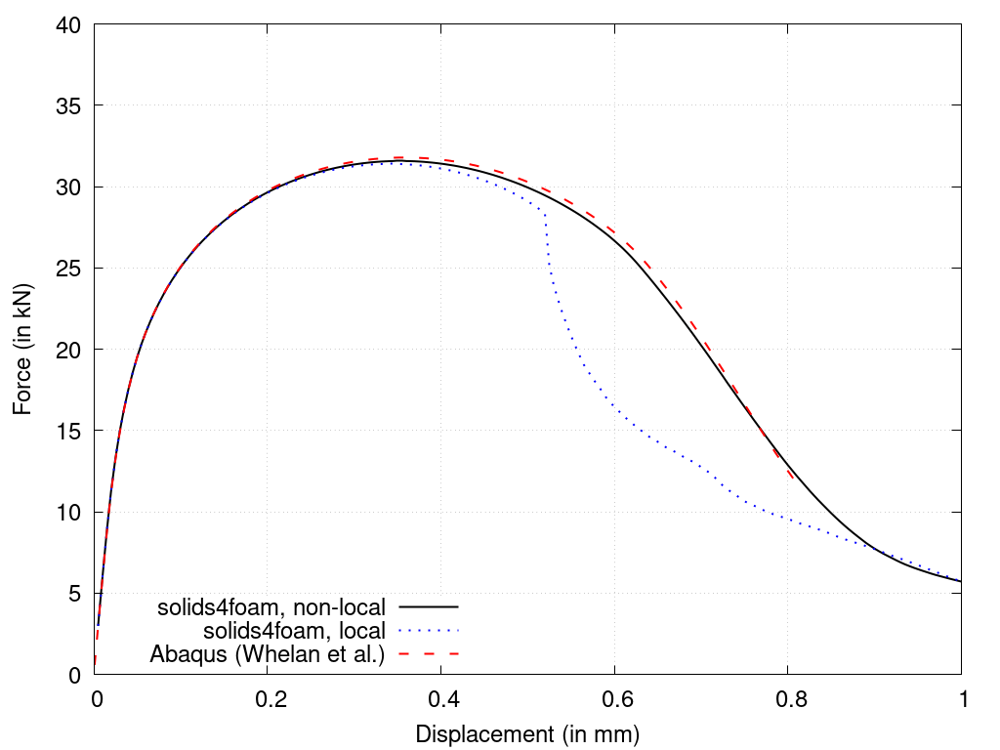
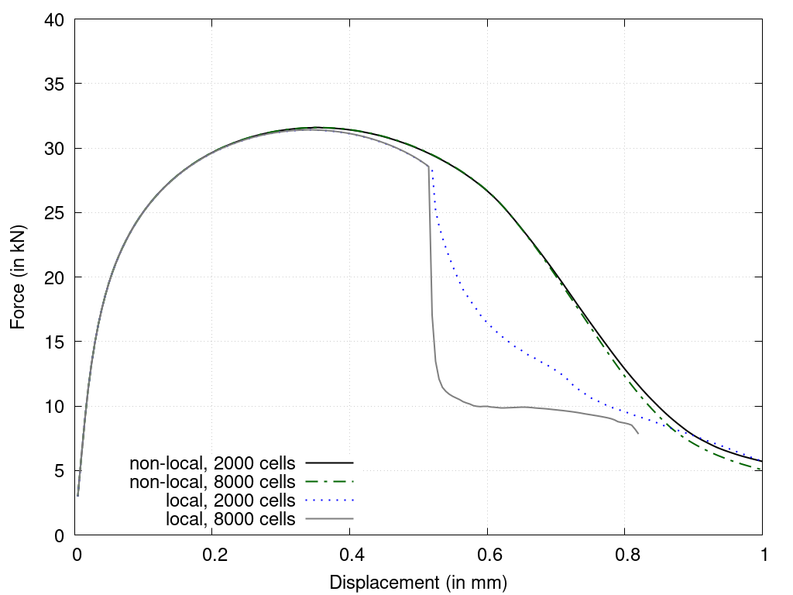

# Ductile Damage in a Notched Round Bar: `notchedBarLemaitre`

Prepared by Andrew Whelan and Philip Cardiff

---

## Tutorial Aims

- Demonstrate the non-local Lemaitre damage law,
  `linearElasticMisesPlasticLemaitreDamage` with `nonLocal classic`, at
  finite strain under the `logStrain` law.
- Show the non-local damage field `damageNonLocal`, which the solid model
  solves as an implicit-gradient equation.
- Compare the reaction force with the Abaqus result of Whelan et al. [1], and
  with the local form of the law.

---

## Case Overview

This case is the notched round bar of the `notchedBar` tutorial, with damage
added: the bar is $$40$$ mm long with a diameter of $$18$$ mm and a notch of
radius $$4$$ mm, leaving a minimum diameter of $$10$$ mm. It is modelled as
axisymmetric, on a $$5^\circ$$ wedge, with a symmetry plane through the
notch. The upper boundary is displaced axially by $$1$$ mm over $$200$$
equal loading increments. The mesh has $$2000$$ cells; the mesh of [1], with
$$8000$$ cells, is obtained by setting `N 40;` in `system/blockMeshDict`.

The material is an aluminium alloy, described by J2 plasticity coupled to
Lemaitre damage [2], with the parameters of [1] (Table 1). The damage `D`
grows with the plastic flow and the energy release rate, and degrades the
stress by $$(1 - D)$$. Left local, the damage localises into a band one cell
wide, so that the solution depends on the mesh. Here it is regularised
instead: the stress is degraded by the non-local damage $$\bar{D}$$ of
Peerlings et al. [3], the solution of

$$
\bar{D} - l_c^2 \nabla^2 \bar{D} = D
$$

with zero flux on the boundary, where $$l_c$$ is the characteristic length.
The solid model solves this equation once per outer iteration, after the
stress update, and the law reads its solution at the next one.

Table 1 - Material properties

| Parameter | Symbol | Value |
| --- | --- | --- |
| Young's modulus | $$E$$ | $$69$$ GPa |
| Poisson's ratio | $$\nu$$ | $$0.3$$ |
| Hardening law | $$\sigma_Y$$ | $$589(10^{-4}+\varepsilon_p)^{0.216}$$ MPa |
| Damage denominator | $$S_0$$ | $$1.1$$ MPa |
| Damage exponent | $$b$$ | $$1$$ |
| Critical damage | $$D_c$$ | $$0.99$$ |
| Characteristic length | $$l_c$$ | $$0.6325$$ mm |

The material is set in `constant/mechanicalProperties`:

```text
type            logStrain;
...
mechanicalLaw
{
    type            linearElasticMisesPlasticLemaitreDamage;
    ...
    S0              S0 [1 -1 -2 0 0 0 0] 1.1e6;
    b               1;
    nonLocal        classic;
    characteristicLength characteristicLength [0 1 0 0 0 0 0] 6.325e-4;
}
```

and the linear solver for `damageNonLocal` in `system/fvSolution`. Removing
the `nonLocal` and `characteristicLength` entries gives the local form, and
`nonLocal effective` the effective non-local damage of [1].

---

## Expected Results

The reaction force rises to a maximum of $$31.6$$ kN at a displacement of
$$0.36$$ mm, against $$31.8$$ kN at $$0.35$$ mm for Abaqus, and then falls
as the damage grows at the centre of the notch (Figure 1). The two agree to
within $$3\%$$ up to a displacement of $$0.8$$ mm, the end of the Abaqus
result, with the solids4foam force slightly lower, as for the undamaged bar
of `notchedBar`. The local form agrees until the damage localises, at a
displacement of about $$0.5$$ mm, and then fails abruptly.



Figure 1: Reaction force at the loading boundary against displacement

Refining the mesh to $$8000$$ cells (Figure 2) changes the non-local
force by less than $$0.2\%$$ up to a displacement of $$0.65$$ mm and by
about $$4\%$$ at $$0.8$$ mm, once the bar has largely failed. The local
form is mesh dependent: on the finer mesh the force drops earlier and more
abruptly, to about a third of its value, and the run stops at $$0.82$$ mm,
when the failed cells at the notch invert.



Figure 2: Mesh study for the non-local and local forms

---

## Running the Case

The case can be run using the included `Allrun` script, i.e. `> ./Allrun`,
which creates the mesh with `blockMesh` and runs `solids4Foam`, in about
fifteen minutes. Optionally, if `gnuplot` is installed, the force against
displacement is plotted with the Abaqus result in `forceDisplacement.png`.
The force on the wedge is scaled by $$360/5 = 72$$ to give the force on the
whole bar. The fields `damage` (local) and `damageNonLocal` are written
with the results.

---

## References

[1]
[A. Whelan, T. Tang, V. Pakrashi and P. Cardiff, "A finite volume framework
for damage and fracture prediction in wire drawing," International Journal
for Numerical Methods in Engineering, 2025.](https://doi.org/10.1002/nme.7640)

[2] J. Lemaitre, "A continuous damage mechanics model for ductile fracture,"
Journal of Engineering Materials and Technology, vol. 107, pp. 83-89, 1985.

[3] R. H. J. Peerlings, R. de Borst, W. A. M. Brekelmans and J. H. P. de
Vree, "Gradient enhanced damage for quasi-brittle materials," International
Journal for Numerical Methods in Engineering, vol. 39, pp. 3391-3403, 1996.
